# PromptLab: Architectural Overview & Big Picture

## 1. What PromptLab Does (Plain Language Explanation)

1. **PromptLab is an automated testing, evaluation, and security auditing platform designed specifically for teams building with Large Language Models (LLMs).**
2. Just as traditional software systems rely on unit and integration test suites to prevent software regressions, PromptLab allows AI engineers to write structured test cases that automatically verify whether model outputs are accurate, complete, and format-compliant.
3. The platform provides an interactive web playground where engineers can formulate and compare advanced prompt engineering strategies—such as few-shot demonstrations, chain-of-thought reasoning, and schema-constrained structured outputs—against hosted models or offline simulations.
4. To protect production systems against malicious actors, PromptLab includes an adversarial cybersecurity suite that subjects models to 16 prompt-injection attack vectors (such as instruction overrides and delimiter escaping) while monitoring for the leakage of confidential canary tokens.
5. In addition to testing output quality and attack resistance, PromptLab includes a real-time safety guardrail that detects and redacts Personally Identifiable Information (PII), payment card numbers verified by algorithmic checksums, network addresses, and exposed cloud or LLM API keys.

---

## 2. Tech Stack & Architectural Justifications

Every tool in PromptLab was chosen to ensure production reliability, strict type safety, zero external network dependency during local development or demonstrations, and clean decoupling across layers.

| Technology / Tool | Version / Spec | Why It Is Used & Alternatives Considered | Code Location Citation |
| :--- | :--- | :--- | :--- |
| **Python** | `>=3.11` | Employs modern union typing (`str \| None`), `asyncio` task groups, and native performance gains over Python 3.9/3.10. | [pyproject.toml:10](file:///c:/Users/vedaa/OneDrive/Desktop/Master%20Folder/promptLab/pyproject.toml#L10)<br>[Dockerfile:2](file:///c:/Users/vedaa/OneDrive/Desktop/Master%20Folder/promptLab/Dockerfile#L2) |
| **FastAPI** | `>=0.110.0` | Asynchronous, non-blocking REST framework with automatic OpenAPI documentation and native dependency injection (`Depends`). Preferred over Flask/Django for native `async/await` handling. | [src/promptlab/api/main.py:17](file:///c:/Users/vedaa/OneDrive/Desktop/Master%20Folder/promptLab/src/promptlab/api/main.py#L17)<br>[src/promptlab/api/dependencies.py:10](file:///c:/Users/vedaa/OneDrive/Desktop/Master%20Folder/promptLab/src/promptlab/api/dependencies.py#L10) |
| **Uvicorn** | `>=0.28.0` | Production ASGI web server running FastAPI on top of Python's `asyncio` event loop. | [Dockerfile:43](file:///c:/Users/vedaa/OneDrive/Desktop/Master%20Folder/promptLab/Dockerfile#L43)<br>[docker-compose.yml:10](file:///c:/Users/vedaa/OneDrive/Desktop/Master%20Folder/promptLab/docker-compose.yml#L10) |
| **Pydantic** | `>=2.6.0` | High-performance Rust-backed data validation and schema generation. Used for immutable domain models and API Data Transfer Objects (DTOs). Avoids plain Python dict errors. | [src/promptlab/core/models.py:13](file:///c:/Users/vedaa/OneDrive/Desktop/Master%20Folder/promptLab/src/promptlab/core/models.py#L13)<br>[src/promptlab/api/schemas.py:10](file:///c:/Users/vedaa/OneDrive/Desktop/Master%20Folder/promptLab/src/promptlab/api/schemas.py#L10) |
| **Pydantic-Settings** | `>=2.2.0` | Strongly-typed environment configuration loaded from `.env` files with fail-fast startup validation. Prevents silent misconfigurations. | [src/promptlab/config.py:12](file:///c:/Users/vedaa/OneDrive/Desktop/Master%20Folder/promptLab/src/promptlab/config.py#L12) |
| **SQLAlchemy** | `>=2.0.25` | Modern typed Object-Relational Mapper (ORM) using 2.0 style declarative mapping (`Mapped`, `mapped_column`) and asynchronous sessions. Decouples business logic from raw SQL dialects. | [src/promptlab/db/base.py:12-19](file:///c:/Users/vedaa/OneDrive/Desktop/Master%20Folder/promptLab/src/promptlab/db/base.py#L12-L19)<br>[src/promptlab/db/orm_models.py:14-18](file:///c:/Users/vedaa/OneDrive/Desktop/Master%20Folder/promptLab/src/promptlab/db/orm_models.py#L14-L18) |
| **aiosqlite** | `>=0.20.0` | Asynchronous SQLite driver preventing database disk I/O operations from blocking the FastAPI event loop thread. | [src/promptlab/config.py:54](file:///c:/Users/vedaa/OneDrive/Desktop/Master%20Folder/promptLab/src/promptlab/config.py#L54)<br>[docker-compose.yml:16](file:///c:/Users/vedaa/OneDrive/Desktop/Master%20Folder/promptLab/docker-compose.yml#L16) |
| **Groq SDK** | `>=0.5.0` | Asynchronous SDK providing high-speed inference for open-source models (Llama 3.3 70B, Qwen 2.5 72B, Mistral, Gemma 2). Preferred for real-time evaluations due to sub-second token generation. | [src/promptlab/core/providers/groq_provider.py:15-20](file:///c:/Users/vedaa/OneDrive/Desktop/Master%20Folder/promptLab/src/promptlab/core/providers/groq_provider.py#L15-L20) |
| **Streamlit** | `>=1.32.0` | Interactive multipage Python web UI framework. Eliminates the need for a separate Node.js/React frontend codebase while providing rapid prototyping for AI teams. | [src/promptlab/dashboard/app.py:7](file:///c:/Users/vedaa/OneDrive/Desktop/Master%20Folder/promptLab/src/promptlab/dashboard/app.py#L7)<br>[src/promptlab/dashboard/pages/](file:///c:/Users/vedaa/OneDrive/Desktop/Master%20Folder/promptLab/src/promptlab/dashboard/pages/) |
| **HTTPX** | `>=0.27.0` | Synchronous and asynchronous HTTP client. Powers `PromptLabClient` in the dashboard to communicate with FastAPI endpoints over REST. | [src/promptlab/dashboard/api_client.py:12](file:///c:/Users/vedaa/OneDrive/Desktop/Master%20Folder/promptLab/src/promptlab/dashboard/api_client.py#L12) |
| **jsonschema** | `>=4.21.0` | Validates JSON completions against formal JSON Schema Draft 7 / 2020-12 specifications inside the evaluation scorer. | [src/promptlab/core/scorers/json_schema.py:11-12](file:///c:/Users/vedaa/OneDrive/Desktop/Master%20Folder/promptLab/src/promptlab/core/scorers/json_schema.py#L11-L12) |
| **SQLite (In-Memory)** | `sqlite3` (std lib) | Provides isolated, sandboxed relational database execution for text-to-SQL evaluations seeded from sample schemas. | [src/promptlab/core/scorers/sql_result.py:11](file:///c:/Users/vedaa/OneDrive/Desktop/Master%20Folder/promptLab/src/promptlab/core/scorers/sql_result.py#L11) |
| **Ruff** | `>=0.3.0` | High-speed Rust linter and formatter enforcing PEP8, Flake8, Bugbear, and isort rules in single passes. | [pyproject.toml:42-59](file:///c:/Users/vedaa/OneDrive/Desktop/Master%20Folder/promptLab/pyproject.toml#L42-L59)<br>[Makefile:18-22](file:///c:/Users/vedaa/OneDrive/Desktop/Master%20Folder/promptLab/Makefile#L18-L22) |
| **Mypy** | `>=1.9.0` | Strict static type checker ensuring type safety (`disallow_untyped_defs = true`, `strict = true`) across domain entities and service boundaries. | [pyproject.toml:60-72](file:///c:/Users/vedaa/OneDrive/Desktop/Master%20Folder/promptLab/pyproject.toml#L60-L72)<br>[Makefile:24-25](file:///c:/Users/vedaa/OneDrive/Desktop/Master%20Folder/promptLab/Makefile#L24-L25) |
| **Pytest Suite** | `>=8.0.0` | Comprehensive test runner using `pytest-asyncio` for async tests and `pytest-cov` enforcing an 85% branch coverage floor. | [pyproject.toml:81-93](file:///c:/Users/vedaa/OneDrive/Desktop/Master%20Folder/promptLab/pyproject.toml#L81-L93)<br>[tests/conftest.py:10](file:///c:/Users/vedaa/OneDrive/Desktop/Master%20Folder/promptLab/tests/conftest.py#L10) |
| **Docker & Compose** | Compose `3.8` | Container orchestration defining isolated services (`backend` on `:8000`, `frontend` on `:8501`), container healthchecks, and shared volumes. | [Dockerfile:1-44](file:///c:/Users/vedaa/OneDrive/Desktop/Master%20Folder/promptLab/Dockerfile#L1-L44)<br>[docker-compose.yml:1-48](file:///c:/Users/vedaa/OneDrive/Desktop/Master%20Folder/promptLab/docker-compose.yml#L1-L48) |
| **GitHub Actions** | `ci.yml` | Continuous integration executing linting, formatting verification, type checks, and pytest coverage across Python 3.11 and 3.12 matrices. | [.github/workflows/ci.yml:1-56](file:///c:/Users/vedaa/OneDrive/Desktop/Master%20Folder/promptLab/.github/workflows/ci.yml#L1-L56) |

---

## 3. Layered Architecture Diagram

PromptLab follows a **Clean / Hexagonal Layered Architecture**. The domain core is at the center, completely isolated from web frameworks, user interfaces, and database drivers.

```mermaid
graph TD
    subgraph Presentation_Layer["1. Presentation Layer (Streamlit Frontend)"]
        UI_App["promptlab.dashboard.app"]
        UI_P1["promptlab.dashboard.pages.1_Playground"]
        UI_P2["promptlab.dashboard.pages.2_Test_Suites"]
        UI_P3["promptlab.dashboard.pages.3_Safety_&_Guardrails"]
        UI_P4["promptlab.dashboard.pages.4_History_&_Comparison"]
        API_Client["promptlab.dashboard.api_client.PromptLabClient"]
        
        UI_App --> API_Client
        UI_P1 --> API_Client
        UI_P2 --> API_Client
        UI_P3 --> API_Client
        UI_P4 --> API_Client
    end

    API_Client -- "HTTP / REST (JSON over :8000)" --> API_Main

    subgraph Web_API_Layer["2. API & Transport Layer (FastAPI)"]
        API_Main["promptlab.api.main (create_app, lifespan, middleware)"]
        API_Routes["promptlab.api.routes (health, models, suites, runs, safety)"]
        API_Deps["promptlab.api.dependencies (get_db, get_*_repo, get_*_service)"]
        API_Schemas["promptlab.api.schemas (DTOs, Pydantic Request/Response)"]
        
        API_Main --> API_Routes
        API_Routes --> API_Schemas
        API_Routes --> API_Deps
    end

    subgraph Service_Layer["3. Service Orchestration Layer (Facades)"]
        EvalService["promptlab.services.evaluation_service.EvaluationService"]
        CompService["promptlab.services.comparison_service.ComparisonService"]
        SafetyService["promptlab.services.safety_service.SafetyService"]
        
        API_Deps --> EvalService
        API_Deps --> CompService
        API_Deps --> SafetyService
    end

    subgraph Core_Domain_Layer["4. Core Domain Layer (Pure Python & Business Logic)"]
        DomainModels["promptlab.core.models (TestSuite, TestCase, RunResult, LLMRequest, LLMResponse)"]
        Runner["promptlab.core.runner.TestRunner (Semaphore Concurrency)"]
        Techniques["promptlab.core.techniques (Registry, ZeroShot, FewShot, CoT, StructuredOutput)"]
        Scorers["promptlab.core.scorers (Registry, ExactMatch, Contains, Regex, JsonValid, JsonSchema, SqlResult, LLMJudge)"]
        SafetySuite["promptlab.core.safety (Guardrail, PIIDetector, InjectionSuite)"]
        
        EvalService --> Runner
        EvalService --> DomainModels
        CompService --> DomainModels
        SafetyService --> SafetySuite
        SafetyService --> DomainModels
        Runner --> Techniques
        Runner --> Scorers
        Runner --> DomainModels
    end

    subgraph Adapters_Repositories_Layer["5. Adapters & Persistence Layer"]
        subgraph Providers["LLM Provider Adapters"]
            ProvFactory["promptlab.core.providers.factory.ProviderFactory"]
            LLMBase["promptlab.core.providers.base.LLMProvider"]
            GroqProv["promptlab.core.providers.groq_provider.GroqProvider"]
            MockProv["promptlab.core.providers.mock_provider.MockProvider"]
            
            ProvFactory --> GroqProv
            ProvFactory --> MockProv
            GroqProv -.-> LLMBase
            MockProv -.-> LLMBase
        end
        
        subgraph Repositories["Data Repositories"]
            SuiteRepo["promptlab.db.repositories.SuiteRepository"]
            RunRepo["promptlab.db.repositories.RunRepository"]
            SafetyRepo["promptlab.db.repositories.SafetyRepository"]
            ORMModels["promptlab.db.orm_models (SuiteModel, RunModel, CaseResultModel, SafetyReportModel)"]
            DBBase["promptlab.db.base (Base, get_engine, get_session_factory, init_db)"]
            
            SuiteRepo --> ORMModels
            RunRepo --> ORMModels
            SafetyRepo --> ORMModels
            SuiteRepo --> DomainModels
            RunRepo --> DomainModels
            SafetyRepo --> DomainModels
        end
    end

    Runner --> Providers
    EvalService --> ProvFactory
    SafetyService --> ProvFactory
    EvalService --> SuiteRepo
    EvalService --> RunRepo
    CompService --> RunRepo
    SafetyService --> SafetyRepo
    API_Deps --> Repositories
    API_Deps --> DBBase

    subgraph External_Infrastructure["6. External Infrastructure & Databases"]
        GroqAPI["External Groq API (api.groq.com)"]
        SQLiteDB["SQLite Persistent DB (promptlab.db via aiosqlite)"]
        MemDB["Sandboxed In-Memory SQLite (:memory:)"]
    end

    GroqProv -- "Async HTTPS SDK" --> GroqAPI
    DBBase -- "SQLAlchemy 2.0 AsyncEngine" --> SQLiteDB
    Scorers -- "sql_result sandboxed queries" --> MemDB
```



---

## 4. Dependency Rule Check & Boundary Verification

In clean architecture, **the Dependency Inversion Principle mandates that source code dependencies must point inward toward higher-level policies**. Lower layers (Domain Core, Infrastructure Base) must never import from higher layers (Services, API, Dashboard).

We conducted an exhaustive static analysis of every import statement across the repository:

### Detailed Layer Dependency Matrix

| Layer | Files in Layer | Permitted Inbound Callers | What This Layer Imports | Dependency Rule Status |
| :--- | :--- | :--- | :--- | :--- |
| **Presentation (`dashboard/`)** | `app.py`, `pages/*.py`, `api_client.py` | None (Top-level UI entrypoint) | Only imports internal `api_client` and `exceptions.PromptLabError`. Communicates with backend purely via HTTP JSON calls. | **PASS (100% Decoupled)** |
| **API (`api/`)** | `main.py`, `dependencies.py`, `schemas.py`, `routes/*.py` | External HTTP Clients, Streamlit `api_client` | Imports `services.*`, `api.schemas`, `core.models`, `config`, `exceptions`, `logging_config`, and calls `db.base`/`db.repositories` in `dependencies.py` and `main.py`. | **PASS (Composition Root)** |
| **Services (`services/`)** | `evaluation_service.py`, `comparison_service.py`, `safety_service.py` | `api.dependencies`, `scripts/seed_db.py`, tests | Imports `core.*`, `db.repositories.*`, `config`, `exceptions`. Imports **zero** modules from `api` or `dashboard`. | **PASS** |
| **Core Domain (`core/`)** | `models.py`, `runner.py`, `providers/*`, `scorers/*`, `techniques/*`, `safety/*` | `services`, `api.routes.models`, `db.repositories`, tests | Imports only internal `core.*`, `config`, and `exceptions`. Imports **zero** modules from `services`, `api`, `dashboard`, or `db`. | **PASS (Zero Framework Leak)** |
| **Database (`db/`)** | `base.py`, `orm_models.py`, `repositories.py` | `api.dependencies`, `api.main`, `services`, `scripts/seed_db.py`, tests | Imports `core.models` (for model hydration), `config`. Imports **zero** modules from `services`, `api`, or `dashboard`. | **PASS** |
| **Cross-Cutting Foundation** | `config.py`, `exceptions.py`, `logging_config.py` | Any layer requiring settings, custom exceptions, or structured logging | Imports standard library and Pydantic. Imports **zero** modules from application layers. | **PASS** |

### Architectural Observations & Minor Boundary Leaks

While no forbidden *upward* imports exist (e.g., Core importing Services or API), the static audit revealed four minor architectural boundary anomalies that an interviewer might probe:

1. **Composition Root within API Layer (`api/dependencies.py`):**
   - *Observation:* [src/promptlab/api/dependencies.py:14-22](file:///c:/Users/vedaa/OneDrive/Desktop/Master%20Folder/promptLab/src/promptlab/api/dependencies.py#L14-L22) imports `db.base.get_session_factory` and `db.repositories.*` to wire database sessions into service constructors.
   - *Architectural Assessment:* This is standard practice in FastAPI applications where the API layer functions as the Dependency Injection "Composition Root". However, in strict hexagonal architecture, an external container or bootstrap module would wire services rather than the web transport layer.
2. **Service Layer Bypass in Models Route (`api/routes/models.py`):**
   - *Observation:* [src/promptlab/api/routes/models.py:11](file:///c:/Users/vedaa/OneDrive/Desktop/Master%20Folder/promptLab/src/promptlab/api/routes/models.py#L11) imports `ProviderFactory` directly from `promptlab.core.providers.factory` to fetch available models, bypassing the `EvaluationService` facade.
   - *Alternative:* It should ideally call `eval_service.list_available_models()` to keep all route actions mediated by service facades.
3. **Private Attribute Access in Safety Route (`api/routes/safety.py`):**
   - *Observation:* In [src/promptlab/api/routes/safety.py:44](file:///c:/Users/vedaa/OneDrive/Desktop/Master%20Folder/promptLab/src/promptlab/api/routes/safety.py#L44), the endpoint accesses a private attribute of the service:
     ```python
     is_safe, sanitized, report = safety_service._guardrail.filter_text(payload.text)
     ```
   - *Architectural Assessment:* Encapsulation leak. `SafetyService` has a public `scan_text(text)` method (line 74), but does not expose a public `filter_text(text)` method, forcing the route to reach into private state (`_guardrail`).
4. **Relative Filesystem Traversal for Core Datasets:**
   - *Observation:* [src/promptlab/core/scorers/sql_result.py:48](file:///c:/Users/vedaa/OneDrive/Desktop/Master%20Folder/promptLab/src/promptlab/core/scorers/sql_result.py#L48) and [src/promptlab/core/safety/injection_suite.py:26](file:///c:/Users/vedaa/OneDrive/Desktop/Master%20Folder/promptLab/src/promptlab/core/safety/injection_suite.py#L26) reach four directories up via `Path(__file__).resolve().parents[3] / "data"` to find seed JSON/SQL files.
   - *Architectural Assessment:* Coupling core business logic to specific relative filesystem folder structures can break if PromptLab is packaged as an installed site-package or wheel. Dataset paths should be passed via `Settings` or loaded via `importlib.resources`.

---

## 5. Top-Level Package Catalog

| Package / Module Path | Primary Responsibility & Purpose | Key Classes & Functions | Inbound Callers (Who calls it?) | Outbound Dependencies (What does it call?) |
| :--- | :--- | :--- | :--- | :--- |
| **`promptlab.config`**<br>[config.py](file:///c:/Users/vedaa/OneDrive/Desktop/Master%20Folder/promptLab/src/promptlab/config.py) | Application-wide settings validation from `.env` files and environment variables. | `Settings`, `get_settings()` | `api.dependencies`, `api.routes.*`, `core.runner`, `core.providers.*`, `db.base`, `services.*` | `pydantic_settings.BaseSettings`, `functools.lru_cache` |
| **`promptlab.exceptions`**<br>[exceptions.py](file:///c:/Users/vedaa/OneDrive/Desktop/Master%20Folder/promptLab/src/promptlab/exceptions.py) | Domain exception hierarchy defining machine error codes and HTTP status mappings. | `PromptLabError`, `ProviderError`, `RateLimitError`, `SecurityError`, `ValidationError` | Entire codebase (Core, DB, Services, API, Dashboard Client) | Python standard library `Exception` |
| **`promptlab.logging_config`**<br>[logging_config.py](file:///c:/Users/vedaa/OneDrive/Desktop/Master%20Folder/promptLab/src/promptlab/logging_config.py) | Structured JSON logging, async ContextVar request-ID tracking, and credential masking. | `JSONLogFormatter`, `configure_logging()`, `set_request_id()`, `mask_sensitive_value()` | `api.main`, `tests/conftest.py` | `contextvars.ContextVar`, `logging`, `re`, `json` |
| **`promptlab.core.models`**<br>[models.py](file:///c:/Users/vedaa/OneDrive/Desktop/Master%20Folder/promptLab/src/promptlab/core/models.py) | Immutable Pydantic domain models representing the ubiquitous language of PromptLab. | `TestSuite`, `TestCase`, `RunResult`, `CaseResult`, `LLMRequest`, `LLMResponse`, `ScoreResult`, `SafetyReport` | `core.*`, `db.repositories`, `services.*`, `api.schemas`, `tests.*` | `pydantic.BaseModel`, `uuid`, `datetime` |
| **`promptlab.core.providers`**<br>[providers/](file:///c:/Users/vedaa/OneDrive/Desktop/Master%20Folder/promptLab/src/promptlab/core/providers/) | Extensible LLM inference adapters and dynamic registry factory. | `LLMProvider` (ABC), `ProviderFactory`, `GroqProvider`, `MockProvider` | `core.runner`, `services.*`, `api.routes.models`, `tests.*` | `core.models`, `groq.AsyncGroq`, `exceptions`, `config` |
| **`promptlab.core.techniques`**<br>[techniques/](file:///c:/Users/vedaa/OneDrive/Desktop/Master%20Folder/promptLab/src/promptlab/core/techniques/) | Prompt engineering strategies converting raw inputs into formatted prompts. | `PromptTechnique` (ABC), `TechniqueRegistry`, `ZeroShot`, `FewShot`, `ChainOfThought`, `StructuredOutput` | `core.runner`, `tests.*` | `exceptions`, `re`, `json` |
| **`promptlab.core.scorers`**<br>[scorers/](file:///c:/Users/vedaa/OneDrive/Desktop/Master%20Folder/promptLab/src/promptlab/core/scorers/) | Evaluation metric rubrics applying the Template Method pattern to grade LLM completions. | `BaseScorer` (ABC), `ScorerRegistry`, `ExactMatch`, `Contains`, `RegexMatch`, `JsonValid`, `JsonSchema`, `SqlResult`, `LLMJudge` | `core.runner`, `tests.*` | `core.models`, `exceptions`, `jsonschema`, `sqlite3`, `re` |
| **`promptlab.core.safety`**<br>[safety/](file:///c:/Users/vedaa/OneDrive/Desktop/Master%20Folder/promptLab/src/promptlab/core/safety/) | Adversarial prompt-injection test harness and regex/checksum-based PII/secret detector. | `PIIDetector`, `validate_luhn()`, `Guardrail`, `InjectionSuite` | `services.safety_service`, `api.routes.safety`, `tests.*` | `core.models`, `core.providers.base`, `re`, `json` |
| **`promptlab.core.runner`**<br>[runner.py](file:///c:/Users/vedaa/OneDrive/Desktop/Master%20Folder/promptLab/src/promptlab/core/runner.py) | Concurrency-bounded evaluation engine running test cases across models and parameter sweeps. | `TestRunner` | `services.evaluation_service`, `tests.*` | `core.models`, `core.providers`, `core.techniques`, `core.scorers`, `config`, `asyncio` |
| **`promptlab.db`**<br>[db/](file:///c:/Users/vedaa/OneDrive/Desktop/Master%20Folder/promptLab/src/promptlab/db/) | Asynchronous SQLAlchemy database engine, ORM table mappings, and repository query classes. | `Base`, `init_db()`, `SuiteModel`, `RunModel`, `SuiteRepository`, `RunRepository`, `SafetyRepository` | `api.dependencies`, `api.main`, `services.*`, `scripts/seed_db.py` | `sqlalchemy`, `aiosqlite`, `core.models`, `config` |
| **`promptlab.services`**<br>[services/](file:///c:/Users/vedaa/OneDrive/Desktop/Master%20Folder/promptLab/src/promptlab/services/) | Business logic facades coordinating runners, repositories, providers, and analytics. | `EvaluationService`, `ComparisonService`, `SafetyService` | `api.dependencies`, `api.routes.*`, `scripts/seed_db.py`, `tests.*` | `core.*`, `db.repositories.*`, `config`, `exceptions` |
| **`promptlab.api`**<br>[api/](file:///c:/Users/vedaa/OneDrive/Desktop/Master%20Folder/promptLab/src/promptlab/api/) | FastAPI REST API application factory, dependency injection, and HTTP route handlers. | `create_app()`, `lifespan()`, `api_router`, `PromptLabClient` (DTOs), route handlers | Streamlit UI (`PromptLabClient`), Uvicorn server, external consumers | `fastapi`, `pydantic`, `services.*`, `db.*`, `logging_config` |
| **`promptlab.dashboard`**<br>[dashboard/](file:///c:/Users/vedaa/OneDrive/Desktop/Master%20Folder/promptLab/src/promptlab/dashboard/) | Multipage Streamlit frontend dashboard providing visual playgrounds, run comparisons, and audits. | `PromptLabClient`, `app.py`, `1_Playground`, `2_Test_Suites`, `3_Safety_&_Guardrails`, `4_History_&_Comparison` | Streamlit runtime CLI (`streamlit run ...`), end-user web browser | `streamlit`, `httpx`, `promptlab.dashboard.api_client` |
