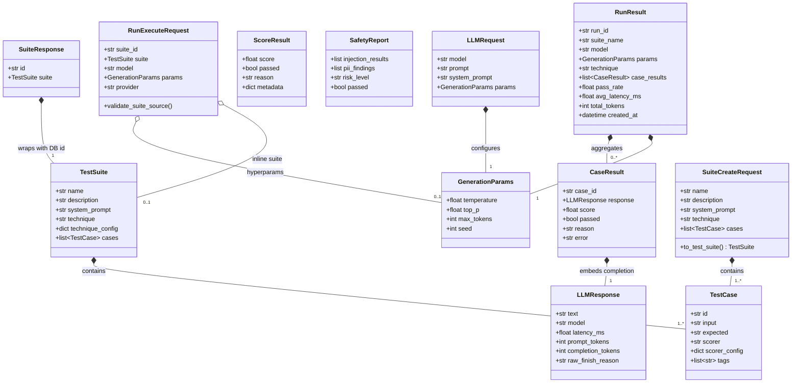

# PromptLab: Domain Models, Schemas & Persistence Translations

This document provides an exhaustive reference for every Pydantic model across PromptLab's domain core and API transport layers, diagrams their nesting relationships, details the model-to-model translation mechanics, and explains why Domain, ORM, and DTO models are strictly decoupled.

---

## 1. Domain Models (`src/promptlab/core/models.py`)

All domain entities in [src/promptlab/core/models.py](file:///c:/Users/vedaa/OneDrive/Desktop/Master%20Folder/promptLab/src/promptlab/core/models.py) represent the ubiquitous language of PromptLab. They enforce data validation at construction time, protect internal invariants, and configure immutability where mutation could introduce concurrency hazards.

### 1.1 `GenerationParams`
[src/promptlab/core/models.py:16-42](file:///c:/Users/vedaa/OneDrive/Desktop/Master%20Folder/promptLab/src/promptlab/core/models.py#L16-L42)

- **Purpose:** Hyperparameters governing LLM sampling and token generation.
- **Immutability:** Configured with `model_config = ConfigDict(frozen=True)` (cannot be modified after instantiation).
- **Fields & Constraints:**

| Field | Type | Default | Constraints & Validators | Purpose |
| :--- | :--- | :--- | :--- | :--- |
| `temperature` | `float` | `0.7` | `ge=0.0`, `le=2.0` | Sampling randomness. `0.0` is deterministic; `2.0` is maximum entropy. |
| `top_p` | `float` | `1.0` | `ge=0.0`, `le=1.0` | Nucleus sampling probability cutoff. |
| `max_tokens` | `int` | `1024` | `ge=1`, `le=8192` | Upper bound on generated completion tokens. |
| `seed` | `int \| None` | `None` | Optional integer | Deterministic seed for reproducible inference on supported engines. |

---

### 1.2 `LLMRequest`
[src/promptlab/core/models.py:45-68](file:///c:/Users/vedaa/OneDrive/Desktop/Master%20Folder/promptLab/src/promptlab/core/models.py#L45-L68)

- **Purpose:** Standardized input envelope passed to any `LLMProvider.generate()`.
- **Immutability:** `frozen=True`.
- **Fields & Constraints:**

| Field | Type | Default | Constraints & Validators | Purpose |
| :--- | :--- | :--- | :--- | :--- |
| `model` | `str` | *(Required)* | `min_length=1` | Target model identifier (e.g. `llama-3.3-70b-versatile`). |
| `prompt` | `str` | *(Required)* | `min_length=1` | Primary user prompt or test case input. |
| `system_prompt` | `str \| None` | `None` | Optional string | Guiding behavior instructions injected into the system role. |
| `params` | `GenerationParams` | `GenerationParams()` | Sub-model | Hyperparameters controlling generation. |

---

### 1.3 `LLMResponse`
[src/promptlab/core/models.py:70-102](file:///c:/Users/vedaa/OneDrive/Desktop/Master%20Folder/promptLab/src/promptlab/core/models.py#L70-L102)

- **Purpose:** Provider-agnostic response envelope produced by any inference engine.
- **Immutability:** `frozen=True`.
- **Fields & Constraints:**

| Field | Type | Default | Constraints & Validators | Purpose |
| :--- | :--- | :--- | :--- | :--- |
| `text` | `str` | *(Required)* | Arbitrary string | The generated text completion. |
| `model` | `str` | *(Required)* | Arbitrary string | Actual model string returned by provider. |
| `latency_ms` | `float` | *(Required)* | `ge=0.0` | Round-trip request duration in milliseconds. |
| `prompt_tokens` | `int` | `0` | `ge=0` | Input token count. |
| `completion_tokens` | `int` | `0` | `ge=0` | Output token count. |
| `raw_finish_reason` | `str \| None` | `None` | Optional string | Provider stop token (e.g. `'stop'`, `'length'`, `'error'`). |

---

### 1.4 `ScoreResult`
[src/promptlab/core/models.py:104-126](file:///c:/Users/vedaa/OneDrive/Desktop/Master%20Folder/promptLab/src/promptlab/core/models.py#L104-L126)

- **Purpose:** Output of an evaluation scorer assessing a single model completion against an expectation.
- **Immutability:** `frozen=True`.
- **Fields & Constraints:**

| Field | Type | Default | Constraints & Validators | Purpose |
| :--- | :--- | :--- | :--- | :--- |
| `score` | `float` | *(Required)* | `ge=0.0`, `le=1.0` | Normalized evaluation metric (0.0 to 1.0). Clamped by `BaseScorer._finalize()`. |
| `passed` | `bool` | *(Required)* | Boolean | Boolean pass/fail indicator meeting rubric threshold. |
| `reason` | `str` | *(Required)* | Arbitrary string | Human-readable explanation of why score was assigned. |
| `metadata` | `dict[str, Any]` | `{}` | Key-value mapping | Supplementary diagnostics (e.g. row counts, diffs, schema errors). |

---

### 1.5 `TestCase`
[src/promptlab/core/models.py:129-159](file:///c:/Users/vedaa/OneDrive/Desktop/Master%20Folder/promptLab/src/promptlab/core/models.py#L129-L159)

- **Purpose:** Defines a single test scenario within an evaluation suite.
- **Fields & Constraints:**

| Field | Type | Default | Constraints & Validators | Purpose |
| :--- | :--- | :--- | :--- | :--- |
| `id` | `str` | *(Required)* | `min_length=1` | Unique test case identifier (e.g. `'sql-01'`). |
| `input` | `str` | *(Required)* | `min_length=1` | Raw user query or prompt under test. |
| `expected` | `str \| None` | `None` | Optional string | Expected ground truth reference string. |
| `scorer` | `str` | *(Required)* | `min_length=1` | Registered scorer key (e.g. `'exact_match'`, `'sql_result'`). |
| `scorer_config` | `dict[str, Any]` | `{}` | Key-value mapping | Scorer-specific options (e.g. `case_sensitive`, `pattern`). |
| `tags` | `list[str]` | `[]` | List of strings | Categorization tags (e.g. `['regression', 'sql']`). |

---

### 1.6 `TestSuite`
[src/promptlab/core/models.py:161-190](file:///c:/Users/vedaa/OneDrive/Desktop/Master%20Folder/promptLab/src/promptlab/core/models.py#L161-L190)

- **Purpose:** Collection of test cases sharing a system prompt and prompt engineering strategy.
- **Fields & Constraints:**

| Field | Type | Default | Constraints & Validators | Purpose |
| :--- | :--- | :--- | :--- | :--- |
| `name` | `str` | *(Required)* | `min_length=1` | Unique suite identifier name (e.g. `'text_to_sql_benchmark'`). |
| `description` | `str` | `""` | String | Human summary of evaluation objective. |
| `system_prompt` | `str \| None` | `None` | Optional string | Shared system instruction applied to all test cases. |
| `technique` | `str` | `"zero_shot"` | String key | Prompt technique strategy (`'zero_shot'`, `'few_shot'`, etc.). |
| `technique_config` | `dict[str, Any]` | `{}` | Key-value mapping | Configuration for technique (e.g. demonstration examples, JSON schema). |
| `cases` | `list[TestCase]` | *(Required)* | `min_length=1` | List of at least one constituent test case. |

---

### 1.7 `CaseResult`
[src/promptlab/core/models.py:192-221](file:///c:/Users/vedaa/OneDrive/Desktop/Master%20Folder/promptLab/src/promptlab/core/models.py#L192-L221)

- **Purpose:** Granular evaluation outcome for a single test case within a run.
- **Fields & Constraints:**

| Field | Type | Default | Constraints & Validators | Purpose |
| :--- | :--- | :--- | :--- | :--- |
| `case_id` | `str` | *(Required)* | Matches `TestCase.id` | Identifier of evaluated test case. |
| `response` | `LLMResponse` | *(Required)* | Sub-model | Raw LLM output and performance telemetry. |
| `score` | `float` | *(Required)* | `ge=0.0`, `le=1.0` | Assigned evaluation score. |
| `passed` | `bool` | *(Required)* | Boolean | True if evaluation criteria was satisfied. |
| `reason` | `str` | *(Required)* | String | Justification for the score. |
| `error` | `str \| None` | `None` | Optional string | Exception message if execution failed during evaluation. |

---

### 1.8 `RunResult`
[src/promptlab/core/models.py:223-270](file:///c:/Users/vedaa/OneDrive/Desktop/Master%20Folder/promptLab/src/promptlab/core/models.py#L223-L270)

- **Purpose:** Aggregated outcome of executing a `TestSuite` on a designated model and hyperparameter set.
- **Fields & Constraints:**

| Field | Type | Default | Constraints & Validators | Purpose |
| :--- | :--- | :--- | :--- | :--- |
| `run_id` | `str` | `uuid4()` | String UUID | Unique execution run identifier. |
| `suite_name` | `str` | *(Required)* | String | Name of evaluated suite. |
| `model` | `str` | *(Required)* | String | Evaluated model identifier. |
| `params` | `GenerationParams` | *(Required)* | Sub-model | Hyperparameters used during execution. |
| `technique` | `str` | *(Required)* | String | Prompt technique applied. |
| `case_results` | `list[CaseResult]` | `[]` | List of sub-models | Per-case evaluation outputs. |
| `pass_rate` | `float` | `0.0` | `ge=0.0`, `le=1.0` | Ratio of passed cases over total cases. |
| `avg_latency_ms` | `float` | `0.0` | `ge=0.0` | Mean latency across all executed cases. |
| `total_tokens` | `int` | `0` | `ge=0` | Sum of prompt and completion tokens consumed. |
| `created_at` | `datetime` | `now(utc)` | UTC datetime | Timestamp when run was finalized. |

---

### 1.9 `SafetyReport`
[src/promptlab/core/models.py:272-291](file:///c:/Users/vedaa/OneDrive/Desktop/Master%20Folder/promptLab/src/promptlab/core/models.py#L272-L291)

- **Purpose:** Output of adversarial prompt injection assessments and PII leakage scans.
- **Fields & Constraints:**

| Field | Type | Default | Constraints & Validators | Purpose |
| :--- | :--- | :--- | :--- | :--- |
| `injection_results` | `list[dict[str, Any]]` | `[]` | List of dicts | Detailed outcomes for each prompt injection attack vector. |
| `pii_findings` | `list[dict[str, Any]]` | `[]` | List of dicts | Detected sensitive PII entities and redacted previews. |
| `risk_level` | `Literal["low", "medium", "high"]` | `"low"` | Enum check | Overall security risk rating. |
| `passed` | `bool` | `True` | Boolean | True if risk is `'low'` and zero attacks breached canary. |

---

## 2. API Data Transfer Objects (`src/promptlab/api/schemas.py`)

All API schemas in [src/promptlab/api/schemas.py](file:///c:/Users/vedaa/OneDrive/Desktop/Master%20Folder/promptLab/src/promptlab/api/schemas.py) isolate the external HTTP interface from internal domain entities.

### 2.1 Health & Models Schemas

- **`HealthResponse`** ([api/schemas.py:20-27](file:///c:/Users/vedaa/OneDrive/Desktop/Master%20Folder/promptLab/src/promptlab/api/schemas.py#L20-L27)):
  - `status: str = "ok"`
  - `demo_mode: bool` (Required)
  - `active_provider: str` (Required)
  - `timestamp: datetime` (Required)
- **`ModelsResponse`** ([api/schemas.py:29-34](file:///c:/Users/vedaa/OneDrive/Desktop/Master%20Folder/promptLab/src/promptlab/api/schemas.py#L29-L34)):
  - `provider: str` (Required)
  - `models: list[str]` (Required)

---

### 2.2 Suite Management Schemas

- **`SuiteCreateRequest`** ([api/schemas.py:36-56](file:///c:/Users/vedaa/OneDrive/Desktop/Master%20Folder/promptLab/src/promptlab/api/schemas.py#L36-L56)):
  - `name: str` (`min_length=1`)
  - `description: str = ""`
  - `system_prompt: str | None = None`
  - `technique: str = "zero_shot"`
  - `technique_config: dict[str, Any] = {}`
  - `cases: list[TestCase]` (`min_length=1`)
  - **Conversion Method:** `to_test_suite() -> TestSuite` (Constructs domain `TestSuite`).
- **`SuiteResponse`** ([api/schemas.py:58-63](file:///c:/Users/vedaa/OneDrive/Desktop/Master%20Folder/promptLab/src/promptlab/api/schemas.py#L58-L63)):
  - `id: str` (Persistent UUID string)
  - `suite: TestSuite` (Nested domain entity)
- **`SuiteListResponse`** ([api/schemas.py:65-72](file:///c:/Users/vedaa/OneDrive/Desktop/Master%20Folder/promptLab/src/promptlab/api/schemas.py#L65-L72)):
  - `items: list[SuiteResponse]`
  - `total: int` (`ge=0`)
  - `offset: int` (`ge=0`)
  - `limit: int` (`ge=1`)

---

### 2.3 Run Execution & Comparison Schemas

- **`RunExecuteRequest`** ([api/schemas.py:74-89](file:///c:/Users/vedaa/OneDrive/Desktop/Master%20Folder/promptLab/src/promptlab/api/schemas.py#L74-L89)):
  - `suite_id: str | None = None` (Existing DB suite UUID)
  - `suite: TestSuite | None = None` (Inline ad-hoc suite definition)
  - `model: str` (`min_length=1`)
  - `params: GenerationParams | None = None`
  - `provider: str | None = None`
  - **Validator:** `@model_validator(mode="after") def validate_suite_source(self)`: Rejects requests missing both `suite_id` and `suite`.
- **`RunListResponse`** ([api/schemas.py:91-98](file:///c:/Users/vedaa/OneDrive/Desktop/Master%20Folder/promptLab/src/promptlab/api/schemas.py#L91-L98)):
  - `items: list[RunResult]`
  - `total: int` (`ge=0`)
  - `offset: int` (`ge=0`)
  - `limit: int` (`ge=1`)
- **`CompareRequest`** ([api/schemas.py:100-104](file:///c:/Users/vedaa/OneDrive/Desktop/Master%20Folder/promptLab/src/promptlab/api/schemas.py#L100-L104)):
  - `run_ids: list[str]` (`min_length=2`, requires at least two runs to compare)
- **`CompareResponse`** ([api/schemas.py:106-114](file:///c:/Users/vedaa/OneDrive/Desktop/Master%20Folder/promptLab/src/promptlab/api/schemas.py#L106-L114)):
  - `run_count: int` (`ge=2`)
  - `summaries: list[dict[str, Any]]`
  - `case_matrix: list[dict[str, Any]]`
  - `best_performing_model: str`
  - `fastest_model: str`

---

### 2.4 Safety & Error Schemas

- **`InjectionTestRequest`** ([api/schemas.py:116-122](file:///c:/Users/vedaa/OneDrive/Desktop/Master%20Folder/promptLab/src/promptlab/api/schemas.py#L116-L122)):
  - `model: str` (`min_length=1`)
  - `canary: str | None = None`
  - `provider: str | None = None`
- **`ScanTextRequest`** ([api/schemas.py:124-128](file:///c:/Users/vedaa/OneDrive/Desktop/Master%20Folder/promptLab/src/promptlab/api/schemas.py#L124-L128)):
  - `text: str` (`min_length=1`)
- **`ScanTextResponse`** ([api/schemas.py:130-137](file:///c:/Users/vedaa/OneDrive/Desktop/Master%20Folder/promptLab/src/promptlab/api/schemas.py#L130-L137)):
  - `risk_level: str` (`"low"`, `"medium"`, `"high"`)
  - `passed: bool`
  - `pii_findings: list[dict[str, Any]]`
  - `redacted_text: str`
- **`SafetyReportListResponse`** ([api/schemas.py:139-146](file:///c:/Users/vedaa/OneDrive/Desktop/Master%20Folder/promptLab/src/promptlab/api/schemas.py#L139-L146)):
  - `items: list[dict[str, Any]]`
  - `total: int`, `offset: int`, `limit: int`
- **`ErrorResponse`** ([api/schemas.py:148-155](file:///c:/Users/vedaa/OneDrive/Desktop/Master%20Folder/promptLab/src/promptlab/api/schemas.py#L148-L155)):
  - `error_code: str` (e.g. `'VALIDATION_ERROR'`, `'RATE_LIMIT_ERROR'`)
  - `message: str`
  - `request_id: str = ""`
  - `details: dict[str, Any] = {}`

---

## 3. Model Nesting & Composition Diagram

The following Mermaid diagram illustrates how Domain Entities and API DTOs compose and nest within each other.

---

## 4. Model-to-Model Translation Table

PromptLab maintains clear boundaries between **Domain Models** (`core/models.py`), **ORM Models** (`db/orm_models.py`), and **API DTOs** (`api/schemas.py`). The table below documents every conversion point, the direction of flow, and the exact executing function.

| From Model | To Model | Direction / Context | Executing Function & File Citation | Mechanism & Transformation Details |
| :--- | :--- | :--- | :--- | :--- |
| **`SuiteCreateRequest`** *(DTO)* | **`TestSuite`** *(Domain)* | Inbound HTTP Request → Domain Entity | [SuiteCreateRequest.to_test_suite()](file:///c:/Users/vedaa/OneDrive/Desktop/Master%20Folder/promptLab/src/promptlab/api/schemas.py#L46-L55) in `api/schemas.py` | Maps validated request fields into a fresh `TestSuite` instance. |
| **`TestSuite`** *(Domain)* | **`SuiteModel`** *(ORM)* | Domain Entity → DB Persistence | [SuiteRepository.save()](file:///c:/Users/vedaa/OneDrive/Desktop/Master%20Folder/promptLab/src/promptlab/db/repositories.py#L35-L63) in `db/repositories.py` | Serializes `suite.cases` via `[c.model_dump() for c in suite.cases]` and stores them as a JSON column in `SuiteModel`. |
| **`SuiteModel`** *(ORM)* | **`TestSuite`** *(Domain)* | DB Persistence → Domain Entity | [SuiteRepository.get_by_id()](file:///c:/Users/vedaa/OneDrive/Desktop/Master%20Folder/promptLab/src/promptlab/db/repositories.py#L64-L78) [SuiteRepository.list()](file:///c:/Users/vedaa/OneDrive/Desktop/Master%20Folder/promptLab/src/promptlab/db/repositories.py#L96-L118) in `db/repositories.py` | Hydrates JSON array of dicts into typed `cases=[TestCase(**c) for c in model.cases]` and returns `(model.id, TestSuite)`. |
| **`TestSuite`** *(Domain)* + `id` | **`SuiteResponse`** *(DTO)* | Domain Entity → HTTP Response | [create_suite()](file:///c:/Users/vedaa/OneDrive/Desktop/Master%20Folder/promptLab/src/promptlab/api/routes/suites.py#L25-L33) [get_suite()](file:///c:/Users/vedaa/OneDrive/Desktop/Master%20Folder/promptLab/src/promptlab/api/routes/suites.py#L53-L60) in `api/routes/suites.py` | Wraps persistent string UUID and `TestSuite` domain object into `SuiteResponse(id=id, suite=suite)`. |
| **`RunExecuteRequest`** *(DTO)* | **`TestSuite`** *(Domain)* / `str` UUID | Inbound HTTP Request → Domain Execution | [execute_run()](file:///c:/Users/vedaa/OneDrive/Desktop/Master%20Folder/promptLab/src/promptlab/api/routes/runs.py#L29-L43) in `api/routes/runs.py` | Extracts either `payload.suite_id` (str) or `payload.suite` (inline `TestSuite`) and passes it into `EvaluationService.execute_run()`. |
| **`RunResult`** *(Domain)* | **`RunModel`** & **`CaseResultModel`** *(ORM)* | Domain Aggregation → Relational Rows | [RunRepository.save()](file:///c:/Users/vedaa/OneDrive/Desktop/Master%20Folder/promptLab/src/promptlab/db/repositories.py#L137-L172) in `db/repositories.py` | Deconstructs `RunResult` into parent `RunModel` row and multiple child `CaseResultModel` rows linked by foreign key `run_id`. Flattens `LLMResponse` metrics (`latency_ms`, `prompt_tokens`, `completion_tokens`) into columns. |
| **`RunModel`** + `case_results` *(ORM)* | **`RunResult`** *(Domain)* | Relational Rows → Domain Aggregation | [RunRepository.get_by_id()](file:///c:/Users/vedaa/OneDrive/Desktop/Master%20Folder/promptLab/src/promptlab/db/repositories.py#L173-L218) [RunRepository.list()](file:///c:/Users/vedaa/OneDrive/Desktop/Master%20Folder/promptLab/src/promptlab/db/repositories.py#L219-L278) in `db/repositories.py` | Executes `selectinload` to fetch parent and children. Rebuilds `LLMResponse`, packs into `CaseResult`, parses `GenerationParams(**model.params)`, and reconstructs complete `RunResult`. |
| **`RunResult`** *(Domain)* | **`RunResult`** *(DTO)* | Domain Entity → HTTP Response | [execute_run()](file:///c:/Users/vedaa/OneDrive/Desktop/Master%20Folder/promptLab/src/promptlab/api/routes/runs.py#L28-L43) [get_run()](file:///c:/Users/vedaa/OneDrive/Desktop/Master%20Folder/promptLab/src/promptlab/api/routes/runs.py#L68-L75) in `api/routes/runs.py` | FastAPI directly serializes domain `RunResult` to JSON using `response_model=RunResult`, leveraging Pydantic v2's native serialization. |
| **`SafetyReport`** *(Domain)* | **`SafetyReportModel`** *(ORM)* | Safety Domain Entity → DB Persistence | [SafetyRepository.save()](file:///c:/Users/vedaa/OneDrive/Desktop/Master%20Folder/promptLab/src/promptlab/db/repositories.py#L297-L311) in `db/repositories.py` | Generates a new UUID and persists `SafetyReportModel` storing `injection_results` and `pii_findings` as JSON columns. |
| **`SafetyReportModel`** *(ORM)* | `dict[str, Any]` | DB Persistence → Service / API DTO | [SafetyRepository.get_by_id()](file:///c:/Users/vedaa/OneDrive/Desktop/Master%20Folder/promptLab/src/promptlab/db/repositories.py#L312-L326) [SafetyRepository.list()](file:///c:/Users/vedaa/OneDrive/Desktop/Master%20Folder/promptLab/src/promptlab/db/repositories.py#L327-L355) in `db/repositories.py` | Extracts ORM model attributes into a serializable dictionary matching `SafetyReportListResponse.items`. |
| `dict[str, Any]` *(Comparison Analytics)* | **`CompareResponse`** *(DTO)* | Service Analytics Dictionary → API DTO | [compare_runs()](file:///c:/Users/vedaa/OneDrive/Desktop/Master%20Folder/promptLab/src/promptlab/api/routes/runs.py#L77-L85) in `api/routes/runs.py` | Unpacks dictionary generated by `ComparisonService.compare_runs()` into validated `CompareResponse(**matrix)`. |

---

## 5. Architectural Rationale: Why Keep Domain, ORM, and DTO Models Separate?

In a technical interview, a common challenge is: *"Why have separate models for Pydantic domain, SQLAlchemy ORM, and FastAPI DTOs? Why not just use SQLModel or let SQLAlchemy models serve as the domain entities?"*

PromptLab intentionally separates these three model representations based on the following engineering principles:

### 1. Single Responsibility Principle (SRP) & Divergent Reasons to Change
- **API DTOs (`api/schemas.py`)** exist to satisfy the **external network contract**. They change when API versions change, when input fields need deprecation, or when query parameters (pagination `offset`/`limit`, partial updates) are introduced.
- **Domain Models (`core/models.py`)** represent the **pure business domain** of prompt evaluation. They change only when core evaluation rules change (e.g. how a scorer evaluates an output or what hyperparameters an LLM accepts).
- **ORM Models (`db/orm_models.py`)** represent the **physical relational storage layout**. They change when indexing strategies change (e.g. adding `Index("ix_runs_suite_created")`), when normalizing tables into foreign keys, or when migrating between database engines (SQLite to PostgreSQL).

### 2. Preventing Mass Assignment / Over-Posting Vulnerabilities
If API controllers accept ORM models directly, a client could pass unexpected internal attributes—such as setting their own `id`, altering `created_at` timestamps, or modifying internal relational foreign keys.
- With strict DTOs (e.g., `SuiteCreateRequest`), the API layer only accepts the exact fields a user is permitted to provide. System fields (`id`, `created_at`) are generated solely by repositories and domain models.

### 3. Decoupling Business Logic from Database Session State (Active Record vs Data Mapper)
SQLAlchemy ORM models are inherently stateful: they are attached to an `AsyncSession`, participate in dirty-tracking, and can raise `DetachedInstanceError` if attributes are accessed outside the session scope or across coroutine boundaries.
- Domain models (`RunResult`, `TestSuite`) are pure, lightweight Python dataclasses/Pydantic models. They can be safely passed to background tasks, cached, or shared across async threads without holding open database sessions or locking connection pools.

### 4. Supporting Different Data Shapes (Storage vs In-Memory Execution)
- In the database, granular test results (`CaseResultModel`) are normalized into relational rows with individual foreign keys to support SQL indexing and queries.
- In domain memory, a `RunResult` holds `case_results` as a direct in-memory `list[CaseResult]` to easily compute aggregate pass rates (`pass_rate = passed / total`) and average latencies.
- In `SuiteModel`, test cases are stored as a compact JSON blob (`cases: Mapped[list[dict]]`) because test cases are always read and executed as an aggregate unit, avoiding expensive relational joins for static benchmark suites.

### 5. Independent Evolution & Zero Framework Leakage
By isolating the domain core (`core/models.py`), the evaluation engine can be packaged and run as a standalone CLI tool, an offline batch worker, or imported into an AWS Lambda function without installing FastAPI, SQLAlchemy, or aiosqlite.
