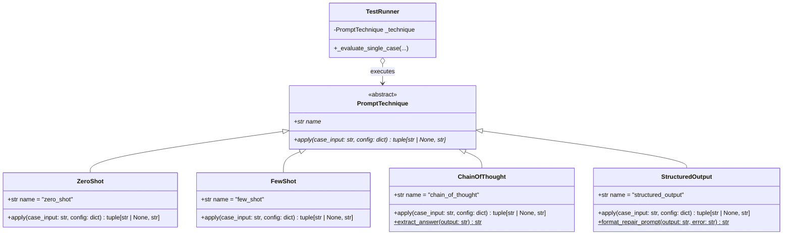
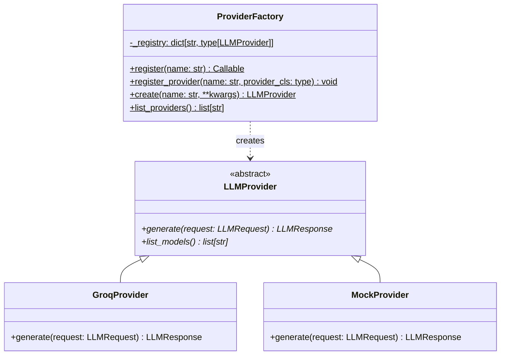
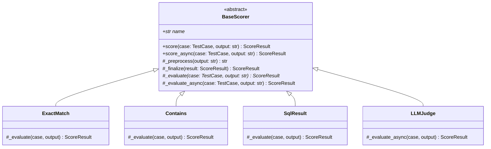
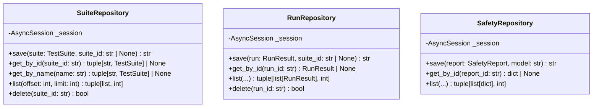
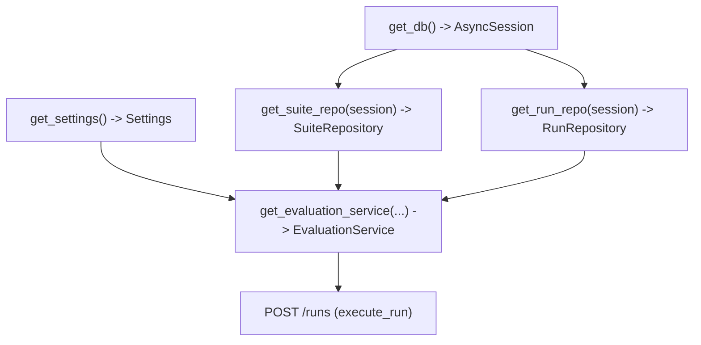
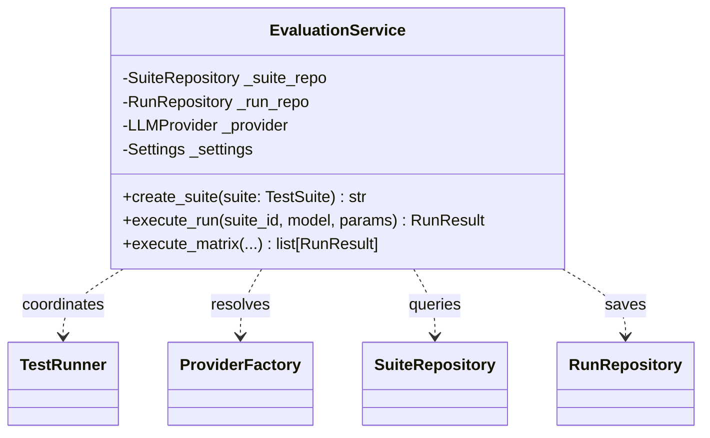

# PromptLab: Design Patterns & Object-Oriented Architecture

This document catalogs every software design pattern implemented across the PromptLab codebase. For each pattern, you will find:
1. A concise **2-line definition**.
2. The **exact classes** implementing it with line citations and a **Mermaid class diagram**.
3. A **before/after comparison**: what the code would look like without the pattern and what the pattern achieves.
4. Step-by-step **extension guides** for adding a new provider, scorer, and prompt technique.
5. A comprehensive **SOLID principles audit** showing where each principle is applied and where it is bent or broken.

---

## 1. Strategy Pattern

### Definition
The Strategy pattern defines a family of interchangeable algorithms, encapsulates each one inside a separate class, and allows them to vary independently from clients that use them. It enables selecting behavior dynamically at runtime without modifying client classes.

### Implementing Classes
- **Abstract Strategy:** `PromptTechnique` ([src/promptlab/core/techniques/base.py:14-34](file:///c:/Users/vedaa/OneDrive/Desktop/Master%20Folder/promptLab/src/promptlab/core/techniques/base.py#L14-L34))
- **Concrete Strategies:**
  - `ZeroShot` ([src/promptlab/core/techniques/zero_shot.py:13-23](file:///c:/Users/vedaa/OneDrive/Desktop/Master%20Folder/promptLab/src/promptlab/core/techniques/zero_shot.py#L13-L23))
  - `FewShot` ([src/promptlab/core/techniques/few_shot.py:13-48](file:///c:/Users/vedaa/OneDrive/Desktop/Master%20Folder/promptLab/src/promptlab/core/techniques/few_shot.py#L13-L48))
  - `ChainOfThought` ([src/promptlab/core/techniques/chain_of_thought.py:15-53](file:///c:/Users/vedaa/OneDrive/Desktop/Master%20Folder/promptLab/src/promptlab/core/techniques/chain_of_thought.py#L15-L53))
  - `StructuredOutput` ([src/promptlab/core/techniques/structured_output.py:15-60](file:///c:/Users/vedaa/OneDrive/Desktop/Master%20Folder/promptLab/src/promptlab/core/techniques/structured_output.py#L15-L60))
- **Strategy Context:** `TestRunner._evaluate_single_case()` ([src/promptlab/core/runner.py:74-85](file:///c:/Users/vedaa/OneDrive/Desktop/Master%20Folder/promptLab/src/promptlab/core/runner.py#L74-L85))

### Class Diagram



### Before & After

#### Without Strategy Pattern (Anti-Pattern: Giant `if/elif` Block)
```python
# In TestRunner: Every time a new prompting style is added, TestRunner must be modified
if suite.technique == "zero_shot":
    user_prompt = case.input
elif suite.technique == "few_shot":
    examples_str = "\n".join([f"Ex: {e}" for e in suite.technique_config["examples"]])
    user_prompt = f"{examples_str}\nInput: {case.input}\nOutput:"
elif suite.technique == "chain_of_thought":
    user_prompt = f"{case.input}\nPlease reason step by step..."
# Violates Open/Closed Principle; runner file grows indefinitely
```

#### With Strategy Pattern
```python
# In src/promptlab/core/runner.py:74-82
technique = self._resolve_technique(suite.technique)
sys_addition, user_prompt = technique.apply(case.input, suite.technique_config)
combined_system = self._combine_system_prompts(suite.system_prompt, sys_addition)
```
- **What it buys us:** `TestRunner` is closed for modification. Adding a new technique requires zero edits to the runner engine.

---

## 2. Factory & Registry Pattern

### Definition
The Factory/Registry pattern maintains a central dictionary of named classes, allowing callers to look up and instantiate concrete implementations dynamically via string keys without coupling to concrete classes.

### Implementing Classes
1. **Provider Factory & Registry:** `ProviderFactory` ([src/promptlab/core/providers/factory.py:20-69](file:///c:/Users/vedaa/OneDrive/Desktop/Master%20Folder/promptLab/src/promptlab/core/providers/factory.py#L20-L69))
2. **Technique Registry:** `TechniqueRegistry` ([src/promptlab/core/techniques/registry.py:20-73](file:///c:/Users/vedaa/OneDrive/Desktop/Master%20Folder/promptLab/src/promptlab/core/techniques/registry.py#L20-L73))
3. **Scorer Registry:** `ScorerRegistry` ([src/promptlab/core/scorers/registry.py:23-78](file:///c:/Users/vedaa/OneDrive/Desktop/Master%20Folder/promptLab/src/promptlab/core/scorers/registry.py#L23-L78))

### Class Diagram



### Before & After

#### Without Factory / Registry Pattern
```python
# Hardcoded direct instantiation
if provider_name == "groq":
    provider = GroqProvider(api_key=settings.groq_api_key)
elif provider_name == "mock":
    provider = MockProvider()
else:
    raise ValueError(f"Unknown provider: {provider_name}")
```
- Callers must import every single concrete provider class. Adding `OllamaProvider` forces updates to API routes, services, and test harnesses.

#### With Factory / Registry Pattern
```python
# In src/promptlab/core/providers/factory.py:41-58
provider = ProviderFactory.create(name, **kwargs)
```
- **What it buys us:** Clean plugin architecture. External modules register their classes with `@ProviderFactory.register("ollama")` without touching core code.

---

## 3. Template Method Pattern

### Definition
The Template Method pattern defines the skeleton of an algorithm in an abstract base class, deferring specific algorithmic steps to subclasses without allowing the overall invariant execution structure to be overridden.

### Implementing Classes
- **Abstract Template Class:** `BaseScorer` ([src/promptlab/core/scorers/base.py:15-70](file:///c:/Users/vedaa/OneDrive/Desktop/Master%20Folder/promptLab/src/promptlab/core/scorers/base.py#L15-L70))
- **Template Methods:**
  - `score(self, case: TestCase, output: str) -> ScoreResult` (Synchronous invariant skeleton)
  - `score_async(self, case: TestCase, output: str) -> ScoreResult` (Asynchronous invariant skeleton)
- **Concrete Subclasses (Primitive Steps):**
  - `ExactMatch` ([src/promptlab/core/scorers/exact_match.py:14-52](file:///c:/Users/vedaa/OneDrive/Desktop/Master%20Folder/promptLab/src/promptlab/core/scorers/exact_match.py#L14-L52))
  - `Contains` ([src/promptlab/core/scorers/contains.py:14-76](file:///c:/Users/vedaa/OneDrive/Desktop/Master%20Folder/promptLab/src/promptlab/core/scorers/contains.py#L14-L76))
  - `RegexMatch` ([src/promptlab/core/scorers/regex_match.py:14-60](file:///c:/Users/vedaa/OneDrive/Desktop/Master%20Folder/promptLab/src/promptlab/core/scorers/regex_match.py#L14-L60))
  - `JsonValid` ([src/promptlab/core/scorers/json_valid.py:15-46](file:///c:/Users/vedaa/OneDrive/Desktop/Master%20Folder/promptLab/src/promptlab/core/scorers/json_valid.py#L15-L46))
  - `JsonSchema` ([src/promptlab/core/scorers/json_schema.py:19-72](file:///c:/Users/vedaa/OneDrive/Desktop/Master%20Folder/promptLab/src/promptlab/core/scorers/json_schema.py#L19-L72))
  - `SqlResult` ([src/promptlab/core/scorers/sql_result.py:40-149](file:///c:/Users/vedaa/OneDrive/Desktop/Master%20Folder/promptLab/src/promptlab/core/scorers/sql_result.py#L40-L149))
  - `LLMJudge` ([src/promptlab/core/scorers/llm_judge.py:30-118](file:///c:/Users/vedaa/OneDrive/Desktop/Master%20Folder/promptLab/src/promptlab/core/scorers/llm_judge.py#L30-L118))

### Class Diagram



### Before & After

#### Without Template Method Pattern
```python
# Every scorer must remember to strip whitespace, clamp scores, and handle rounding
class BadScorer:
    def score(self, case, output):
        clean = output.strip()  # easily forgotten
        score = calculate_score(clean)
        # BUG: Forgot to clamp between 0.0 and 1.0; returns 1.25 or -0.1
        return ScoreResult(score=score, passed=score > 0.5, reason="...")
```

#### With Template Method Pattern
```python
# In src/promptlab/core/scorers/base.py:34-46
def score(self, case: TestCase, output: str) -> ScoreResult:
    normalized = self._preprocess(output)  # 1. Invariant Step
    result = self._evaluate(case, normalized)  # 2. Hook to Subclass
    return self._finalize(result)  # 3. Invariant Step (Clamping [0.0, 1.0])
```
- **What it buys us:** Subclasses only implement `_evaluate()`. Normalization and score boundary guarantees ($0.0 \le \text{score} \le 1.0$) are enforced centrally.

---

## 4. Repository Pattern

### Definition
The Repository pattern mediates between the domain and data mapping layers using a collection-like interface, isolating domain logic from database query syntax and ORM dependencies.

### Implementing Classes
- `SuiteRepository` ([src/promptlab/db/repositories.py:28-128](file:///c:/Users/vedaa/OneDrive/Desktop/Master%20Folder/promptLab/src/promptlab/db/repositories.py#L28-L128))
- `RunRepository` ([src/promptlab/db/repositories.py:130-288](file:///c:/Users/vedaa/OneDrive/Desktop/Master%20Folder/promptLab/src/promptlab/db/repositories.py#L130-L288))
- `SafetyRepository` ([src/promptlab/db/repositories.py:290-355](file:///c:/Users/vedaa/OneDrive/Desktop/Master%20Folder/promptLab/src/promptlab/db/repositories.py#L290-L355))

### Class Diagram



### Before & After

#### Without Repository Pattern (Raw Database Access in Routes/Services)
```python
# In FastAPI route or Service:
async def get_run_route(run_id: str, db: AsyncSession):
    stmt = select(RunModel).where(RunModel.id == run_id)
    raw = await db.execute(stmt)
    # Service layer is now coupled to SQLAlchemy syntax and session state
```

#### With Repository Pattern
```python
# In src/promptlab/services/evaluation_service.py:116
run = await self._run_repo.get_by_id(run_id)
```
- **What it buys us:** `EvaluationService` has zero knowledge of SQLAlchemy, SQL syntax, or database schemas. Unit tests can test services using an in-memory dictionary mock repository.

---

## 5. Dependency Injection (Inversion of Control)

### Definition
Dependency Injection passes an object's collaborators to it rather than allowing the object to instantiate them directly, enabling modularity, test isolation, and decoupled configuration.

### Implementing Code
- **Dependency Providers:** [src/promptlab/api/dependencies.py](file:///c:/Users/vedaa/OneDrive/Desktop/Master%20Folder/promptLab/src/promptlab/api/dependencies.py)
  - `get_db() -> AsyncGenerator[AsyncSession, None]` ([api/dependencies.py:26-36](file:///c:/Users/vedaa/OneDrive/Desktop/Master%20Folder/promptLab/src/promptlab/api/dependencies.py#L26-L36))
  - `get_suite_repo(session: AsyncSession = Depends(get_db)) -> SuiteRepository` ([api/dependencies.py:38-40](file:///c:/Users/vedaa/OneDrive/Desktop/Master%20Folder/promptLab/src/promptlab/api/dependencies.py#L38-L40))
  - `get_evaluation_service(suite_repo, run_repo, settings) -> EvaluationService` ([api/dependencies.py:53-64](file:///c:/Users/vedaa/OneDrive/Desktop/Master%20Folder/promptLab/src/promptlab/api/dependencies.py#L53-L64))
- **Consumer Routes:** E.g., `execute_run(payload, eval_service = Depends(get_evaluation_service))` ([src/promptlab/api/routes/runs.py:29-32](file:///c:/Users/vedaa/OneDrive/Desktop/Master%20Folder/promptLab/src/promptlab/api/routes/runs.py#L29-L32))

### Class / Graph Diagram



### Before & After

#### Without Dependency Injection (Hardcoded Instantiation)
```python
@router.post("/runs")
async def execute_run(payload: RunExecuteRequest):
    # Route creates its own DB connection and services
    engine = create_async_engine("sqlite+aiosqlite:///promptlab.db")
    session = AsyncSession(engine)
    service = EvaluationService(SuiteRepository(session), RunRepository(session))
```
- Cannot test routes without connecting to a real on-disk SQLite database. Session lifecycles are unmanaged.

#### With Dependency Injection
```python
# In src/promptlab/api/routes/runs.py:29-32
@router.post("", response_model=RunResult, status_code=status.HTTP_201_CREATED)
async def execute_run(
    payload: RunExecuteRequest,
    eval_service: EvaluationService = Depends(get_evaluation_service),
) -> RunResult:
```
- **What it buys us:** Tests use `app.dependency_overrides[get_evaluation_service] = mock_service` to test the HTTP layer in complete isolation.

---

## 6. Facade Pattern

### Definition
The Facade pattern provides a simplified, unified high-level interface to a complex subsystem of classes, libraries, and workflows.

### Implementing Classes
- `EvaluationService` ([src/promptlab/services/evaluation_service.py:20-132](file:///c:/Users/vedaa/OneDrive/Desktop/Master%20Folder/promptLab/src/promptlab/services/evaluation_service.py#L20-L132))
- `ComparisonService` ([src/promptlab/services/comparison_service.py:16-93](file:///c:/Users/vedaa/OneDrive/Desktop/Master%20Folder/promptLab/src/promptlab/services/comparison_service.py#L16-L93))
- `SafetyService` ([src/promptlab/services/safety_service.py:21-90](file:///c:/Users/vedaa/OneDrive/Desktop/Master%20Folder/promptLab/src/promptlab/services/safety_service.py#L21-L90))

### Class Diagram



### Before & After

#### Without Facade Pattern
API routes would need to:
1. Query `SuiteRepository` for suite ID.
2. Resolve provider via `ProviderFactory`.
3. Check `Settings.demo_mode`.
4. Construct `TestRunner`.
5. Call `runner.run_suite()`.
6. Save results back to `RunRepository`.
This duplicates 30 lines of coordination logic in every route and script.

#### With Facade Pattern
```python
# In src/promptlab/services/evaluation_service.py:88-90
run_result = await runner.run_suite(suite, model=model, params=params)
await self._run_repo.save(run_result, suite_id=suite_id)
return run_result
```
- **What it buys us:** A single method call `eval_service.execute_run()` encapsulates the entire multi-step evaluation and persistence workflow.

---

## 7. Additional Patterns Found in PromptLab

| Pattern | Definition | Exact Implementing Class / Function | Citation |
| :--- | :--- | :--- | :--- |
| **Adapter** | Converts the interface of a vendor SDK into a standard interface expected by clients. | `GroqProvider` (Adapts `groq.AsyncGroq` to `LLMProvider`) | [core/providers/groq_provider.py:31](file:///c:/Users/vedaa/OneDrive/Desktop/Master%20Folder/promptLab/src/promptlab/core/providers/groq_provider.py#L31) |
| **Singleton** | Ensures a class has only one global instance and provides a global access point. | `get_settings()` (via `@lru_cache(maxsize=1)`)<br>`get_engine()` (Global `_engine`) | [config.py:99-106](file:///c:/Users/vedaa/OneDrive/Desktop/Master%20Folder/promptLab/src/promptlab/config.py#L99-L106)<br>[db/base.py:33-40](file:///c:/Users/vedaa/OneDrive/Desktop/Master%20Folder/promptLab/src/promptlab/db/base.py#L33-L40) |
| **Unit of Work** | Maintains a list of database operations affected by a business transaction and coordinates commit/rollback. | `get_session()` async context manager | [db/base.py:65-76](file:///c:/Users/vedaa/OneDrive/Desktop/Master%20Folder/promptLab/src/promptlab/db/base.py#L65-L76) |
| **Application Factory** | Encapsulates application setup in a function to permit isolated instantiation across tests and runtime. | `create_app()` | [api/main.py:40-136](file:///c:/Users/vedaa/OneDrive/Desktop/Master%20Folder/promptLab/src/promptlab/api/main.py#L40-L136) |
| **Remote Proxy / Client** | Wraps remote REST HTTP endpoints inside native typed Python method calls. | `PromptLabClient` | [dashboard/api_client.py:29-166](file:///c:/Users/vedaa/OneDrive/Desktop/Master%20Folder/promptLab/src/promptlab/dashboard/api_client.py#L29-L166) |

---

## 8. How to Extend PromptLab (Step-by-Step Guides)

### Extension 1: Adding a New LLM Provider (e.g., `OllamaProvider`)

To add local open-source model inference via Ollama:

1. **Create the Provider Class:**
   Create `src/promptlab/core/providers/ollama_provider.py`:
   ```python
   # src/promptlab/core/providers/ollama_provider.py
   import httpx, time
   from promptlab.core.models import LLMRequest, LLMResponse
   from promptlab.core.providers.base import LLMProvider
   from promptlab.core.providers.factory import ProviderFactory


   @ProviderFactory.register("ollama")
   class OllamaProvider(LLMProvider):
       name: str = "ollama"

       def __init__(self, base_url: str = "http://localhost:11434"):
           self.base_url = base_url

       async def generate(self, request: LLMRequest) -> LLMResponse:
           start = time.perf_counter()
           async with httpx.AsyncClient() as client:
               resp = await client.post(
                   f"{self.base_url}/api/generate",
                   json={"model": request.model, "prompt": request.prompt, "stream": False},
               )
           lat = (time.perf_counter() - start) * 1000.0
           data = resp.json()
           return LLMResponse(text=data["response"], model=request.model, latency_ms=lat)

       async def list_models(self) -> list[str]:
           return ["llama3:8b", "mistral:7b"]
   ```
2. **Export and Register:**
   In [src/promptlab/core/providers/__init__.py](file:///c:/Users/vedaa/OneDrive/Desktop/Master%20Folder/promptLab/src/promptlab/core/providers/__init__.py): import and add `OllamaProvider` to `__all__`.
3. **Files to Touch:**
   - Create `src/promptlab/core/providers/ollama_provider.py`
   - Update `src/promptlab/core/providers/__init__.py`
   - Zero changes required in `TestRunner`, `EvaluationService`, or `api/routes/runs.py`!

---

### Extension 2: Adding a New Scorer (e.g., `SemanticSimilarityScorer`)

To add an embedding-based cosine similarity evaluation rubric:

1. **Create the Scorer Class:**
   Create `src/promptlab/core/scorers/semantic_similarity.py`:
   ```python
   # src/promptlab/core/scorers/semantic_similarity.py
   from promptlab.core.models import ScoreResult, TestCase
   from promptlab.core.scorers.base import BaseScorer
   from promptlab.core.scorers.registry import ScorerRegistry


   @ScorerRegistry.register("semantic_similarity")
   class SemanticSimilarityScorer(BaseScorer):
       name: str = "semantic_similarity"

       def _evaluate(self, case: TestCase, output: str) -> ScoreResult:
           threshold = case.scorer_config.get("threshold", 0.8)
           # Compute cosine similarity between output and case.expected
           sim_score = 0.85  # calculated similarity
           passed = sim_score >= threshold
           return ScoreResult(
               score=sim_score,
               passed=passed,
               reason=f"Similarity {sim_score:.2f} >= threshold {threshold}",
           )
   ```
2. **Export and Register:**
   In [src/promptlab/core/scorers/__init__.py](file:///c:/Users/vedaa/OneDrive/Desktop/Master%20Folder/promptLab/src/promptlab/core/scorers/__init__.py): import and add `SemanticSimilarityScorer` to `__all__`.
3. **Files to Touch:**
   - Create `src/promptlab/core/scorers/semantic_similarity.py`
   - Update `src/promptlab/core/scorers/__init__.py`

---

### Extension 3: Adding a New Prompt Technique (e.g., `SelfConsistency`)

To add self-consistency sampling where the prompt instructs multiple perspectives:

1. **Create the Technique Class:**
   Create `src/promptlab/core/techniques/self_consistency.py`:
   ```python
   # src/promptlab/core/techniques/self_consistency.py
   from typing import Any
   from promptlab.core.techniques.base import PromptTechnique
   from promptlab.core.techniques.registry import TechniqueRegistry


   @TechniqueRegistry.register("self_consistency")
   class SelfConsistency(PromptTechnique):
       name: str = "self_consistency"

       def apply(self, case_input: str, config: dict[str, Any]) -> tuple[str | None, str]:
           sys_addition = "Generate multiple diverse reasoning paths before answering."
           user_prompt = (
               f"{case_input}\n\nExplore multiple perspectives and provide your consensus answer."
           )
           return (sys_addition, user_prompt)
   ```
2. **Export and Register:**
   In [src/promptlab/core/techniques/__init__.py](file:///c:/Users/vedaa/OneDrive/Desktop/Master%20Folder/promptLab/src/promptlab/core/techniques/__init__.py): import and add `SelfConsistency` to `__all__`.
3. **Files to Touch:**
   - Create `src/promptlab/core/techniques/self_consistency.py`
   - Update `src/promptlab/core/techniques/__init__.py`

---

## 9. SOLID Principles Audit

| Principle | Where Visibly Applied | Concrete Code Example | Where Bent or Broken | Concrete Code Example |
| :--- | :--- | :--- | :--- | :--- |
| **S - Single Responsibility** | `PIIDetector` handles detection and regex string replacement only. `Guardrail` handles risk assessment policy only. | [pii_detector.py:78](file:///c:/Users/vedaa/OneDrive/Desktop/Master%20Folder/promptLab/src/promptlab/core/safety/pii_detector.py#L78)<br>[guardrail.py:21](file:///c:/Users/vedaa/OneDrive/Desktop/Master%20Folder/promptLab/src/promptlab/core/safety/guardrail.py#L21) | `GroqProvider` handles Groq SDK I/O, exponential backoff calculation, jitter math, transient error detection, message translation, and token metrics. | [groq_provider.py:68-142](file:///c:/Users/vedaa/OneDrive/Desktop/Master%20Folder/promptLab/src/promptlab/core/providers/groq_provider.py#L68-L142) |
| **O - Open / Closed** | `ScorerRegistry`, `TechniqueRegistry`, and `ProviderFactory` allow registering new classes via decorators without editing registry code. | [factory.py:26-33](file:///c:/Users/vedaa/OneDrive/Desktop/Master%20Folder/promptLab/src/promptlab/core/providers/factory.py#L26-L33)<br>[registry.py:26-35](file:///c:/Users/vedaa/OneDrive/Desktop/Master%20Folder/promptLab/src/promptlab/core/scorers/registry.py#L26-L35) | Streamlit UI pages hardcode provider dropdown options as fallback defaults instead of querying dynamic registries. | [1_Playground.py:41](file:///c:/Users/vedaa/OneDrive/Desktop/Master%20Folder/promptLab/src/promptlab/dashboard/pages/1_Playground.py#L41) |
| **L - Liskov Substitution** | `MockProvider` can be substituted anywhere `LLMProvider` is expected (`TestRunner`, `InjectionSuite`, `LLMJudge`) without breaking callers. | [runner.py:43](file:///c:/Users/vedaa/OneDrive/Desktop/Master%20Folder/promptLab/src/promptlab/core/runner.py#L43)<br>[injection_suite.py:106](file:///c:/Users/vedaa/OneDrive/Desktop/Master%20Folder/promptLab/src/promptlab/core/safety/injection_suite.py#L106) | `LLMJudge` inherits from `BaseScorer`, but its synchronous `_evaluate()` hook returns a dummy score 0.0 failure instead of evaluating. | [llm_judge.py:111-117](file:///c:/Users/vedaa/OneDrive/Desktop/Master%20Folder/promptLab/src/promptlab/core/scorers/llm_judge.py#L111-L117) |
| **I - Interface Segregation** | `PromptTechnique` requires only `apply()`; clients do not depend on methods they do not use. | [techniques/base.py:20](file:///c:/Users/vedaa/OneDrive/Desktop/Master%20Folder/promptLab/src/promptlab/core/techniques/base.py#L20) | `BaseScorer` exposes both `score()` and `score_async()`, forcing scorers with asynchronous network dependencies (like `LLMJudge`) to maintain a dummy synchronous stub. | [scorers/base.py:34-48](file:///c:/Users/vedaa/OneDrive/Desktop/Master%20Folder/promptLab/src/promptlab/core/scorers/base.py#L34-L48) |
| **D - Dependency Inversion** | High-level `TestRunner` depends on the abstraction `LLMProvider`, not concrete `GroqProvider`. | [runner.py:37](file:///c:/Users/vedaa/OneDrive/Desktop/Master%20Folder/promptLab/src/promptlab/core/runner.py#L37) | In [api/routes/safety.py:44](file:///c:/Users/vedaa/OneDrive/Desktop/Master%20Folder/promptLab/src/promptlab/api/routes/safety.py#L44), route reaches into `safety_service._guardrail` (private attribute). In [models.py:11](file:///c:/Users/vedaa/OneDrive/Desktop/Master%20Folder/promptLab/src/promptlab/api/routes/models.py#L11), route imports `ProviderFactory` directly. | [safety.py:44](file:///c:/Users/vedaa/OneDrive/Desktop/Master%20Folder/promptLab/src/promptlab/api/routes/safety.py#L44)<br>[models.py:11](file:///c:/Users/vedaa/OneDrive/Desktop/Master%20Folder/promptLab/src/promptlab/api/routes/models.py#L11) |
