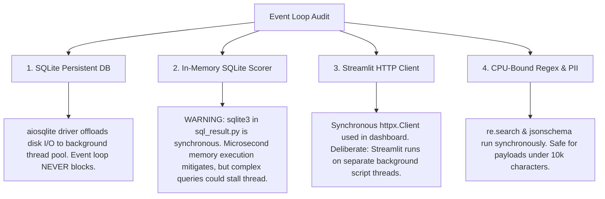
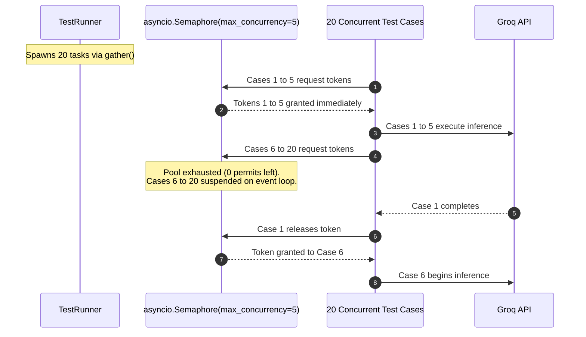

# PromptLab: Concurrency, Reliability & Fault Tolerance

This document analyzes PromptLab's asynchronous architecture, event-loop behavior, concurrency controls, retry mechanics, failure isolation, and rate-limit safeguards.

---

## 1. Asynchronous Architecture & Event-Loop Hygiene

PromptLab is built from the ground up as an asynchronous system on top of Python's `asyncio` event loop.

### End-to-End Async Call Stack

The table below traces the asynchronous call hierarchy from the HTTP route down to the socket-level inference call.

| Layer | File & Line Citation | Function / Coroutine | Await Point (`await`) |
| :--- | :--- | :--- | :--- |
| **API Route** | [api/routes/runs.py:29-43](file:///c:/Users/vedaa/OneDrive/Desktop/Master%20Folder/promptLab/src/promptlab/api/routes/runs.py#L29-L43) | `async def execute_run(...)` | `await eval_service.execute_run(...)` |
| **Service Facade** | [services/evaluation_service.py:77-90](file:///c:/Users/vedaa/OneDrive/Desktop/Master%20Folder/promptLab/src/promptlab/services/evaluation_service.py#L77-L90) | `async def execute_run(...)` | `await runner.run_suite(...)`<br>`await self._run_repo.save(...)` |
| **Runner Orchestration** | [core/runner.py:126-171](file:///c:/Users/vedaa/OneDrive/Desktop/Master%20Folder/promptLab/src/promptlab/core/runner.py#L126-L171) | `async def run_suite(...)` | `await asyncio.gather(*tasks)` |
| **Case Execution** | [core/runner.py:64-125](file:///c:/Users/vedaa/OneDrive/Desktop/Master%20Folder/promptLab/src/promptlab/core/runner.py#L64-L125) | `async def _evaluate_single_case(...)` | `async with semaphore:`<br>`await self._provider.generate(...)`<br>`await scorer.score_async(...)` |
| **Provider Adapter** | [core/providers/groq_provider.py:123-142](file:///c:/Users/vedaa/OneDrive/Desktop/Master%20Folder/promptLab/src/promptlab/core/providers/groq_provider.py#L123-L142) | `async def generate(...)` | `await self._execute_with_retry(...)` |
| **Retry Loop** | [core/providers/groq_provider.py:82-122](file:///c:/Users/vedaa/OneDrive/Desktop/Master%20Folder/promptLab/src/promptlab/core/providers/groq_provider.py#L82-L122) | `async def _execute_with_retry(...)` | `await self._client.chat.completions.create(...)`<br>`await asyncio.sleep(delay)` |
| **Repository Persistence**| [db/repositories.py:137-172](file:///c:/Users/vedaa/OneDrive/Desktop/Master%20Folder/promptLab/src/promptlab/db/repositories.py#L137-L172) | `async def save(...)` | `await self._session.flush()` |
| **Session Cleanup** | [api/dependencies.py:26-36](file:///c:/Users/vedaa/OneDrive/Desktop/Master%20Folder/promptLab/src/promptlab/api/dependencies.py#L26-L36) | `async def get_db(...)` | `await session.commit()` / `rollback()` |

---

### Audit: Where Could Blocking Code Stall the Event Loop?

Because Node.js and Python asyncio operate on a single thread per process, **any synchronous blocking I/O or heavy CPU loop blocks the entire event loop**, freezing all concurrent requests for all users.

Our audit identified the following blocking points and how they are handled:



1. **Database Disk I/O (`aiosqlite`):**
   - *Location:* [src/promptlab/config.py:54](file:///c:/Users/vedaa/OneDrive/Desktop/Master%20Folder/promptLab/src/promptlab/config.py#L54) (`sqlite+aiosqlite:///...`).
   - *Behavior:* `aiosqlite` offloads SQLite C-extension calls to an underlying background worker thread pool (`ThreadPoolExecutor`). The asyncio event loop remains non-blocking during database writes and reads.
2. **Synchronous In-Memory SQLite in `SqlResult` (POTENTIAL RISK):**
   - *Location:* [src/promptlab/core/scorers/sql_result.py:90-97, 120-125](file:///c:/Users/vedaa/OneDrive/Desktop/Master%20Folder/promptLab/src/promptlab/core/scorers/sql_result.py#L90-L97)
   - *Code:*
     ```python
     conn = sqlite3.connect(":memory:")
     candidate_rows = cursor.execute(candidate_sql).fetchall()
     ```
   - *Behavior:* Standard library `sqlite3` is synchronous. Because the database is purely in memory (`:memory:`) and schemas contain only dozens of sample records, execution completes in sub-millisecond timeframes.
   - *Production Recommendation:* If test queries might evaluate large tables or run Cartesian products (`CROSS JOIN`), wrap execution in `asyncio.to_thread()`:
     ```python
     rows = await asyncio.to_thread(cursor.execute(sql).fetchall)
     ```
3. **Streamlit UI HTTP Calls (`PromptLabClient`):**
   - *Location:* [src/promptlab/dashboard/api_client.py:37](file:///c:/Users/vedaa/OneDrive/Desktop/Master%20Folder/promptLab/src/promptlab/dashboard/api_client.py#L37)
   - *Behavior:* Uses synchronous `httpx.Client()`. This is standard architecture for Streamlit: Streamlit executes each user session on an isolated background OS thread, not the main UI loop.

---

## 2. Semaphore Concurrency Throttling

When running a test suite with 50 cases, firing all 50 network calls simultaneously causes socket exhaustion and triggers immediate HTTP 429 rate limits from LLM providers.

PromptLab throttles concurrency using an `asyncio.Semaphore`.



### Implementation Details in Code

In [src/promptlab/core/runner.py:134-147](file:///c:/Users/vedaa/OneDrive/Desktop/Master%20Folder/promptLab/src/promptlab/core/runner.py#L134-L147):
```python
semaphore = asyncio.Semaphore(self._settings.max_concurrency)

tasks = [
    self._evaluate_single_case(
        case=case, suite=suite, model=model, params=effective_params, semaphore=semaphore
    )
    for case in suite.cases
]

case_results: list[CaseResult] = await asyncio.gather(*tasks)
```
And inside `_evaluate_single_case()` ([runner.py:73](file:///c:/Users/vedaa/OneDrive/Desktop/Master%20Folder/promptLab/src/promptlab/core/runner.py#L73)):
```python
async with semaphore:
    # Inference and scoring execute here.
    # At most self._settings.max_concurrency (default 5) enter this block simultaneously.
```

- **Configurable Bound:** Configured via `Settings.max_concurrency` ([config.py:47-52](file:///c:/Users/vedaa/OneDrive/Desktop/Master%20Folder/promptLab/src/promptlab/config.py#L47-L52)), with bounds `ge=1, le=50`.
- **Injection Suite Re-use:** `InjectionSuite.run_suite()` ([core/safety/injection_suite.py:113](file:///c:/Users/vedaa/OneDrive/Desktop/Master%20Folder/promptLab/src/promptlab/core/safety/injection_suite.py#L113)) employs an identical semaphore pattern when executing adversarial attacks.

---

## 3. Retry Policy & Exponential Backoff with Jitter

PromptLab protects inference calls against transient network disconnects and quota rate limits using an exponential backoff algorithm with full jitter.

### Retry Configuration & Classification

In [src/promptlab/core/providers/groq_provider.py:39-46, 74-80](file:///c:/Users/vedaa/OneDrive/Desktop/Master%20Folder/promptLab/src/promptlab/core/providers/groq_provider.py#L39-L46):
- **Maximum Retries:** `max_retries = 3` (up to 4 attempts total).
- **Base Backoff:** `base_backoff_seconds = 0.5`.
- **Eligible Transient Exceptions (`_is_transient`):**
  - `groq.RateLimitError`
  - `groq.APIConnectionError`
  - `groq.APIStatusError` where `status_code in {429, 500, 502, 503, 504}`
- **Non-Transient Exceptions (Never Retried):**
  - HTTP 400 Bad Request, HTTP 401 Unauthorized, HTTP 404 Model Not Found. These fail immediately without delay.

### The Backoff Formula

In [src/promptlab/core/providers/groq_provider.py:68-72](file:///c:/Users/vedaa/OneDrive/Desktop/Master%20Folder/promptLab/src/promptlab/core/providers/groq_provider.py#L68-L72):
$$\text{delay} = \text{round}\left( \text{base\_backoff} \times 2^{\text{attempt}} + \text{jitter}, 3 \right)$$
where $\text{jitter} \sim \mathcal{U}(0.05, 0.25)$.

| Attempt | Base Exponential ($0.5 \times 2^{\text{attempt}}$) | Jitter Range ($\text{random}(0.05, 0.25)$) | Total Sleep Window |
| :---: | :---: | :---: | :---: |
| **0** | $0.50\text{s}$ | $0.05\text{s} - 0.25\text{s}$ | **$0.55\text{s} - 0.75\text{s}$** |
| **1** | $1.00\text{s}$ | $0.05\text{s} - 0.25\text{s}$ | **$1.05\text{s} - 1.25\text{s}$** |
| **2** | $2.00\text{s}$ | $0.05\text{s} - 0.25\text{s}$ | **$2.05\text{s} - 2.25\text{s}$** |

### Why Jitter is Critical
Without jitter, if a sudden rate limit hits 5 concurrent tasks simultaneously, all 5 tasks would sleep for exactly $0.500\text{s}$ and retry in unison at $T + 0.500\text{s}$, creating a **thundering herd** that immediately triggers another 429. Jitter desynchronizes retries across a random window.

---

## 4. Timeouts & Partial-Failure Containment

### Request Timeout Enforcement
- **Provider Level:** `AsyncGroq(timeout=timeout_seconds)` ([core/providers/groq_provider.py:58](file:///c:/Users/vedaa/OneDrive/Desktop/Master%20Folder/promptLab/src/promptlab/core/providers/groq_provider.py#L58)) enforces a per-call timeout defined by `Settings.request_timeout_seconds` (default: 60.0 seconds).
- **Dashboard Client:** `PromptLabClient(timeout=60.0)` ([dashboard/api_client.py:37](file:///c:/Users/vedaa/OneDrive/Desktop/Master%20Folder/promptLab/src/promptlab/dashboard/api_client.py#L37)) prevents the Streamlit UI from hanging indefinitely if the backend is slow.

---

### Scenario: If 3 of 20 Cases Fail, What Does the User See?

In naive test runners, if 1 case in an `asyncio.gather` raises an exception, the entire gather aborts, the database transaction is lost, and the user receives an error screen with zero results.

**PromptLab implements strict case-level fault isolation:**

In [src/promptlab/core/runner.py:107-124](file:///c:/Users/vedaa/OneDrive/Desktop/Master%20Folder/promptLab/src/promptlab/core/runner.py#L107-L124):
```python
try:
    response = await self._provider.generate(request)
    scorer = self._scorer_registry.get(case.scorer)
    score_res = await scorer.score_async(case, response.text)
    return CaseResult(
        case_id=case.id,
        response=response,
        score=score_res.score,
        passed=score_res.passed,
        reason=score_res.reason,
        error=None,
    )
except Exception as exc:
    logger.error("Error evaluating test case '%s': %s", case.id, exc)
    fallback_response = LLMResponse(
        text="",
        model=model,
        latency_ms=0.0,
        prompt_tokens=0,
        completion_tokens=0,
        raw_finish_reason="error",
    )
    return CaseResult(
        case_id=case.id,
        response=fallback_response,
        score=0.0,
        passed=False,
        reason=f"Evaluation failed due to exception: {exc}",
        error=str(exc),
    )
```

### What the User Experiences:
1. **The Run Completes Successfully:** The API returns `HTTP 201 Created`. The run is saved to SQLite without rolling back the valid 17 cases.
2. **Metric Integrity:**
   - Evaluated Cases: `20`
   - Passed Cases: `17`
   - Pass Rate: $\frac{17}{20} = 0.85$ (**85.0%**)
   - Average Latency: Computed over the 17 completed cases ($0.0\text{ms}$ factored into denominator).
3. **UI Dashboard Visualization:**
   - 17 cases display green cards: `✅ Case [tc-01] — Score: 1.00 (PASSED)`.
   - 3 cases display red failure cards: `❌ Case [tc-08] — Score: 0.00 (FAILED)`.
   - Expanding the failed cases reveals the exact diagnostic error:
     ```text
     Evaluation Reason: Evaluation failed due to exception: Groq inference failed: Connection timed out
     ```

---

## 5. Rate Limits & Cost Control Safeguards

PromptLab implements five distinct defense mechanisms to prevent runaway API costs and cloud quota exhaustion:

| Safeguard | Configuration / Mechanism | Location | Protection Provided |
| :--- | :--- | :--- | :--- |
| **Max Prompt Length** | `max_prompt_length: int = 10000` (`ge=100, le=100000`) | [config.py:73-78](file:///c:/Users/vedaa/OneDrive/Desktop/Master%20Folder/promptLab/src/promptlab/config.py#L73-L78) | Rejects payload flooding attacks that consume millions of context tokens. |
| **Max Cases Per Suite** | `max_cases_per_suite: int = 100` (`ge=1, le=1000`) | [config.py:79-84](file:///c:/Users/vedaa/OneDrive/Desktop/Master%20Folder/promptLab/src/promptlab/config.py#L79-L84) | Prevents users from scheduling single evaluation runs with thousands of cases. |
| **Max Token Generation** | `max_tokens: int = 1024` (`ge=1, le=8192`) | [core/models.py:34-38](file:///c:/Users/vedaa/OneDrive/Desktop/Master%20Folder/promptLab/src/promptlab/core/models.py#L34-L38) | Caps completion generation tokens, preventing infinite autoregressive generation loops. |
| **Concurrency Limit** | `max_concurrency: int = 5` (`ge=1, le=50`) | [config.py:47-52](file:///c:/Users/vedaa/OneDrive/Desktop/Master%20Folder/promptLab/src/promptlab/config.py#L47-L52) | Protects provider Requests-Per-Minute (RPM) quotas. |
| **Token Cost Telemetry** | `RunResult.total_tokens` | [core/models.py:261-265](file:///c:/Users/vedaa/OneDrive/Desktop/Master%20Folder/promptLab/src/promptlab/core/models.py#L261-L265) | Tracks cumulative prompt and completion tokens per run, enabling teams to monitor spend. |
