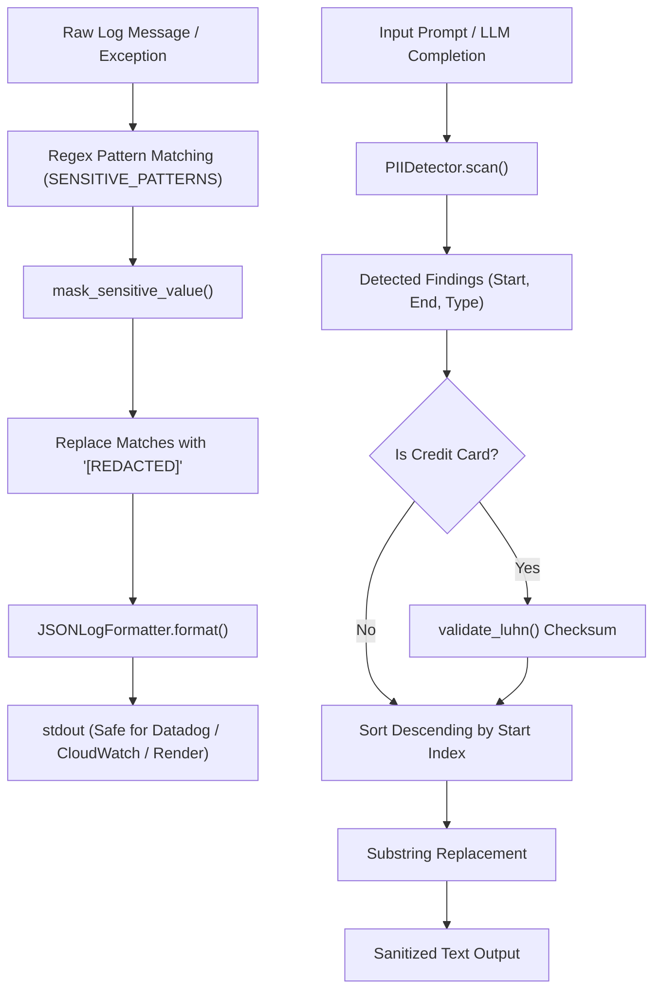
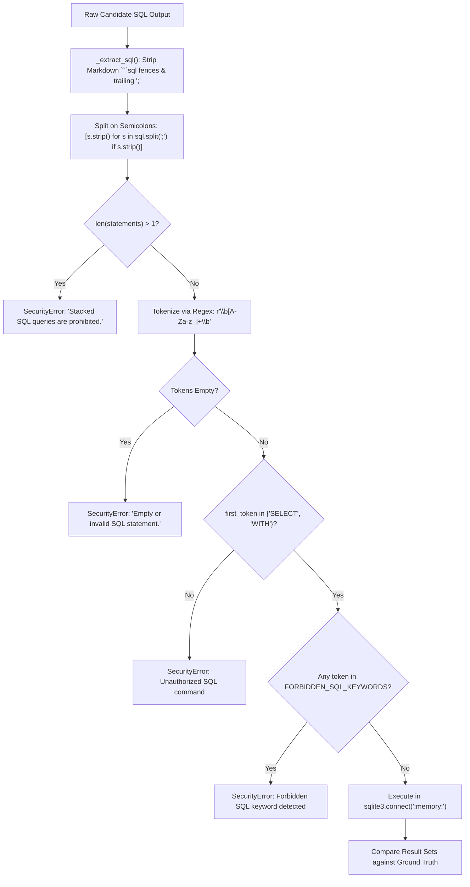
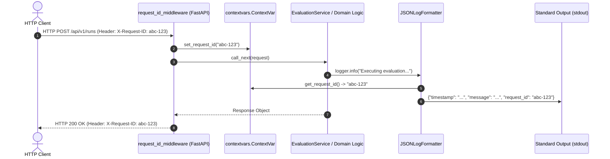

# PromptLab Architecture: Configuration, Security, and Safety Deep-Dive

This document provides a comprehensive technical audit of configuration management, credential masking, authentication architecture, sandbox security, asynchronous context tracking, and safety guardrails across the PromptLab codebase.

---

## 1. Configuration Audit (`config.py`)

PromptLab utilizes **Pydantic Settings 2.0** ([src/promptlab/config.py](file:///c:/Users/vedaa/OneDrive/Desktop/Master%20Folder/promptLab/src/promptlab/config.py)) to define strongly-typed, schema-validated runtime configuration.

```python
# src/promptlab/config.py:32-37
model_config = SettingsConfigDict(
    env_file=".env",
    env_file_encoding="utf-8",
    case_sensitive=False,
    extra="ignore",
)
```

Configuration resolution order follows standard Pydantic Settings semantics:
1. Explicit constructor arguments passed directly during instantiation.
2. System environment variables (case-insensitive).
3. Key-value pairs loaded from the local `.env` file (encoded in UTF-8).
4. Hardcoded field defaults defined in the `Settings` class.

### Complete Settings Inventory

The table below catalogs every runtime parameter, its type constraints, default values, and operational consumers across the repository:

| Setting Key | Python Type | Default Value | Validation Bounds | Code Citations & Where Consumed | Operational Role & Gaps |
| :--- | :--- | :--- | :--- | :--- | :--- |
| `groq_api_key` | `str \| None` | `None` | Optional string | [config.py:39-42](file:///c:/Users/vedaa/OneDrive/Desktop/Master%20Folder/promptLab/src/promptlab/config.py#L39-L42)<br>[groq_provider.py:52](file:///c:/Users/vedaa/OneDrive/Desktop/Master%20Folder/promptLab/src/promptlab/core/providers/groq_provider.py#L52) | Authenticates outbound inference against the Groq Cloud API. If omitted when `demo_mode=False`, raises `ProviderError`. |
| `default_model` | `str` | `"llama-3.3-70b-versatile"` | Non-empty string | [config.py:43-46](file:///c:/Users/vedaa/OneDrive/Desktop/Master%20Folder/promptLab/src/promptlab/config.py#L43-L46) | **Dead Setting**: Declared as the default model for runs and playground, but API schemas ([schemas.py:79](file:///c:/Users/vedaa/OneDrive/Desktop/Master%20Folder/promptLab/src/promptlab/api/schemas.py#L79)) require `model` explicitly. Never referenced by services or runners. |
| `max_concurrency` | `int` | `5` | `ge=1, le=50` | [config.py:47-52](file:///c:/Users/vedaa/OneDrive/Desktop/Master%20Folder/promptLab/src/promptlab/config.py#L47-L52)<br>[runner.py:134](file:///c:/Users/vedaa/OneDrive/Desktop/Master%20Folder/promptLab/src/promptlab/core/runner.py#L134)<br>[safety_service.py:58](file:///c:/Users/vedaa/OneDrive/Desktop/Master%20Folder/promptLab/src/promptlab/services/safety_service.py#L58) | Controls maximum parallel requests dispatched via `asyncio.Semaphore(max_concurrency)` during evaluation suite and prompt injection runs. |
| `database_url` | `str` | `"sqlite+aiosqlite:///./promptlab.db"` | Valid URI string | [config.py:53-56](file:///c:/Users/vedaa/OneDrive/Desktop/Master%20Folder/promptLab/src/promptlab/config.py#L53-L56)<br>[db/base.py:37](file:///c:/Users/vedaa/OneDrive/Desktop/Master%20Folder/promptLab/src/promptlab/db/base.py#L37) | Async connection string used by `create_async_engine()`. Points to a local SQLite database file in current working directory. |
| `log_level` | `Literal["DEBUG", "INFO", "WARNING", "ERROR", "CRITICAL"]` | `"INFO"` | Valid log level (auto-normalized to uppercase) | [config.py:57-60](file:///c:/Users/vedaa/OneDrive/Desktop/Master%20Folder/promptLab/src/promptlab/config.py#L57-L60)<br>[config.py:92-96](file:///c:/Users/vedaa/OneDrive/Desktop/Master%20Folder/promptLab/src/promptlab/config.py#L92-L96) | Parsed and validated via `@field_validator("log_level", mode="before")`. **Gap**: `create_app()` in `api/main.py` does not invoke `configure_logging(get_settings().log_level)` during server startup. |
| `judge_model` | `str` | `"llama-3.3-70b-versatile"` | Non-empty string | [config.py:61-64](file:///c:/Users/vedaa/OneDrive/Desktop/Master%20Folder/promptLab/src/promptlab/config.py#L61-L64)<br>[scorers/llm_judge.py:42](file:///c:/Users/vedaa/OneDrive/Desktop/Master%20Folder/promptLab/src/promptlab/core/scorers/llm_judge.py#L42) | Model identifier used as the fallback evaluator in `LLMJudge` when no model override is supplied in `TestCase.scorer_config`. |
| `api_key` | `str \| None` | `None` | Optional string | [config.py:65-68](file:///c:/Users/vedaa/OneDrive/Desktop/Master%20Folder/promptLab/src/promptlab/config.py#L65-L68) | **Unimplemented Auth Setting**: Documented as "Optional backend secret key for endpoint authentication", but no route or middleware in `src/promptlab/api/` enforces or inspects it. |
| `demo_mode` | `bool` | `False` | Boolean | [config.py:69-72](file:///c:/Users/vedaa/OneDrive/Desktop/Master%20Folder/promptLab/src/promptlab/config.py#L69-L72)<br>[api/routes/health.py:20](file:///c:/Users/vedaa/OneDrive/Desktop/Master%20Folder/promptLab/src/promptlab/api/routes/health.py#L20) | Toggles application into offline demonstration mode. Reported by `/api/v1/health` and allows playground evaluations without paid API credentials. |
| `max_prompt_length` | `int` | `10000` | `ge=100, le=100000` | [config.py:73-78](file:///c:/Users/vedaa/OneDrive/Desktop/Master%20Folder/promptLab/src/promptlab/config.py#L73-L78) | **Unwired Limit**: Intended to prevent prompt payload abuse, but never validated in `SuiteCreateRequest`, `TestCase`, or `EvaluationService`. |
| `max_cases_per_suite` | `int` | `100` | `ge=1, le=1000` | [config.py:79-84](file:///c:/Users/vedaa/OneDrive/Desktop/Master%20Folder/promptLab/src/promptlab/config.py#L79-L84) | **Unwired Limit**: Intended to limit test suite size for rate and memory safety, but `SuiteCreateRequest.cases` only enforces `min_length=1`. |
| `request_timeout_seconds` | `float` | `60.0` | `gt=0.0, le=300.0` | [config.py:85-90](file:///c:/Users/vedaa/OneDrive/Desktop/Master%20Folder/promptLab/src/promptlab/config.py#L85-L90) | **Unwired Limit**: `GroqProvider` hardcodes default parameter `timeout_seconds: float = 60.0` instead of reading `get_settings().request_timeout_seconds`. |

### Singleton Pattern via `lru_cache`

To avoid reloading environment variables and reading `.env` files from disk on every FastAPI dependency resolution, the configuration object is memoized using `functools.lru_cache`:

```python
# src/promptlab/config.py:99-106
@lru_cache(maxsize=1)
def get_settings() -> Settings:
    """Return a cached singleton instance of application settings."""
    return Settings()
```

When used as a FastAPI dependency (`settings: Settings = Depends(get_settings)`), the identical in-memory instance is reused across the entire application lifecycle, maintaining zero allocation overhead.

---

## 2. Secrets Management and Redaction

PromptLab enforces sensitive data redaction across two distinct layers:
1. **Infrastructure Logging Layer** ([src/promptlab/logging_config.py](file:///c:/Users/vedaa/OneDrive/Desktop/Master%20Folder/promptLab/src/promptlab/logging_config.py)): Automatically sanitizes API tokens and access keys before log records are emitted to standard output.
2. **Domain Guardrails Layer** ([src/promptlab/core/safety/pii_detector.py](file:///c:/Users/vedaa/OneDrive/Desktop/Master%20Folder/promptLab/src/promptlab/core/safety/pii_detector.py)): Scans user prompts and model completions for PII and secrets, replacing them with sanitized preview strings.



### Log Redaction Mechanics (`logging_config.py`)

Log messages pass through `mask_sensitive_value()`, which runs five compiled regular expressions:

```python
# src/promptlab/logging_config.py:20-26
SENSITIVE_PATTERNS: list[re.Pattern[str]] = [
    re.compile(r"(gsk_[A-Za-z0-9_]{16,})", re.IGNORECASE),
    re.compile(r"(sk-[A-Za-z0-9_-]{16,})", re.IGNORECASE),
    re.compile(r"(AKIA[0-9A-Z]{16})"),
    re.compile(r"(Bearer\s+)[A-Za-z0-9._\-]{16,}", re.IGNORECASE),
    re.compile(r"(api[_-]?key[\"'\s:=]+)([\w\-]{8,})", re.IGNORECASE),
]
```

- **Groq Keys (`gsk_...`)**: Matches Groq API keys starting with prefix `gsk_` followed by at least 16 alphanumeric characters.
- **OpenAI Keys (`sk-...`)**: Matches standard OpenAI secret keys starting with `sk-` followed by at least 16 characters.
- **AWS Access Keys (`AKIA...`)**: Matches 20-character AWS IAM access key IDs.
- **Bearer Tokens**: Matches authorization header values following `Bearer `.
- **Generic Key Assignments**: Catches parameters such as `api_key = "..."` or `apikey: xyz`.

When `JSONLogFormatter.format(record)` executes ([logging_config.py:57-60](file:///c:/Users/vedaa/OneDrive/Desktop/Master%20Folder/promptLab/src/promptlab/logging_config.py#L57-L60)), it invokes `mask_sensitive_value()` on `record.getMessage()`. As a result, credentials mistakenly printed or logged in stack traces are scrubbed before reaching log aggregators.

### PII & Secret Redaction in Guardrails (`pii_detector.py`)

`PIIDetector` expands secret detection into Personally Identifiable Information:
- **Email addresses**: `[A-Za-z0-9._%+-]+@[A-Za-z0-9.-]+\.[A-Z|a-z]{2,}` masked to `u***@example.com` via `_mask_email()`.
- **Phone numbers**: Indian format `(?:\+91[\-\s]?)?[6-9]\d{9}` and International E.164 formats masked to `+91-***-***42`.
- **IPv4 addresses**: Masked to keep the network prefix while redacting the host octets (`192.168.***.***`).
- **Credit Card Numbers with Luhn Algorithm**: Raw strings matching 13 to 19 digits are validated using `validate_luhn()` ([pii_detector.py:16-30](file:///c:/Users/vedaa/OneDrive/Desktop/Master%20Folder/promptLab/src/promptlab/core/safety/pii_detector.py#L16-L30)). If the Modulo-10 checksum fails, the number is disregarded as a false positive. Valid cards are masked to `****-****-****-1234`.

#### Non-Corrupting Substring Redaction Algorithm

When replacing multiple findings within a string, replacing from left-to-right shifts the character indices of all subsequent matches, causing truncation or corrupted replacements. `PIIDetector.redact()` resolves this by sorting all detected spans in descending order by their start index:

```python
# src/promptlab/core/safety/pii_detector.py:173-180
sorted_findings = sorted(findings, key=lambda f: int(f["start"]), reverse=True)
result = text
for finding in sorted_findings:
    start = int(finding["start"])
    end = int(finding["end"])
    snippet = str(finding["snippet"])
    result = result[:start] + snippet + result[end:]
return result
```

Replacing from the end of the string backward ensures that the character offsets of earlier findings remain strictly valid.

---

## 3. Authentication and Authorization Audit

### The Reality of `Settings.api_key`

In [src/promptlab/config.py:25](file:///c:/Users/vedaa/OneDrive/Desktop/Master%20Folder/promptLab/src/promptlab/config.py#L25) and [config.py:65-68](file:///c:/Users/vedaa/OneDrive/Desktop/Master%20Folder/promptLab/src/promptlab/config.py#L65-L68), the configuration schema specifies:
```python
api_key: str | None = Field(
    default=None,
    description="Optional backend secret key for endpoint authentication",
)
```

However, an exhaustive search across the API layer reveals:
- **Zero authentication dependencies exist**: No routes declare `Depends(verify_api_key)` or `Security(APIKeyHeader(...))`.
- **Zero authentication middleware exists**: `request_id_middleware` in [api/main.py:59-74](file:///c:/Users/vedaa/OneDrive/Desktop/Master%20Folder/promptLab/src/promptlab/api/main.py#L59-L74) only manages `X-Request-ID`.
- **All REST endpoints are completely unauthenticated**: Any external client with network access to the FastAPI server can create test suites, execute evaluations, initiate LLM provider calls, trigger prompt injection attacks, and query historical database records without supplying credentials.
- **No rate-limiting or tenant isolation**: There is no concept of API key tenants, usage quotas, or client identity.

### Production Remediation: Implementing `APIKeyHeader`

To enforce the intended `X-API-Key` authentication contract, the following dependency should be added to `api/dependencies.py` and applied globally or to sensitive routers:

```python
# Recommended Architecture Fix
from fastapi import HTTPException, Security, status
from fastapi.security import APIKeyHeader
from promptlab.config import get_settings

api_key_header = APIKeyHeader(name="X-API-Key", auto_error=False)


async def verify_api_key(
    header_key: str | None = Security(api_key_header),
) -> None:
    settings = get_settings()
    # If no server key configured, allow open development access
    if not settings.api_key:
        return
    if not header_key or header_key != settings.api_key:
        raise HTTPException(
            status_code=status.HTTP_401_UNAUTHORIZED,
            detail="Invalid or missing X-API-Key header.",
        )
```

---

## 4. Input Validation and Abuse Limits

PromptLab relies on Pydantic v2 schemas in [src/promptlab/api/schemas.py](file:///c:/Users/vedaa/OneDrive/Desktop/Master%20Folder/promptLab/src/promptlab/api/schemas.py) for request payload parsing:

- `SuiteCreateRequest`: Requires `name: str = Field(..., min_length=1)` and `cases: list[TestCase] = Field(..., min_length=1)`.
- `RunExecuteRequest`: Requires `model: str = Field(..., min_length=1)` and validates that either `suite_id` or an inline `suite` is present.
- `CompareRequest`: Requires `run_ids: list[str] = Field(..., min_length=2)`.
- `ScanTextRequest`: Requires `text: str = Field(..., min_length=1)`.
- `InjectionTestRequest`: Requires `model: str = Field(..., min_length=1)`.

### Architectural Gaps in Boundary Limits

While [config.py](file:///c:/Users/vedaa/OneDrive/Desktop/Master%20Folder/promptLab/src/promptlab/config.py) defines bounds for defense-in-depth, they are not currently wired into request ingestion:

1. **Unbounded Suite Size (`max_cases_per_suite` not enforced)**:
   - `Settings.max_cases_per_suite` defaults to `100` (`ge=1, le=1000`).
   - In `SuiteCreateRequest.cases`, there is **no `max_length` parameter**.
   - An attacker can submit a suite with 50,000 test cases. The server will accept the payload, serialize it to SQLite, and attempt to schedule 50,000 asynchronous evaluation tasks, leading to memory exhaustion or SQLite lock contention.

2. **Unbounded Text Payload (`max_prompt_length` not enforced)**:
   - `Settings.max_prompt_length` defaults to `10,000` (`ge=100, le=100,000`).
   - Neither `TestCase.prompt`, `SuiteCreateRequest.system_prompt`, nor `ScanTextRequest.text` enforce a maximum character length.
   - Sending a 50MB string to `/api/v1/safety/scan-text` will force multiple complex regular expressions in `PIIDetector` to execute over tens of megabytes of text on the main thread, resulting in CPU starvation.

---

## 5. SQL Scorer Sandbox Safety Deep-Dive (`_validate_sql_safety`)

The `SqlResult` scorer ([src/promptlab/core/scorers/sql_result.py](file:///c:/Users/vedaa/OneDrive/Desktop/Master%20Folder/promptLab/src/promptlab/core/scorers/sql_result.py)) implements a strict zero-trust sandbox to evaluate model-generated SQL without compromising host databases or servers.



### Complete Line-by-Line Code Analysis

```python
# src/promptlab/core/scorers/sql_result.py:57-89
def _validate_sql_safety(self, sql: str) -> None:
    # 1. Stacked Query Detection
    statements = [s.strip() for s in sql.split(";") if s.strip()]
    if len(statements) > 1:
        raise SecurityError(
            "Stacked SQL queries are prohibited.",
            details={"statements_count": len(statements)},
        )

    # 2. Token Extraction
    clean_sql = statements[0] if statements else sql
    tokens = re.findall(r"\b[A-Za-z_]+\b", clean_sql.upper())
    if not tokens:
        raise SecurityError("Empty or invalid SQL statement.")

    # 3. Permitted Command Whitelist
    first_token = tokens[0]
    if first_token not in {"SELECT", "WITH"}:
        raise SecurityError(
            f"Unauthorized SQL command '{first_token}'. Only SELECT queries are permitted.",
            details={"command": first_token},
        )

    # 4. Forbidden Keyword Blacklist
    for token in tokens:
        if token in FORBIDDEN_SQL_KEYWORDS:
            raise SecurityError(
                f"Forbidden SQL keyword '{token}' detected.",
                details={"forbidden_token": token},
            )
```

### Complete Forbidden Keyword Catalog

The constant `FORBIDDEN_SQL_KEYWORDS` ([sql_result.py:19-36](file:///c:/Users/vedaa/OneDrive/Desktop/Master%20Folder/promptLab/src/promptlab/core/scorers/sql_result.py#L19-L36)) blocks 16 destructive or administrative SQL operations:

| Keyword | Threat Category | Attack Vector Blocked |
| :--- | :--- | :--- |
| `INSERT` | State Mutation | Modifying table data within the test database. |
| `UPDATE` | State Mutation | Altering pre-seeded test records. |
| `DELETE` | State Mutation | Purging records to corrupt subsequent query assertions. |
| `DROP` | Schema Destruction | Deleting entire tables or indexes (`DROP TABLE users`). |
| `ALTER` | Schema Mutation | Modifying table structures or constraints. |
| `CREATE` | Schema Mutation | Creating unauthorized tables or triggers. |
| `REPLACE` | State Mutation | Overwriting records via SQLite's `INSERT OR REPLACE`. |
| `TRUNCATE` | State Mutation | High-speed data clearing (non-standard SQLite keyword, blocked proactively). |
| `ATTACH` | Sandbox Breakout | Attaching external host filesystem database files (`ATTACH DATABASE '/etc/passwd' AS shadow`). |
| `DETACH` | Sandbox Manipulation | Disconnecting attached database namespaces. |
| `PRAGMA` | System Inspection / Abuse | Interacting with SQLite internal flags, foreign keys, or dumping database memory. |
| `VACUUM` | Filesystem Manipulation | Rewriting database files or abusing filesystem buffers. |
| `REINDEX` | Engine Manipulation | Rebuilding collation indexes. |
| `TRANSACTION` | State Isolation Abuse | Opening persistent lock transactions. |
| `COMMIT` | Transaction Manipulation | Forcing dirty commits to disk. |
| `ROLLBACK` | Transaction Manipulation | Reverting transaction state. |

### Sandbox Isolation

In addition to static AST/token validation, execution safety is enforced by database isolation:
```python
# src/promptlab/core/scorers/sql_result.py:90-97
def _init_in_memory_db(self) -> sqlite3.Connection:
    conn = sqlite3.connect(":memory:")
    schema_path = Path(self._sample_db_sql_path)
    if schema_path.exists():
        schema_sql = schema_path.read_text(encoding="utf-8")
        conn.executescript(schema_sql)
    return conn
```
Every candidate evaluation instantiates a brand new, completely isolated `:memory:` database instance initialized with `sample.db.sql`. The connection is closed and discarded immediately after comparing rows in `finally: conn.close()`. Even if a query were to alter data, mutations would vanish upon connection termination.

### Vulnerabilities, Edge Cases, and Bypass Vectors

1. **False Positive on String Literals with Semicolons**:
   - The check `sql.split(";")` is a naive character split without SQL lexing.
   - A valid query like:
     ```sql
     SELECT * FROM logs WHERE message = 'error; retry count exceeded'
     ```
     is incorrectly split into two statements, raising `SecurityError("Stacked SQL queries are prohibited.")`.
2. **Denial of Service via Recursive CTEs (CPU Starvation)**:
   - SQLite supports `WITH RECURSIVE`.
   - The query:
     ```sql
     WITH RECURSIVE spin(x) AS (SELECT 1 UNION ALL SELECT x+1 FROM spin)
     SELECT count(*) FROM spin;
     ```
     starts with `WITH`, contains none of the 16 forbidden keywords, and is a single statement.
   - However, it executes an infinite loop inside `cursor.execute()`. Because execution is synchronous on the main event loop thread without a `sqlite3.set_progress_handler` timeout, this completely hangs the worker process.
3. **SQLite Metadata Disclosure**:
   - Queries can inspect SQLite schema tables:
     ```sql
     SELECT sql FROM sqlite_master;
     ```
     `sqlite_master` and `sqlite_schema` are not forbidden keywords. While acceptable for an in-memory sample database, it leaks structural metadata.

---

## 6. Request ID Tracing and Asynchronous Context Logging

PromptLab implements distributed correlation tracking using Python's standard `contextvars.ContextVar` ([src/promptlab/logging_config.py:17](file:///c:/Users/vedaa/OneDrive/Desktop/Master%20Folder/promptLab/src/promptlab/logging_config.py#L17)):

```python
request_id_ctx: ContextVar[str] = ContextVar("request_id", default="")
```

### End-to-End Tracing Flow



### Step-by-Step Execution Mechanics

1. **Header Ingestion and Fallback Generation** ([api/main.py:64-66](file:///c:/Users/vedaa/OneDrive/Desktop/Master%20Folder/promptLab/src/promptlab/api/main.py#L64-L66)):
   ```python
   header_req_id = request.headers.get("X-Request-ID")
   active_req_id = header_req_id if header_req_id else str(uuid.uuid4())
   set_request_id(active_req_id)
   ```
   If the upstream client or reverse proxy supplies `X-Request-ID`, it is preserved; otherwise, a fresh UUIDv4 string is minted.

2. **Asynchronous Context Binding**:
   `set_request_id()` writes the ID to `request_id_ctx`. Because `ContextVar` is natively aware of Python `asyncio` tasks, child tasks scheduled in the same context inherit the variable, while concurrent requests on separate coroutines remain isolated.

3. **Log Injection and Redaction** ([logging_config.py:71-75](file:///c:/Users/vedaa/OneDrive/Desktop/Master%20Folder/promptLab/src/promptlab/logging_config.py#L71-L75)):
   When any logger emits a record, `JSONLogFormatter.format()` checks `get_request_id()`. If present, `"request_id": active_req_id` is automatically attached to the JSON output dictionary alongside the masked log message.

4. **Structured Error Correlation**:
   If an exception occurs during request execution, all three exception handlers in `api/main.py` ([lines 77-129](file:///c:/Users/vedaa/OneDrive/Desktop/Master%20Folder/promptLab/src/promptlab/api/main.py#L77-L129)) inject `active_id = get_request_id()` directly into:
   - The JSON error body (`"request_id": active_id`).
   - The HTTP response headers (`headers={"X-Request-ID": active_id}`).

5. **Response Header Propagation** ([api/main.py:73](file:///c:/Users/vedaa/OneDrive/Desktop/Master%20Folder/promptLab/src/promptlab/api/main.py#L73)):
   The active request ID is stamped onto the outgoing HTTP response header `X-Request-ID`, enabling end-to-end tracing across distributed microservices.

---

## 7. Threat Model and Risk Matrix

The threat model below evaluates PromptLab's security posture against common LLM platform vulnerabilities, identifying where each threat is addressed in code and highlighting residual risk:

| Threat / Attack Vector | Severity | Where Mitigated in Code | Mitigation Mechanism | Residual Risk / Architecture Action |
| :--- | :--- | :--- | :--- | :--- |
| **API Secret / Credential Leakage in Logs** | High | [logging_config.py:39-51](file:///c:/Users/vedaa/OneDrive/Desktop/Master%20Folder/promptLab/src/promptlab/logging_config.py#L39-L51) | `mask_sensitive_value()` applies regex masks to all log strings. | Only matches known key formats (`gsk_`, `sk-`, `AKIA`). Custom keys or non-standard tokens may evade detection. |
| **PII & Credit Card Leakage in LLM Outputs** | High | [pii_detector.py:78-164](file:///c:/Users/vedaa/OneDrive/Desktop/Master%20Folder/promptLab/src/promptlab/core/safety/pii_detector.py#L78-L164)<br>[guardrail.py:51-67](file:///c:/Users/vedaa/OneDrive/Desktop/Master%20Folder/promptLab/src/promptlab/core/safety/guardrail.py#L51-L67) | Modulo-10 Luhn validation for cards, regex matching for emails, phones, IPs. Substrings redacted in descending offset order. | Guardrails are opt-in via `/api/v1/safety/scan-text` and are not automatically invoked inline during evaluation runs. |
| **Adversarial Prompt Injection & Jailbreaking** | High | [injection_suite.py:47-63](file:///c:/Users/vedaa/OneDrive/Desktop/Master%20Folder/promptLab/src/promptlab/core/safety/injection_suite.py#L47-L63) | Canary token matching and success indicator audits across 5 attack categories. | Injection suite is an evaluation benchmark, not a real-time runtime firewall. |
| **Text-to-SQL Sandbox Breakout / Host Compromise** | Critical | [sql_result.py:57-89](file:///c:/Users/vedaa/OneDrive/Desktop/Master%20Folder/promptLab/src/promptlab/core/scorers/sql_result.py#L57-L89)<br>[sql_result.py:90-97](file:///c:/Users/vedaa/OneDrive/Desktop/Master%20Folder/promptLab/src/promptlab/core/scorers/sql_result.py#L90-L97) | Zero-trust token check, 16 forbidden keywords blocked, stacked query ban, ephemeral `:memory:` SQLite DB. | Recursive CTE queries (`WITH RECURSIVE`) can trigger an infinite loop, freezing the server thread due to missing execution timeouts. |
| **Unauthenticated API Access / Resource Theft** | Critical | [config.py:65](file:///c:/Users/vedaa/OneDrive/Desktop/Master%20Folder/promptLab/src/promptlab/config.py#L65) (Config only) | Intended via `Settings.api_key`. | **Unmitigated**: No route or middleware checks `api_key`. The API is completely public. Needs `verify_api_key` dependency. |
| **Denial of Service via Massive Suite Payloads** | High | [config.py:79](file:///c:/Users/vedaa/OneDrive/Desktop/Master%20Folder/promptLab/src/promptlab/config.py#L79) (Config only) | Intended via `Settings.max_cases_per_suite`. | **Unmitigated**: `SuiteCreateRequest.cases` only validates `min_length=1`. An attacker can submit 50,000 cases, crashing the worker. |
| **CPU Starvation via Massive Prompt Payloads** | Medium | [config.py:73](file:///c:/Users/vedaa/OneDrive/Desktop/Master%20Folder/promptLab/src/promptlab/config.py#L73) (Config only) | Intended via `Settings.max_prompt_length`. | **Unmitigated**: Schemas do not enforce `max_length`. Submitting megabyte-sized strings can cause ReDoS in `PIIDetector`. |
| **Distributed Trace Disconnection / Uncorrelated Logs** | Low | [api/main.py:59-74](file:///c:/Users/vedaa/OneDrive/Desktop/Master%20Folder/promptLab/src/promptlab/api/main.py#L59-L74)<br>[logging_config.py:17](file:///c:/Users/vedaa/OneDrive/Desktop/Master%20Folder/promptLab/src/promptlab/logging_config.py#L17) | `request_id_middleware` extracts or mints UUIDv4 and binds to `ContextVar`. | If asynchronous background tasks are scheduled outside the request context without copying context, the request ID defaults to empty. |
