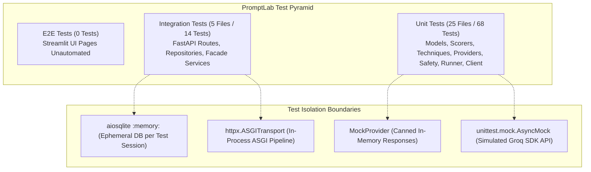
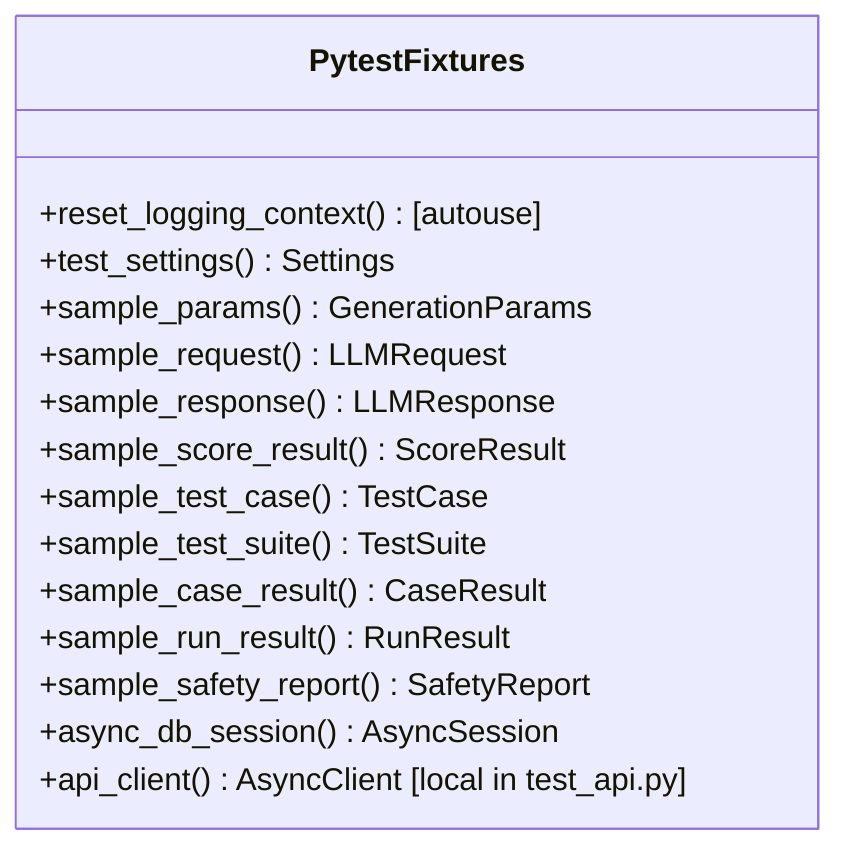
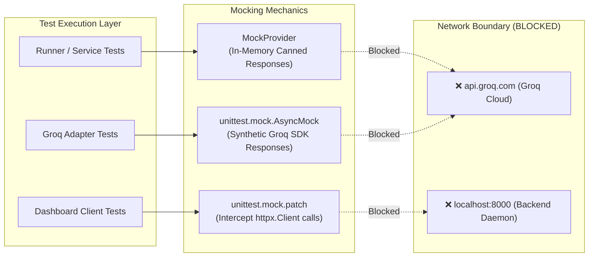

# PromptLab Architecture: Testing Strategy, Test Map, Fixtures, and Coverage Gaps

This document provides a complete technical map of PromptLab's test architecture, detailing test philosophies, an exhaustive directory inventory, fixture lifecycles, mocking strategies, uncovered code paths, and test execution procedures.

---

## 1. Testing Philosophy and Architecture Overview

PromptLab enforces a strict, deterministic test suite designed to run in continuous integration without network access or cloud API spend.



### Core Architecture Principles

1. **Zero External Network Dependencies**: All LLM interactions are isolated via `MockProvider` or mocked Groq SDK clients (`AsyncMock`). Running `pytest` requires no internet connection and consumes zero Groq API credits.
2. **Ephemeral In-Memory Persistence**: Integration tests instantiate an isolated SQLite database using `sqlite+aiosqlite:///:memory:`. Tables are minted before tests and flushed during engine disposal, preventing disk pollution or cross-test data leaks.
3. **Strict Coverage Enforcement**: Configured in [pyproject.toml:81-94](file:///c:/Users/vedaa/OneDrive/Desktop/Master%20Folder/promptLab/pyproject.toml#L81-L94), the suite mandates **85% minimum branch coverage** (`fail_under = 85`, `branch = true`). If code coverage drops below 85%, the CI workflow fails immediately.
4. **Synchronous and Asynchronous Compatibility**: Uses `pytest-asyncio` with `asyncio_mode = "auto"`. Test functions declared with `async def` run natively on asyncio event loops.

---

## 2. Exhaustive Test Inventory Map

The codebase contains **30 test files** (25 unit test files and 5 integration test files) organized under `tests/`:

| Test File Path | Target Class / Module | Test Type | Key Scenarios & Core Assertions |
| :--- | :--- | :--- | :--- |
| [tests/unit/test_config.py](file:///c:/Users/vedaa/OneDrive/Desktop/Master%20Folder/promptLab/tests/unit/test_config.py) | `Settings`, `get_settings()` | Unit | Default values audit, `.env` parameter overrides, `log_level` uppercase normalization, boundary validation (`max_concurrency`, `max_prompt_length`, `request_timeout_seconds`), and `lru_cache` singleton identity. |
| [tests/unit/test_models.py](file:///c:/Users/vedaa/OneDrive/Desktop/Master%20Folder/promptLab/tests/unit/test_models.py) | `core.models.*` | Unit | Validation boundaries for `GenerationParams` (`temperature`, `top_p`, `max_tokens`), immutability of frozen params, non-empty string checks in `LLMRequest`, non-negative latency in `LLMResponse`, Score clamping (`0.0 <= score <= 1.0`), and UUIDv4 generation in `RunResult`. |
| [tests/unit/test_exceptions.py](file:///c:/Users/vedaa/OneDrive/Desktop/Master%20Folder/promptLab/tests/unit/test_exceptions.py) | `promptlab.exceptions.*` | Unit | Status code and error code mapping across 9 custom domain exceptions (`ResourceNotFoundError` $\to$ 404, `SecurityError` $\to$ 403, `RateLimitError` $\to$ 429, etc.), serialization to dictionary, and inheritance from base `PromptLabError`. |
| [tests/unit/test_logging.py](file:///c:/Users/vedaa/OneDrive/Desktop/Master%20Folder/promptLab/tests/unit/test_logging.py) | `logging_config.*` | Unit | `ContextVar` request ID binding and retrieval across async context, credential masking (`gsk_`, `sk-`, `AKIA`), `JSONLogFormatter` payload schema, and root logger configuration. |
| [tests/unit/test_runner.py](file:///c:/Users/vedaa/OneDrive/Desktop/Master%20Folder/promptLab/tests/unit/test_runner.py) | `TestRunner` | Unit | Basic suite execution and metrics aggregation, per-case fault tolerance (one invalid scorer doesn't abort run), suite prompt technique application, and multi-model matrix sweep (`run_matrix`). |
| [tests/unit/test_dashboard_client.py](file:///c:/Users/vedaa/OneDrive/Desktop/Master%20Folder/promptLab/tests/unit/test_dashboard_client.py) | `PromptLabClient` | Unit | Base URL trimming, connection failure fallback to unreachable status, mock model fallback when backend down, suite creation HTTP POST, and HTTP error translation to `APIClientError`. |
| [tests/unit/test_providers/test_mock_provider.py](file:///c:/Users/vedaa/OneDrive/Desktop/Master%20Folder/promptLab/tests/unit/test_providers/test_mock_provider.py) | `MockProvider` | Unit | Deterministic generation, canned response substring matching, simulated latency delay, token count estimation, and model catalog listing. |
| [tests/unit/test_providers/test_groq_provider.py](file:///c:/Users/vedaa/OneDrive/Desktop/Master%20Folder/promptLab/tests/unit/test_providers/test_groq_provider.py) | `GroqProvider` | Unit | Missing API key raises `ConfigurationError`, successful completion parsing and token usage mapping, retry on transient HTTP 429 rate limits, failure when retries exhausted, non-transient 400 Bad Request fail-fast behavior, and model listing. |
| [tests/unit/test_providers/test_provider_factory.py](file:///c:/Users/vedaa/OneDrive/Desktop/Master%20Folder/promptLab/tests/unit/test_providers/test_provider_factory.py) | `ProviderFactory` | Unit | Provider lookup (`groq`, `mock`), case-insensitive identifier resolution, registration decorator (`@register`), and `ProviderNotFoundError` on unknown provider keys. |
| [tests/unit/test_safety/test_guardrail.py](file:///c:/Users/vedaa/OneDrive/Desktop/Master%20Folder/promptLab/tests/unit/test_safety/test_guardrail.py) | `Guardrail` | Unit | Risk level classification (`low`, `medium`, `high`), pass/fail criteria (high risk fails), and `filter_text()` returning sanitized payload and report. |
| [tests/unit/test_safety/test_injection_suite.py](file:///c:/Users/vedaa/OneDrive/Desktop/Master%20Folder/promptLab/tests/unit/test_safety/test_injection_suite.py) | `InjectionSuite` | Unit | Loading JSON attack dataset (5 categories, $\ge 15$ vectors), canary leakage detection, success indicator trigger detection, safe model refusal detection, and end-to-end execution with `MockProvider`. |
| [tests/unit/test_safety/test_pii_detector.py](file:///c:/Users/vedaa/OneDrive/Desktop/Master%20Folder/promptLab/tests/unit/test_safety/test_pii_detector.py) | `PIIDetector` | Unit | Modulo-10 Luhn checksum validation for valid/invalid credit cards, detection of emails, Indian/international phones, IPv4 addresses, and Groq/OpenAI/AWS keys. Non-corrupting reverse-offset substring redaction. |
| [tests/unit/test_scorers/test_exact_match.py](file:///c:/Users/vedaa/OneDrive/Desktop/Master%20Folder/promptLab/tests/unit/test_scorers/test_exact_match.py) | `ExactMatch` | Unit | Strict string equality, case sensitivity toggle, whitespace trimming, and missing expected value handling. |
| [tests/unit/test_scorers/test_contains.py](file:///c:/Users/vedaa/OneDrive/Desktop/Master%20Folder/promptLab/tests/unit/test_scorers/test_contains.py) | `Contains` | Unit | Substring inclusion, case-insensitive match, and multiple comma-separated substring handling. |
| [tests/unit/test_scorers/test_regex_match.py](file:///c:/Users/vedaa/OneDrive/Desktop/Master%20Folder/promptLab/tests/unit/test_scorers/test_regex_match.py) | `RegexMatch` | Unit | Regular expression pattern matching, invalid regex error handling, and case sensitivity flags. |
| [tests/unit/test_scorers/test_json_valid.py](file:///c:/Users/vedaa/OneDrive/Desktop/Master%20Folder/promptLab/tests/unit/test_scorers/test_json_valid.py) | `JsonValid` | Unit | Clean JSON string validation, markdown ````json``` code fence stripping, and malformed syntax rejection. |
| [tests/unit/test_scorers/test_json_schema.py](file:///c:/Users/vedaa/OneDrive/Desktop/Master%20Folder/promptLab/tests/unit/test_scorers/test_json_schema.py) | `JsonSchema` | Unit | Structural schema validation against JSON Schema drafts, missing property detection, and type violation handling. |
| [tests/unit/test_scorers/test_sql_result.py](file:///c:/Users/vedaa/OneDrive/Desktop/Master%20Folder/promptLab/tests/unit/test_scorers/test_sql_result.py) | `SqlResult` | Unit | Valid SELECT query execution against sandboxed `:memory:` SQLite DB, row comparison against ground truth, blocking `DROP TABLE`, blocking `DELETE`, blocking `INSERT`, blocking `PRAGMA`, and blocking stacked semicolon queries. |
| [tests/unit/test_scorers/test_llm_judge.py](file:///c:/Users/vedaa/OneDrive/Desktop/Master%20Folder/promptLab/tests/unit/test_scorers/test_llm_judge.py) | `LLMJudge` | Unit | Async evaluation parsing JSON grade (`score` and `reason`), pass threshold at 0.7, malformed JSON fallback, and synchronous `score()` method warning. |
| [tests/unit/test_scorers/test_scorer_registry.py](file:///c:/Users/vedaa/OneDrive/Desktop/Master%20Folder/promptLab/tests/unit/test_scorers/test_scorer_registry.py) | `ScorerRegistry` | Unit | Retrieval of all 7 built-in scorers, case-insensitive lookup, custom scorer registration, and `ScorerNotFoundError` on unregistered keys. |
| [tests/unit/test_techniques/test_zero_shot.py](file:///c:/Users/vedaa/OneDrive/Desktop/Master%20Folder/promptLab/tests/unit/test_techniques/test_zero_shot.py) | `ZeroShotTechnique` | Unit | Identity prompt formatting (returns prompt unmodified). |
| [tests/unit/test_techniques/test_few_shot.py](file:///c:/Users/vedaa/OneDrive/Desktop/Master%20Folder/promptLab/tests/unit/test_techniques/test_few_shot.py) | `FewShotTechnique` | Unit | Prepends formatted input-output demonstration pairs to prompt payload. |
| [tests/unit/test_techniques/test_chain_of_thought.py](file:///c:/Users/vedaa/OneDrive/Desktop/Master%20Folder/promptLab/tests/unit/test_techniques/test_chain_of_thought.py) | `ChainOfThoughtTechnique` | Unit | Appends step-by-step reasoning cue (`"Let's think step by step:"`) or custom instruction. |
| [tests/unit/test_techniques/test_structured_output.py](file:///c:/Users/vedaa/OneDrive/Desktop/Master%20Folder/promptLab/tests/unit/test_techniques/test_structured_output.py) | `StructuredOutputTechnique` | Unit | Appends strict JSON schema formatting instructions to prompt payload. |
| [tests/unit/test_techniques/test_technique_registry.py](file:///c:/Users/vedaa/OneDrive/Desktop/Master%20Folder/promptLab/tests/unit/test_techniques/test_technique_registry.py) | `TechniqueRegistry` | Unit | Retrieval of all 4 prompt techniques, case-insensitive name resolution, and registration of custom technique classes. |
| [tests/integration/test_db_repositories.py](file:///c:/Users/vedaa/OneDrive/Desktop/Master%20Folder/promptLab/tests/integration/test_db_repositories.py) | `SuiteRepository`, `RunRepository`, `SafetyRepository` | Integration | Full CRUD lifecycle for test suites, eager loading of child `CaseResultRecord` items in `RunRepository.get_by_id`, filtering runs by model/suite, and JSON serialization of safety audit reports. |
| [tests/integration/test_evaluation_service.py](file:///c:/Users/vedaa/OneDrive/Desktop/Master%20Folder/promptLab/tests/integration/test_evaluation_service.py) | `EvaluationService` | Integration | End-to-end evaluation orchestration: suite creation, execution against `MockProvider`, metrics calculation, and database persistence. Multi-model matrix runs and `ResourceNotFoundError` handling. |
| [tests/integration/test_comparison_service.py](file:///c:/Users/vedaa/OneDrive/Desktop/Master%20Folder/promptLab/tests/integration/test_comparison_service.py) | `ComparisonService` | Integration | Fetching multiple runs, generating side-by-side per-case matrix, identifying highest pass rate (`best_performing_model`) and lowest latency (`fastest_model`), and validation on run count $< 2$. |
| [tests/integration/test_safety_service.py](file:///c:/Users/vedaa/OneDrive/Desktop/Master%20Folder/promptLab/tests/integration/test_safety_service.py) | `SafetyService` | Integration | Executing prompt injection audits against `MockProvider`, persisting reports in database, text scanning for PII, and `ResourceNotFoundError` handling. |
| [tests/integration/test_api.py](file:///c:/Users/vedaa/OneDrive/Desktop/Master%20Folder/promptLab/tests/integration/test_api.py) | FastAPI REST API (`main.create_app`) | Integration | Testing all HTTP routes via `httpx.AsyncClient`: `/health`, `/api/v1/models`, test suite CRUD, run execution and comparison, safety injection and scanning, `X-Request-ID` propagation, and 422 validation error payloads. |

---

## 3. Fixtures Audit (`conftest.py` & Local Fixtures)

PromptLab centralizes shared test state in [tests/conftest.py](file:///c:/Users/vedaa/OneDrive/Desktop/Master%20Folder/promptLab/tests/conftest.py). The catalog below details each fixture's scope, constructed entity, and teardown mechanics:



### Detailed Fixtures Inventory

| Fixture Name | Declared Scope | Return Type | Construction Mechanics | Teardown Behavior |
| :--- | :--- | :--- | :--- | :--- |
| `reset_logging_context` | Function (`autouse=True`) | `Generator[None, None, None]` | Invokes `set_request_id("")` to clear any residual async context before each test runs. | Invokes `set_request_id("")` again after the test yields, ensuring zero context leakage across tests. |
| `test_settings` | Function | `Settings` | Constructs non-production `Settings(demo_mode=True, max_concurrency=2, database_url="sqlite+aiosqlite:///:memory:", log_level="DEBUG")`. | None (garbage collected). |
| `sample_params` | Function | `GenerationParams` | Instantiates immutable `GenerationParams(temperature=0.2, top_p=0.9, max_tokens=256, seed=42)`. | None (frozen object). |
| `sample_request` | Function | `LLMRequest` | Instantiates `LLMRequest` using `sample_params`, targeting `"llama-3.3-70b-versatile"`. | None. |
| `sample_response` | Function | `LLMResponse` | Instantiates `LLMResponse(text="...", latency_ms=145.2, prompt_tokens=25, completion_tokens=18)`. | None. |
| `sample_score_result` | Function | `ScoreResult` | Instantiates `ScoreResult(score=1.0, passed=True, reason="...")`. | None. |
| `sample_test_case` | Function | `TestCase` | Constructs `TestCase(id="tc-001", input="What is 2 + 2?", expected="4", scorer="exact_match")`. | None. |
| `sample_test_suite` | Function | `TestSuite` | Constructs `TestSuite(name="arithmetic_suite", cases=[sample_test_case])`. | None. |
| `sample_case_result` | Function | `CaseResult` | Wraps `sample_response` in `CaseResult(case_id="tc-001", score=1.0, passed=True)`. | None. |
| `sample_run_result` | Function | `RunResult` | Constructs complete `RunResult(run_id="run-test-uuid-1234", case_results=[sample_case_result], pass_rate=1.0)`. | None. |
| `sample_safety_report`| Function | `SafetyReport` | Instantiates benign `SafetyReport(risk_level="low", passed=True)`. | None. |
| `async_db_session` | Function | `AsyncGenerator[AsyncSession, None]` | Creates an in-memory async engine `sqlite+aiosqlite:///:memory:`, runs `Base.metadata.create_all`, and opens `AsyncSession`. | Closes the session and invokes `await engine.dispose()` to terminate the in-memory SQLite database cleanly. |
| `api_client` *(Local to `test_api.py`)* | Function | `AsyncGenerator[AsyncClient, None]` | Instantiates `create_app()`, applies `app.dependency_overrides` for `get_db` and `get_settings`, and mounts via `httpx.ASGITransport`. | Clears `app.dependency_overrides.clear()` upon exit. |

---

## 4. Mocking Strategy and External Call Boundary

PromptLab enforces a zero-cost, zero-network test suite using three complementary mocking patterns:



### 1. In-Memory Mock Provider (`MockProvider`)
- **Where Used**: `test_runner.py`, `test_injection_suite.py`, `test_evaluation_service.py`, `test_safety_service.py`, `test_api.py`.
- **Mechanics**: Implements the `LLMProvider` abstract protocol. Tests pre-program canned outputs using `mock_provider.set_canned_response("2+2", "4")`. If an incoming prompt contains `"2+2"`, the mock returns `"4"` instantly with configurable simulated latency (`simulated_latency_ms=0.0`).
- **Why It Matters**: Evaluates test runners, scoring pipelines, and prompt injection suites without relying on network latency or external API availability.

### 2. Async SDK Mocks (`unittest.mock.AsyncMock`)
- **Where Used**: `tests/unit/test_providers/test_groq_provider.py`.
- **Mechanics**: Synthetic completions are constructed via helper `create_fake_completion()`, attaching mock choices, tokens, and finish reasons.
- **Simulating Transient Network Failures**:
  ```python
  # Simulating 429 RateLimitError followed by HTTP 200 recovery
  mock_client.chat.completions.create = AsyncMock(side_effect=[rate_limit_err, success_completion])
  ```
  This proves that `GroqProvider`'s exponential backoff retry loop executes and recovers without ever pinging Groq's servers.

### 3. HTTP Client Interception (`unittest.mock.patch`)
- **Where Used**: `tests/unit/test_dashboard_client.py`.
- **Mechanics**: Uses `patch.object(client._client, "get", side_effect=httpx.ConnectError(...))` to test frontend client resilience when the backend server is completely offline.

---

## 5. Test Coverage Gaps and Uncovered Code

While PromptLab maintains $> 85\%$ test coverage across its core domain and API layers, an honest audit reveals several key coverage gaps:

### 1. Streamlit Dashboard UI Pages Have Zero Automated Tests
- **Uncovered Files**:
  - [src/promptlab/dashboard/app.py](file:///c:/Users/vedaa/OneDrive/Desktop/Master%20Folder/promptLab/src/promptlab/dashboard/app.py)
  - [src/promptlab/dashboard/pages/1_Playground.py](file:///c:/Users/vedaa/OneDrive/Desktop/Master%20Folder/promptLab/src/promptlab/dashboard/pages/1_Playground.py)
  - [src/promptlab/dashboard/pages/2_Evaluations.py](file:///c:/Users/vedaa/OneDrive/Desktop/Master%20Folder/promptLab/src/promptlab/dashboard/pages/2_Evaluations.py)
  - [src/promptlab/dashboard/pages/3_Comparisons.py](file:///c:/Users/vedaa/OneDrive/Desktop/Master%20Folder/promptLab/src/promptlab/dashboard/pages/3_Comparisons.py)
  - [src/promptlab/dashboard/pages/4_Guardrails.py](file:///c:/Users/vedaa/OneDrive/Desktop/Master%20Folder/promptLab/src/promptlab/dashboard/pages/4_Guardrails.py)
  - [src/promptlab/dashboard/pages/5_History.py](file:///c:/Users/vedaa/OneDrive/Desktop/Master%20Folder/promptLab/src/promptlab/dashboard/pages/5_History.py)
- **Impact**: While `test_dashboard_client.py` tests the HTTP client wrapper, none of the interactive UI layouts, forms, buttons, session state transitions, or Plotly chart renders are tested. Streamlit's official testing framework (`streamlit.testing.v1.AppTest`) is not utilized.

### 2. Lifespan Startup Migration Bypassed in API Tests
- In [src/promptlab/api/main.py:30-37](file:///c:/Users/vedaa/OneDrive/Desktop/Master%20Folder/promptLab/src/promptlab/api/main.py#L30-L37), `lifespan` invokes `await init_db()`.
- In `test_api.py`, the app is mounted using `ASGITransport(app=app)`. In `httpx`, `ASGITransport` does **not** trigger ASGI lifespan events by default. As a result, the production database startup migration path is never exercised during API integration tests (the test fixture manually creates tables via `Base.metadata.create_all`).

### 3. Real Groq SDK Live Integration Tests Omitted
- No live integration tests verify compatibility with live Groq endpoints (`llama-3.3-70b-versatile`).
- If Groq alters its JSON payload structure, deprecates a model ID, or updates its SDK headers, the mock test suite will still pass while production breaks.

### 4. SQLite Concurrency Stress Testing
- No test runs concurrent writes against a single physical SQLite database file to measure lock contention (`OperationalError: database is locked`). Tests only execute sequentially against `:memory:`.

### 5. SQL Scorer Infinite Loop / Timeout Gaps
- `SqlResult` lacks tests evaluating recursive queries (`WITH RECURSIVE`) or query cancellation timeouts. If a query deadlocks or loops infinitely, no test catches it.

---

## 6. How to Run Tests: Command Guide

The test suite can be run via `make` or directly using `pytest`.

### 1. Run the Entire Test Suite with Coverage
```bash
# Via Makefile
make test

# Direct command (with terminal missing lines report)
pytest --cov=promptlab --cov-report=term-missing
```

### 2. Run Only Unit Tests
```bash
pytest tests/unit
```

### 3. Run Only Integration Tests
```bash
pytest tests/integration
```

### 4. Run a Specific Test File
```bash
pytest tests/unit/test_runner.py
```

### 5. Run a Specific Test Function
```bash
pytest tests/unit/test_runner.py::test_runner_fault_tolerance_per_case -v
```

### 6. Generate an HTML Coverage Report
```bash
pytest --cov=promptlab --cov-report=html
# View report in browser:
# open htmlcov/index.html (macOS) or start htmlcov/index.html (Windows)
```

### 7. Run Linters and Type Checkers
```bash
# Run Ruff lint checks
ruff check src tests

# Run Ruff formatting check
ruff format --check src tests

# Run Mypy strict type checking
mypy src tests
```
