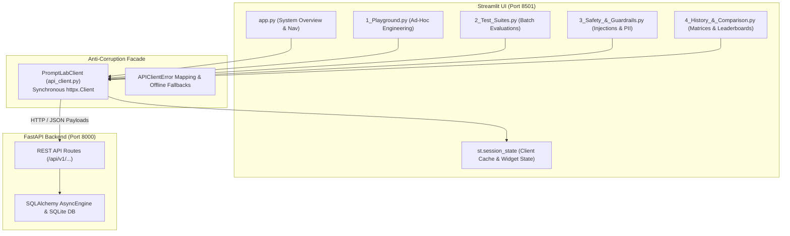
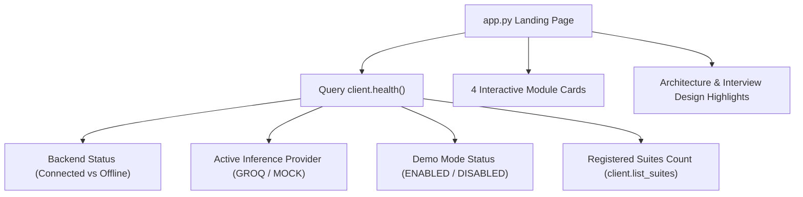
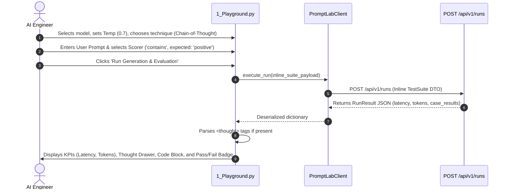
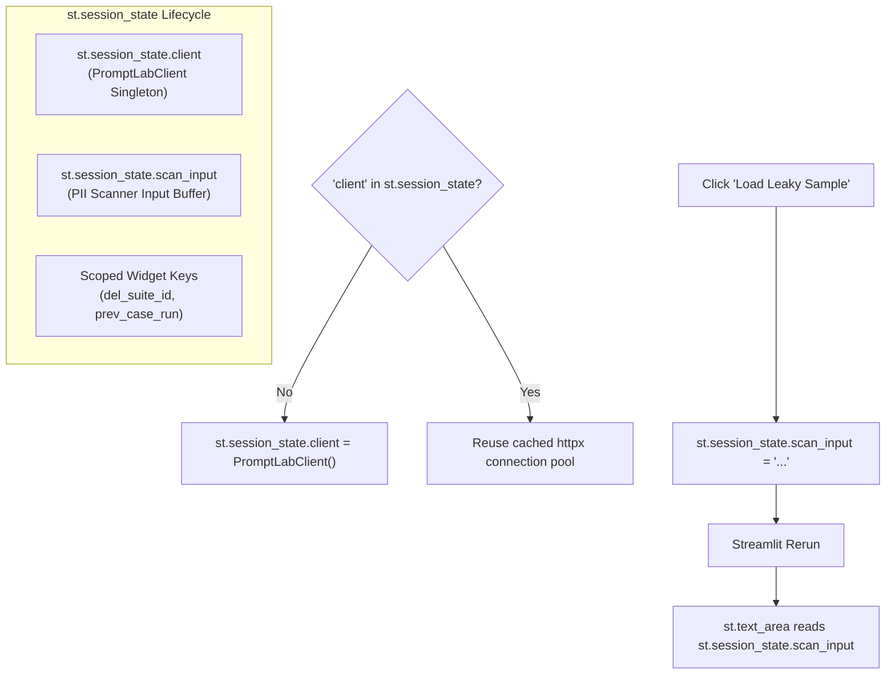

# PromptLab Architecture: Dashboard Walkthrough and Frontend Architecture

This document provides a comprehensive technical walkthrough of the PromptLab Streamlit frontend (`src/promptlab/dashboard/`), detailing its multipage architecture, user workflows, API integration points, session state management, visualization rendering, and resilience mechanisms.

---

## 1. Frontend Architecture & Design Principles

PromptLab features a modern, reactive web interface built with **Streamlit** ([src/promptlab/dashboard/app.py](file:///c:/Users/vedaa/OneDrive/Desktop/Master%20Folder/promptLab/src/promptlab/dashboard/app.py)) that communicates with the asynchronous FastAPI backend via a dedicated synchronous client facade ([src/promptlab/dashboard/api_client.py](file:///c:/Users/vedaa/OneDrive/Desktop/Master%20Folder/promptLab/src/promptlab/dashboard/api_client.py)).



### Streamlit Execution Model vs. Asynchronous Backend

1. **Top-to-Bottom Execution (Rerun Model)**: Streamlit re-executes the entire Python script upon every user interaction (button click, slider adjustment, selectbox change).
2. **Synchronous Boundary Isolation**: While FastAPI and PromptLab's core engines are asynchronous (`async`/`await`), Streamlit expects linear, blocking execution. Attempting to run `asyncio.run()` directly inside Streamlit pages often clashes with existing event loops. `PromptLabClient` eliminates this by utilizing synchronous `httpx.Client`, ensuring deterministic, blocking HTTP round-trips.
3. **Anti-Corruption Layer**: `PromptLabClient` acts as an anti-corruption layer:
   - Normalizes backend errors into domain-specific `APIClientError`.
   - Provides graceful degradations: if the backend is down, `health()` returns an `unreachable` status instead of throwing an unhandled stack trace, and `list_models()` returns default mock identifiers so dropdowns remain functional.

---

## 2. API Client Facade (`api_client.py`)

Located at [src/promptlab/dashboard/api_client.py](file:///c:/Users/vedaa/OneDrive/Desktop/Master%20Folder/promptLab/src/promptlab/dashboard/api_client.py), `PromptLabClient` encapsulates all network I/O, base URL resolution, connection pooling, and error handling.

### Configuration and Base URL Resolution
```python
# src/promptlab/dashboard/api_client.py:32-37
def __init__(self, base_url: str | None = None, timeout: float = 60.0) -> None:
    resolved_url = base_url or os.getenv("PROMPTLAB_API_URL", "http://localhost:8000")
    self.base_url = resolved_url.rstrip("/")
    self.timeout = timeout
    self._client = httpx.Client(base_url=self.base_url, timeout=self.timeout)
```
- Defaults to `http://localhost:8000`, overrideable via the `PROMPTLAB_API_URL` environment variable.
- Reuses a persistent `httpx.Client` connection pool across page interactions.

### Complete Method and Endpoint Catalog

| Client Method | HTTP Verb & Path | Request Payload / Query Params | Fallback / Error Handling |
| :--- | :--- | :--- | :--- |
| `health()` | `GET /health` | None | Catches `httpx.RequestError` and returns `{"status": "unreachable", "demo_mode": True, "active_provider": "offline"}`. |
| `list_models(provider)` | `GET /api/v1/models` | `?provider=...` (optional) | On error, falls back to `["mock-llama-3.3-70b", "mock-qwen-2.5-72b", "mock-mistral-large", "mock-gemma-2-9b"]`. |
| `create_suite(payload)` | `POST /api/v1/suites` | `SuiteCreateRequest` JSON | Raises `APIClientError` on validation or duplicate errors. |
| `list_suites(offset, limit)` | `GET /api/v1/suites` | `?offset=0&limit=50` | Raises `APIClientError` if backend fails. |
| `get_suite(suite_id)` | `GET /api/v1/suites/{id}` | None | Raises `APIClientError` (404 if missing). |
| `delete_suite(suite_id)` | `DELETE /api/v1/suites/{id}` | None | Returns boolean `deleted` flag. |
| `execute_run(payload)` | `POST /api/v1/runs` | `RunExecuteRequest` JSON | Raises `APIClientError` on failure. |
| `list_runs(offset, limit, ...)` | `GET /api/v1/runs` | `?offset=0&limit=50&suite_name=...` | Returns list of run summary objects and total count. |
| `get_run(run_id)` | `GET /api/v1/runs/{id}` | None | Returns full `RunResult` JSON with all case evaluations. |
| `compare_runs(run_ids)` | `POST /api/v1/runs/compare` | `{"run_ids": [...]}` | Returns side-by-side comparison matrix and leaderboards. |
| `run_injection_test(...)` | `POST /api/v1/safety/injection-test` | `{"model": ..., "canary": ...}` | Executes prompt injection audit against canary token. |
| `scan_text(text)` | `POST /api/v1/safety/scan` | `{"text": ...}` | Returns PII findings, risk level, and redacted payload. |
| `list_safety_reports(...)` | `GET /api/v1/safety/reports` | `?offset=0&limit=50` | Returns historical safety audits. |
| `get_safety_report(id)` | `GET /api/v1/safety/reports/{id}` | None | Returns detailed safety report. |

---

## 3. Page-by-Page Walkthrough

### 1. Main Entrypoint & System Overview (`app.py`)

- **File**: [src/promptlab/dashboard/app.py](file:///c:/Users/vedaa/OneDrive/Desktop/Master%20Folder/promptLab/src/promptlab/dashboard/app.py)
- **Role**: Dashboard landing page, system diagnostics, and visual architecture index.



#### Visual Styling & Layout
- **Custom CSS Theme**: Implements sleek glassmorphism cards (`rgba(30, 41, 59, 0.7)`), gradient typography (`#6366f1` to `#ec4899`), and glowing status badges (`.status-online` / `.status-offline`).
- **Real-Time Health Bar**: Renders four prominent metric cards across the top:
  1. *Backend Status*: Green `● API Connected` or red `○ Offline / Demo`.
  2. *Inference Provider*: Active provider identifier (e.g., `GROQ`, `MOCK`).
  3. *Demo Mode*: `ENABLED (Mock)` or `DISABLED (Live Groq)`.
  4. *Registered Suites*: Total count of persisted suites queried via `client.list_suites(limit=1)`.
- **Module Grid**: Interactive feature cards directing users to each sub-page.
- **Architectural Accordion**: Expandable callout detailing core design patterns (Template Method, Strategy, Factory, Facade, Repository) for technical interview preparation.

---

### 2. Interactive Prompt Playground (`1_Playground.py`)

- **File**: [src/promptlab/dashboard/pages/1_Playground.py](file:///c:/Users/vedaa/OneDrive/Desktop/Master%20Folder/promptLab/src/promptlab/dashboard/pages/1_Playground.py)
- **Role**: Rapid experimentation on single prompts with dynamic techniques, sampling controls, and real-time rubric scoring.



#### User Interaction Flow
1. **Sidebar Configuration**:
   - Model dropdown populated dynamically via `client.list_models()`.
   - Sampling sliders: Temperature ($0.0 - 2.0$), Top-P ($0.0 - 1.0$), Max Tokens ($32 - 2048$).
   - Prompt technique selector: `zero_shot`, `few_shot`, `chain_of_thought`, `structured_output`.
   - Dynamic technique configuration: If `few_shot` is selected, input/output demonstration fields appear; if `structured_output` is selected, a JSON schema textarea appears.
2. **Main Canvas**:
   - Left column: System prompt input and user prompt textarea.
   - Right column: Scorer selector (`contains`, `exact_match`, `regex_match`, `json_valid`, `sql_result`) and expected ground truth input.
3. **Execution & Results**:
   - Constructs an ephemeral, inline `TestSuite` containing a single `TestCase` (`play-case-1`).
   - Dispatches `POST /api/v1/runs`.
   - Renders 4 KPI metrics: Latency in ms, Prompt Tokens, Completion Tokens, and Total Tokens.
   - **Reasoning Drawer**: If the model output contains `<thought>...</thought>` tags (e.g., DeepSeek-R1 or reasoning models), the UI splits the string, displaying the internal reasoning process inside an expandable accordion while rendering the final output in a clean code block.
   - Displays a colored evaluation alert (`st.success` or `st.error`) with the calculated score ($0.0 - 1.0$) and scorer explanation.

---

### 3. Test Suites & Batch Evaluation Runner (`2_Test_Suites.py`)

- **File**: [src/promptlab/dashboard/pages/2_Test_Suites.py](file:///c:/Users/vedaa/OneDrive/Desktop/Master%20Folder/promptLab/src/promptlab/dashboard/pages/2_Test_Suites.py)
- **Role**: Test case authoring, suite persistence, batch evaluation execution, and regression auditing.

The page is organized into three distinct tabs:

#### Tab 1: `🚀 Run Suite`
- Dropdown populated with registered suites via `client.list_suites(limit=100)`.
- Model selector and sampling controls (Temperature, Max Tokens).
- On execution: Invokes `POST /api/v1/runs` with `{"suite_id": selected_id, "model": model, ...}`.
- Renders aggregate summary metrics: Pass Rate %, Average Latency (ms), Total Tokens, and Evaluated Cases Count.
- **Granular Case Breakdown**: Generates an interactive accordion for every test case evaluated. Accordions display status icons (`✅` or `❌`), latency, scoring reasons, and the full model completion.

#### Tab 2: `➕ Create Suite`
- Streamlit form (`st.form("create_suite_form")`) containing:
  - Suite Name, Description, and System Prompt.
  - Prompt Technique selector.
  - JSON Textarea preloaded with a multi-case schema (demonstrating `contains`, `exact_match`, and `sql_result` scorers).
- On submission: Parses JSON and dispatches `POST /api/v1/suites`, assigning a UUIDv4 and persisting the suite in SQLite.

#### Tab 3: `⚙️ Manage Existing Suites`
- Queries and lists all suites from the database.
- Displays suite name, truncated UUID, description, and test case count.
- Includes a dedicated `🗑️ Delete` button per suite. Clicking it invokes `client.delete_suite(s_id)` and triggers `st.rerun()`, immediately updating the UI.

---

### 4. Safety & Guardrails Playground (`3_Safety_&_Guardrails.py`)

- **File**: [src/promptlab/dashboard/pages/3_Safety_&_Guardrails.py](file:///c:/Users/vedaa/OneDrive/Desktop/Master%20Folder/promptLab/src/promptlab/dashboard/pages/3_Safety_&_Guardrails.py)
- **Role**: Adversarial prompt injection audits, real-time PII/secret scanning, and historical safety audit reports.

Organized into three functional tabs:

#### Tab 1: `🎯 Adversarial Injection Audit`
- Select target model and configure a canary secret token (defaults to `CANARY_SECRET_98765`).
- On click: Calls `POST /api/v1/safety/injection-test`.
- Renders risk summary KPIs: Attacks Tested (16 attack vectors), Breaches Detected, and an overall Risk Rating (`HIGH RISK` vs `LOW RISK (PASS)`).
- **Attack Vector Analysis**: Iterates over all tested vectors across 5 categories (override, delimiter-escape, roleplay, data-exfiltration, indirect). Breached vectors are highlighted in red (`🚨 BREACHED`) and automatically expanded to display the malicious prompt and leaking completion.

#### Tab 2: `🔍 Real-Time PII & Secrets Scanner`
- Textarea to enter arbitrary strings.
- Includes quick-load sample buttons:
  - *"Load Leaky Sample"*: Populates text containing an email, phone number, IPv4 address, and Groq API key (`gsk_...`).
  - *"Load Safe Sample"*: Populates benign programming assistance text.
- On click: Calls `POST /api/v1/safety/scan`.
- Renders verdict badge (`SAFE` vs `BREACH / LEAK`), risk rating, sanitized text preview with redactions applied, and a structured breakdown of each detected entity with character offsets.

#### Tab 3: `📜 Historical Safety Reports`
- Queries `GET /api/v1/safety/reports`.
- Displays historical audit cards with pass/fail badges, target model identifiers, and breach counts.

---

### 5. Evaluation History & Comparative Analytics (`4_History_&_Comparison.py`)

- **File**: [src/promptlab/dashboard/pages/4_History_&_Comparison.py](file:///c:/Users/vedaa/OneDrive/Desktop/Master%20Folder/promptLab/src/promptlab/dashboard/pages/4_History_&_Comparison.py)
- **Role**: Side-by-side comparative analytics, leaderboards, case alignment matrices, and historical run browsing.

Organized into two tabs:

#### Tab 1: `⚖️ Side-by-Side Comparison`
- Queries all historical runs via `client.list_runs(limit=100)`.
- If fewer than 2 runs exist, prompts the user to execute evaluations first.
- Provides a multiselect widget allowing the engineer to pick two or more runs to compare.
- On click: Dispatches `POST /api/v1/runs/compare` with `{"run_ids": [...]}`.
- **Leaderboard Highlights**: Computes and highlights the top-performing model (`best_performing_model`) and lowest-latency model (`fastest_model`).
- **Run Summaries Table**: Renders an interactive `st.dataframe` showing Model, Suite, Technique, Pass Rate %, Average Latency, Total Tokens, and Temperature.
- **Per-Case Side-by-Side Matrix**:
  - Dynamically builds side-by-side columns matching the number of compared runs:
    ```python
    run_cols = st.columns(len(selected_ids))
    ```
  - For every test case ID in the suite, aligns the outputs side by side, displaying pass/fail badges, scores, latency, and disabled text areas showing completion previews.

#### Tab 2: `📜 Historical Run Explorer`
- Interactive filter input to search runs by model name substring.
- Renders expandable cards for all historical evaluation runs, showing pass rates, latency, token consumption, and per-case outputs.

---

## 4. State Management and Session Lifecycles

Streamlit applications do not maintain long-lived in-memory objects across reruns unless bound to `st.session_state`. PromptLab manages state using three patterns:



1. **Client Memoization**:
   In `app.py` and each page, `get_client()` checks:
   ```python
   if "client" not in st.session_state:
       st.session_state.client = PromptLabClient()
   return st.session_state.client
   ```
   This ensures that HTTP connection pools are not re-allocated on every script rerun, preventing socket exhaustion.
2. **Cross-Widget State Buffering**:
   In `3_Safety_&_Guardrails.py`, sample loader buttons set `st.session_state.scan_input = "..."`. When Streamlit triggers a script rerun, the text area initializes directly with the buffered sample string.
3. **Collision-Free Dynamic Widget Keys**:
   When rendering loops of buttons or text areas (e.g. delete buttons for suites, or multi-column comparison text areas), PromptLab assigns unique compound keys:
   - `key=f"del_{s_id}"`
   - `key=f"prev_{cid}_{rid}"`
   This prevents Streamlit `DuplicateWidgetID` runtime exceptions.

---

## 5. Frontend Error Handling and Resilience

The dashboard implements defense-in-depth error handling to prevent UI crashes:

1. **Backend Offline Graceful Degradation**:
   - If the FastAPI daemon is stopped, `app.py` does not crash.
   - `client.health()` catches `httpx.RequestError` and reports `{"status": "unreachable", "demo_mode": True, "active_provider": "offline"}`.
   - The UI reflects this with a red status badge (`○ Offline / Demo`), alerting the developer without raising an unhandled exception.
2. **Model Dropdown Fallback**:
   - If `/api/v1/models` cannot be reached, `client.list_models()` catches the exception and returns four standard mock model identifiers (`["mock-llama-3.3-70b", ...]`). This prevents Streamlit selectboxes from crashing due to empty option lists.
3. **Granular Try/Except Blocks on Actions**:
   - All network mutations (`run_btn`, `submit_suite`, `Launch Injection Audit`) are wrapped in explicit `try/except Exception as exc:` blocks.
   - Errors are displayed in clean UI notification banners (`st.error(f"Execution failed: {exc}")`), preserving full session state and allowing the user to correct parameters without refreshing the browser.
