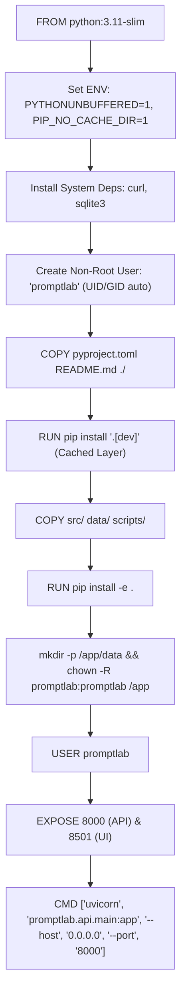
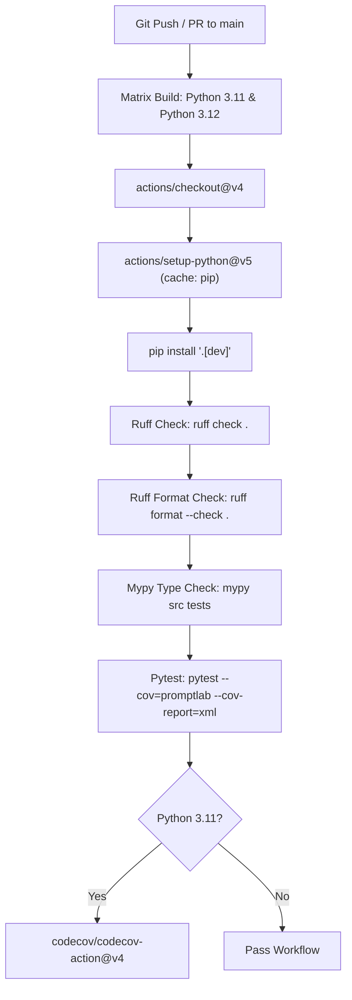

# PromptLab Architecture: Build, Run, Deploy, and Infrastructure

This document provides a comprehensive technical guide to PromptLab's packaging, containerization, multi-service orchestration, continuous integration, configuration management, and deployment operations.

---

## 1. Packaging & Dependencies (`pyproject.toml`)

PromptLab uses standard **PEP 621** metadata with the **Hatchling** build system ([pyproject.toml](file:///c:/Users/vedaa/OneDrive/Desktop/Master%20Folder/promptLab/pyproject.toml)).

```toml
# pyproject.toml:1-4
[build-system]
requires = ["hatchling"]
build-backend = "hatchling.build"
```

### Wheel Target and Namespace Configuration
```toml
# pyproject.toml:39-40
[tool.hatch.build.targets.wheel]
packages = ["src/promptlab"]
```
The wheel builder bundles only the `src/promptlab` package, excluding `tests/`, `docs/`, `scripts/`, and root files from distributed artifacts.

### Dependency Ecosystem Breakdown

PromptLab separates runtime dependencies from developer tooling via optional extras:

| Dependency Group | Package Name | Minimum Version | Operational Role in PromptLab |
| :--- | :--- | :--- | :--- |
| **Core API & Persistence** | `fastapi` | `>=0.110.0` | REST API routing, OpenAPI generation, middleware, and dependency injection. |
| | `uvicorn` | `>=0.28.0` | High-performance ASGI production web server. |
| | `pydantic` | `>=2.6.0` | Domain model definition, field validation, and JSON serialization. |
| | `pydantic-settings` | `>=2.2.0` | Strongly typed environment variable and `.env` parsing. |
| | `sqlalchemy` | `>=2.0.25` | Async ORM mapping, unit of work sessions, and relational modeling. |
| | `aiosqlite` | `>=0.20.0` | Non-blocking async SQLite driver for SQLAlchemy async engines. |
| **Inference & UI** | `groq` | `>=0.5.0` | Official client SDK for hosted Llama, Gemma, and Qwen inference. |
| | `streamlit` | `>=1.32.0` | Reactive web dashboard and multipage interface. |
| | `httpx` | `>=0.27.0` | HTTP client used by the Streamlit client facade and API tests. |
| | `jsonschema` | `>=4.21.0` | Validates model completions against structured JSON schemas in `JsonSchema` scorer. |
| | `python-dotenv` | `>=1.0.1` | Reads `.env` key-value pairs during local development. |
| **Development & Testing** (`[project.optional-dependencies] dev`) | `pytest` | `>=8.0.0` | Primary test execution framework. |
| | `pytest-asyncio` | `>=0.23.0` | Coroutine and async fixture support for pytest. |
| | `pytest-cov` | `>=4.1.0` | Coverage measurement and terminal missing-line reporting. |
| | `ruff` | `>=0.3.0` | High-speed linting, import sorting, and code formatting. |
| | `mypy` | `>=1.9.0` | Static type analysis in strict mode. |
| | `pre-commit` | `>=3.6.0` | Git hook automation. |

### Linter, Formatter, and Type-Check Standards
- **Ruff** ([pyproject.toml:42-58](file:///c:/Users/vedaa/OneDrive/Desktop/Master%20Folder/promptLab/pyproject.toml#L42-L58)): Target Python 3.11 with a 100-character line limit. Enforces pycodestyle (`E`, `W`), pyflakes (`F`), isort (`I`), pep8-naming (`N`), pyupgrade (`UP`), flake8-bugbear (`B`), and flake8-simplify (`SIM`).
- **Mypy** ([pyproject.toml:60-79](file:///c:/Users/vedaa/OneDrive/Desktop/Master%20Folder/promptLab/pyproject.toml#L60-L79)): Configured in `strict = true` mode (`disallow_untyped_defs`, `disallow_incomplete_defs`, `warn_return_any`). Ignores missing stubs for dynamic third-party libraries (`groq.*`, `streamlit.*`, `jsonschema.*`).

---

## 2. Containerization Architecture (`Dockerfile`)

PromptLab utilizes a hardened, non-root Docker image ([Dockerfile](file:///c:/Users/vedaa/OneDrive/Desktop/Master%20Folder/promptLab/Dockerfile)) based on `python:3.11-slim`:



### Key Security & Optimization Directives

1. **Layer Caching Optimization** ([Dockerfile:20-23](file:///c:/Users/vedaa/OneDrive/Desktop/Master%20Folder/promptLab/Dockerfile#L20-L23)):
   `pyproject.toml` and `README.md` are copied and installed prior to copying source code. Edits to Python source files do not invalidate the slow dependency installation layer.
2. **Principle of Least Privilege** ([Dockerfile:17, 36](file:///c:/Users/vedaa/OneDrive/Desktop/Master%20Folder/promptLab/Dockerfile#L17-L36)):
   A dedicated system user `promptlab` is created with `/bin/bash` shell and home directory. Execution privileges drop to `USER promptlab`, ensuring the process cannot modify system binaries or escape the container via root exploits.
3. **Storage Provisioning** ([Dockerfile:34](file:///c:/Users/vedaa/OneDrive/Desktop/Master%20Folder/promptLab/Dockerfile#L34)):
   The `/app/data` directory is pre-created and ownership is assigned to `promptlab:promptlab`, allowing the unprivileged container to create and lock the SQLite database file (`promptlab.db`).
4. **Health Check Support**:
   Installs `curl` specifically to allow Docker Compose and container orchestration engines (Kubernetes, Render, AWS ECS) to execute native HTTP health checks.

---

## 3. Multi-Service Orchestration (`docker-compose.yml`)

The multi-container stack ([docker-compose.yml](file:///c:/Users/vedaa/OneDrive/Desktop/Master%20Folder/promptLab/docker-compose.yml)) coordinates the FastAPI backend and Streamlit dashboard using Docker's internal bridge network and service health dependencies:

```mermaid
flowchart LR
    Client["Browser / Engineer"] -->|Port 8501| Frontend["promptlab-frontend<br>(Streamlit UI)"]
    Client -->|Port 8000| Backend["promptlab-backend<br>(FastAPI API)"]

    Frontend -->|http://backend:8000<br>(Internal Docker DNS)| Backend
    Backend -->|Seed on Boot| Seed["scripts/seed_db.py"]
    Backend -->|Persist DB| Vol[("Named Volume:<br>promptlab_persistent_data<br>(/app/data)")]
```

### Services Breakdown

#### 1. `backend` Service
- **Container Name**: `promptlab-backend`
- **Boot Command**:
  ```bash
  bash -c "python scripts/seed_db.py && uvicorn promptlab.api.main:app --host 0.0.0.0 --port 8000"
  ```
  Runs `seed_db.py` to create the schema and populate baseline benchmarks before launching Uvicorn.
- **Port Exposure**: Maps host port `8000` to container port `8000`.
- **Environment Bindings**:
  - `GROQ_API_KEY`: Injected from host environment.
  - `PROMPTLAB_DEMO_MODE`: Defaults to `true` if unset.
  - `PROMPTLAB_DATABASE_URL`: Set to `sqlite+aiosqlite:////app/data/promptlab.db`.
- **Volume**: Mounts named volume `promptlab_data` at `/app/data` to persist evaluations across container teardowns.
- **Healthcheck**: Probes `http://localhost:8000/health` every 10 seconds. Declares the service healthy once HTTP 200 is confirmed.

#### 2. `frontend` Service
- **Container Name**: `promptlab-frontend`
- **Boot Command**:
  ```bash
  streamlit run src/promptlab/dashboard/app.py --server.port 8501 --server.address 0.0.0.0 --browser.serverAddress localhost
  ```
- **Port Exposure**: Maps host port `8501` to container port `8501`.
- **Service Dependency**:
  ```yaml
  depends_on:
    backend:
      condition: service_healthy
  ```
  Prevents Streamlit from booting until the backend finishes schema migration, data seeding, and returns a successful health check.
- **Service Discovery**: Sets `PROMPTLAB_API_URL=http://backend:8000`, using Docker's automatic DNS resolution to route requests directly to the backend container.

---

## 4. Automation and Makefile Targets (`Makefile`)

The [Makefile](file:///c:/Users/vedaa/OneDrive/Desktop/Master%20Folder/promptLab/Makefile) streamlines common developer workflows into standard targets:

| Make Target | Shell Command Invoked | Purpose & Operational Behavior |
| :--- | :--- | :--- |
| `make install` | `pip install -e ".[dev]"` | Installs the package in editable mode along with testing, linting, and typing dependencies. |
| `make lint` | `ruff check src tests` | Runs the Ruff linter across source files and tests, reporting style or safety issues. |
| `make format` | `ruff format src tests` | Auto-formats all Python code according to project style standards. |
| `make type` | `mypy src tests` | Executes Mypy static type checking in strict mode. |
| `make test` | `pytest` | Runs pytest with automated branch coverage reporting (`--cov=promptlab`). |
| `make run-api` | `uvicorn promptlab.api.main:app --reload --host 0.0.0.0 --port 8000` | Starts the local development API server with hot reloading enabled. |
| `make run-ui` | `streamlit run src/promptlab/dashboard/app.py --server.port 8501` | Launches the Streamlit dashboard in development mode. |
| `make docker-up`| `docker compose up --build` | Builds container images and starts the multi-service stack in the foreground. |
| `make clean` | `find . ... -exec rm -rf {} +` | Purges `__pycache__`, `.pytest_cache`, `.mypy_cache`, `.ruff_cache`, and build artifacts. |

---

## 5. Continuous Integration Pipeline (`.github/workflows/ci.yml`)

PromptLab executes automated quality checks on every push and pull request to the `main` branch ([.github/workflows/ci.yml](file:///c:/Users/vedaa/OneDrive/Desktop/Master%20Folder/promptLab/.github/workflows/ci.yml)):



- **Matrix Testing**: Validates compatibility across both Python 3.11 and 3.12.
- **Fail-Fast**: Configured with `fail-fast: false`, ensuring all matrix branches run to completion even if one fails.
- **Enforced Quality Gates**:
  1. Ruff linting must pass with 0 errors.
  2. Ruff formatting must be clean (no unformatted files).
  3. Mypy must pass in strict mode with 0 type errors.
  4. Pytest must achieve $\ge 85\%$ test coverage.

---

## 6. Environment Configuration (`.env.example`)

The repository includes [.env.example](file:///c:/Users/vedaa/OneDrive/Desktop/Master%20Folder/promptLab/.env.example) as the reference template for environment setup:

```bash
# Groq Inference API Key (hosted open-source LLMs: Llama, Mistral, Gemma, Qwen)
GROQ_API_KEY=

# Default model used for single evaluations and playground default
DEFAULT_MODEL=llama-3.3-70b-versatile

# Maximum concurrent requests executed by TestRunner (semaphore-bound)
MAX_CONCURRENCY=5

# Database connection URL (SQLAlchemy 2.0 async engine)
DATABASE_URL=sqlite+aiosqlite:///./promptlab.db

# Structured logging level (DEBUG, INFO, WARNING, ERROR)
LOG_LEVEL=INFO

# Dedicated model for LLM-as-a-Judge evaluations
JUDGE_MODEL=llama-3.3-70b-versatile

# Optional backend security key for FastAPI authorization header (X-API-Key)
API_KEY=

# Demo Mode: when true, uses MockProvider with canned responses (no API key needed)
DEMO_MODE=false

# System Safety & Abuse Limits
MAX_PROMPT_LENGTH=10000
MAX_CASES_PER_SUITE=100
REQUEST_TIMEOUT_SECONDS=60.0
```

---

## 7. Database Seeding & Startup Mechanics (`seed_db.py`)

### Schema Initialization
PromptLab does not use Alembic migrations. Instead, schema initialization is handled via SQLAlchemy's `Base.metadata.create_all`:
- **In Code**: Managed by `init_db()` in [src/promptlab/db/base.py:58-63](file:///c:/Users/vedaa/OneDrive/Desktop/Master%20Folder/promptLab/src/promptlab/db/base.py#L58-L63).
- **At API Startup**: FastAPI's `lifespan` handler ([api/main.py:30-37](file:///c:/Users/vedaa/OneDrive/Desktop/Master%20Folder/promptLab/src/promptlab/api/main.py#L30-L37)) executes `await init_db()` when the application boots, creating any missing tables before accepting requests.

### Benchmark Seeding Script (`scripts/seed_db.py`)
Located at [scripts/seed_db.py](file:///c:/Users/vedaa/OneDrive/Desktop/Master%20Folder/promptLab/scripts/seed_db.py), this utility pre-populates fresh environments:
1. Calls `await init_db()` to ensure tables exist.
2. Reads `data/benchmark_suites.json` and loads benchmark test suites (Text-to-SQL, Sentiment Classification, Math Chain-of-Thought). Idempotent: skips suites that already exist by name.
3. Executes baseline demo evaluation runs on the first suite using `mock-llama-3.3-70b` and `mock-qwen-2.5-72b` to populate the comparison leaderboard immediately.
4. Executes a baseline adversarial prompt injection audit against `CANARY_BENCHMARK_SECRET`.

---

## 8. Step-by-Step Execution Guides

### Running Locally from Scratch

```bash
# 1. Clone repository
git clone https://github.com/VedantSinngh/llm-testing.git
cd llm-testing

# 2. Create and activate a Python virtual environment (Python 3.11+)
python -m venv .venv
# On Windows:
.venv\Scripts\activate
# On Linux / macOS:
source .venv/bin/activate

# 3. Install PromptLab in editable mode with development dependencies
pip install -e ".[dev]"

# 4. Configure local environment
cp .env.example .env
# Edit .env: enter your GROQ_API_KEY, or set DEMO_MODE=true for offline mode

# 5. Seed benchmark test suites and baseline runs
python scripts/seed_db.py

# 6. Start the FastAPI backend server (Terminal 1)
uvicorn promptlab.api.main:app --reload --host 127.0.0.1 --port 8000

# 7. Start the Streamlit frontend dashboard (Terminal 2)
streamlit run src/promptlab/dashboard/app.py --server.port 8501

# 8. Open browser
# Navigate to http://localhost:8501 for Dashboard
# Navigate to http://localhost:8000/docs for Swagger API Docs
```

### Running with Docker & Docker Compose

```bash
# 1. Build and launch multi-service stack
docker compose up --build

# 2. Access applications:
# - Streamlit UI: http://localhost:8501
# - FastAPI API:  http://localhost:8000
# - Healthcheck:  http://localhost:8000/health

# 3. Teardown stack (preserving data volume)
docker compose down

# 4. Teardown stack and purge persistent volume
docker compose down -v
```

---

## 9. Cloud Deployment Guide (Render.com)

PromptLab can be deployed to Render using either a single combined service or a two-service architecture (recommended for production).


### Option A: Two-Service Deployment (Recommended)

#### Service 1: FastAPI Backend (`promptlab-api`)
- **Environment**: Docker (or Python native).
- **Build Command** (if Python native): `pip install ".[dev]"`
- **Start Command**: `python scripts/seed_db.py && uvicorn promptlab.api.main:app --host 0.0.0.0 --port $PORT`
- **Health Check Path**: `/health`
- **Required Environment Variables**:
  - `GROQ_API_KEY`: Your hosted Groq API key (or leave empty and set `DEMO_MODE=true`).
  - `DEMO_MODE`: `false` (or `true`).
  - `DATABASE_URL`: `sqlite+aiosqlite:////app/data/promptlab.db` (with Persistent Disk) or a managed PostgreSQL connection string.
- **Disk Persistence**: Attach a 1GB Persistent Disk mounted at `/app/data` so historical evaluation runs survive container restarts.

#### Service 2: Streamlit Dashboard (`promptlab-ui`)
- **Environment**: Docker (or Python native).
- **Build Command** (if Python native): `pip install ".[dev]"`
- **Start Command**: `streamlit run src/promptlab/dashboard/app.py --server.port $PORT --server.address 0.0.0.0`
- **Health Check Path**: `/`
- **Required Environment Variables**:
  - `PROMPTLAB_API_URL`: Set to the public HTTPS URL of Service 1 (e.g., `https://promptlab-api.onrender.com`).

### Option B: Single-Container Unified Deployment
If deploying on a single free-tier Render Web Service, start both processes in a combined entrypoint shell script:
```bash
#!/bin/bash
# start.sh
python scripts/seed_db.py
uvicorn promptlab.api.main:app --host 127.0.0.1 --port 8000 &
streamlit run src/promptlab/dashboard/app.py --server.port $PORT --server.address 0.0.0.0
```
This binds Streamlit directly to Render's public routing port (`$PORT`) while routing backend API requests internally over `localhost:8000`.
