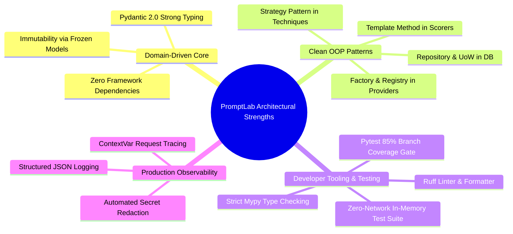
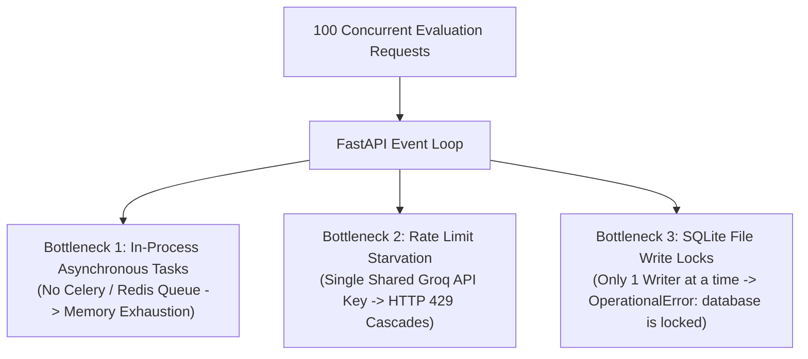
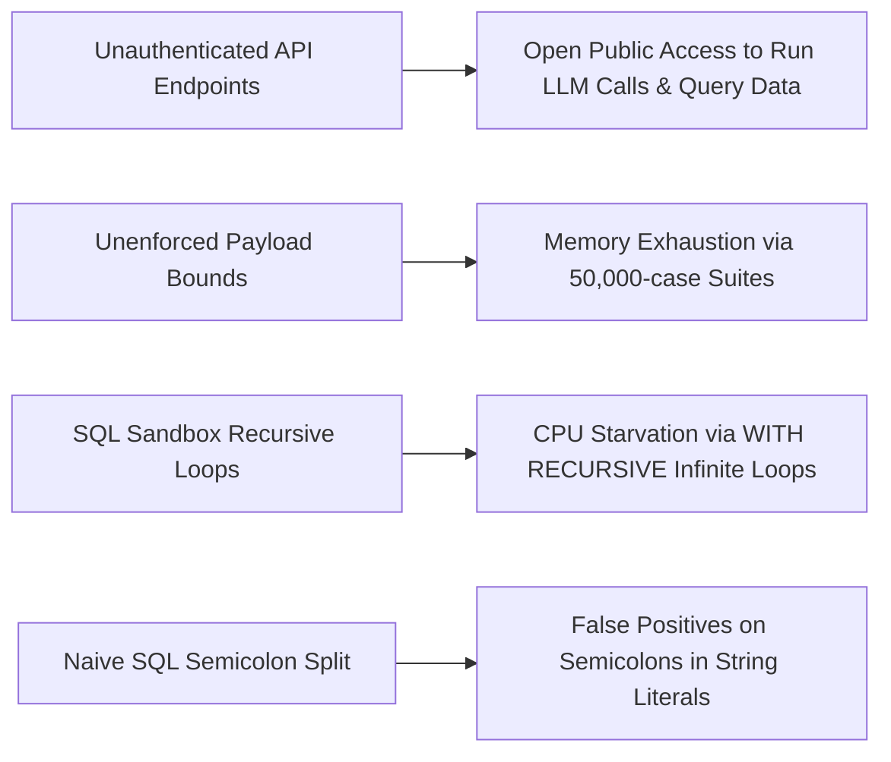

# PromptLab Architecture: Honest Architectural Review, Technical Debt, and Gaps

This document provides a candid, production-grade architectural audit of the PromptLab codebase. It highlights well-engineered subsystems, catalogs real anti-patterns and code smells with exact line citations, details scalability bottlenecks, evaluates security risks, and outlines a prioritized engineering remediation roadmap.

---

## 1. What Is Well-Designed & Production-Grade

PromptLab exhibits several architectural strengths rarely found in typical AI prototypes. When explaining this codebase in a technical interview, these are the core strengths to highlight:



### 1. Pure Domain Isolation & Immutability
- **Clean Architecture Boundaries**: Core domain models ([src/promptlab/core/models.py](file:///c:/Users/vedaa/OneDrive/Desktop/Master%20Folder/promptLab/src/promptlab/core/models.py)) have zero dependencies on FastAPI, SQLAlchemy, or Streamlit. The domain can be imported and executed as a standalone Python library.
- **Defensive Immutability**: Critical configuration structures like `GenerationParams` are declared with `frozen=True` ([models.py:27](file:///c:/Users/vedaa/OneDrive/Desktop/Master%20Folder/promptLab/src/promptlab/core/models.py#L27)). This prevents accidental side-effects during multi-model matrix sweeps.

### 2. Idiomatic Object-Oriented Design Patterns
- **Template Method Pattern** ([core/scorers/base.py](file:///c:/Users/vedaa/OneDrive/Desktop/Master%20Folder/promptLab/src/promptlab/core/scorers/base.py)): `BaseScorer.score()` defines an immutable 3-phase execution skeleton (`_preprocess` $\to$ `_evaluate` $\to$ `_finalize`), ensuring uniform error capture, score clamping, and metric metadata across all 7 scorers.
- **Strategy Pattern** ([core/techniques/base.py](file:///c:/Users/vedaa/OneDrive/Desktop/Master%20Folder/promptLab/src/promptlab/core/techniques/base.py)): Prompt formulation strategies (`ZeroShot`, `FewShot`, `ChainOfThought`, `StructuredOutput`) are completely swappable at runtime without altering test execution logic.
- **Factory & Registry Pattern** ([core/providers/factory.py](file:///c:/Users/vedaa/OneDrive/Desktop/Master%20Folder/promptLab/src/promptlab/core/providers/factory.py)): Providers register via `@ProviderFactory.register("name")`, enabling Open/Closed addition of new inference engines without touching core evaluators.
- **Repository Pattern & Unit of Work** ([db/repositories.py](file:///c:/Users/vedaa/OneDrive/Desktop/Master%20Folder/promptLab/src/promptlab/db/repositories.py)): Raw SQL and ORM queries are encapsulated behind async repositories. Database sessions are injected per-request via FastAPI's `get_db` dependency with automatic rollback on error.

### 3. Production Observability & Redaction
- **Structured JSON Logging** ([logging_config.py:54-81](file:///c:/Users/vedaa/OneDrive/Desktop/Master%20Folder/promptLab/src/promptlab/logging_config.py#L54-L81)): Emits serialized JSON with timestamps, logger names, line numbers, and async-bound request IDs.
- **Automatic Log Redaction** ([logging_config.py:39-51](file:///c:/Users/vedaa/OneDrive/Desktop/Master%20Folder/promptLab/src/promptlab/logging_config.py#L39-L51)): Intercepts all log records and applies compiled regex masks to scrub Groq, OpenAI, and AWS credentials before stdout emission.

---

## 2. Code Smells, Gaps, and Anti-Patterns

A senior engineer must be honest about where the codebase compromises clean design or leaves features incomplete. The table below catalogs all confirmed code smells:

| # | Code Smell / Gap | Exact Code Citation | Architectural Impact | Severity |
| :- | :--- | :--- | :--- | :--- |
| **1** | **Encapsulation Leak (Private Attribute Access)** | [api/routes/safety.py:44](file:///c:/Users/vedaa/OneDrive/Desktop/Master%20Folder/promptLab/src/promptlab/api/routes/safety.py#L44) | The route directly invokes `safety_service._guardrail.filter_text(...)`, bypassing public service methods and violating class encapsulation. | High |
| **2** | **Service Layer Bypass** | [api/routes/models.py:23](file:///c:/Users/vedaa/OneDrive/Desktop/Master%20Folder/promptLab/src/promptlab/api/routes/models.py#L23) | Route instantiates `ProviderFactory.create()` directly instead of delegating provider queries to `EvaluationService`. | Medium |
| **3** | **Event Loop Blocking by Synchronous SQLite** | [scorers/sql_result.py:90-97](file:///c:/Users/vedaa/OneDrive/Desktop/Master%20Folder/promptLab/src/promptlab/core/scorers/sql_result.py#L90-L97) | Uses standard-library synchronous `sqlite3.connect(":memory:")` and `executescript()` on the main event loop thread without `asyncio.to_thread()`. | High |
| **4** | **Silent Failure in `LLMJudge.score()`** | [scorers/llm_judge.py:59-67](file:///c:/Users/vedaa/OneDrive/Desktop/Master%20Folder/promptLab/src/promptlab/core/scorers/llm_judge.py#L59-L67) | Synchronous `_evaluate()` silently returns `ScoreResult(score=0.0, passed=False)` instead of raising `NotImplementedError` or forcing async execution. | Medium |
| **5** | **Fragile Relative File Paths** | [scorers/sql_result.py:48](file:///c:/Users/vedaa/OneDrive/Desktop/Master%20Folder/promptLab/src/promptlab/core/scorers/sql_result.py#L48)<br>[injection_suite.py:26](file:///c:/Users/vedaa/OneDrive/Desktop/Master%20Folder/promptLab/src/promptlab/core/safety/injection_suite.py#L26) | Traverses filesystem using `Path(__file__).resolve().parents[3] / "data"`. Fails if PromptLab is packaged and installed as a pip wheel in `site-packages`. | High |
| **6** | **Dead / Unwired Configuration Settings** | [config.py:43, 73, 79, 85](file:///c:/Users/vedaa/OneDrive/Desktop/Master%20Folder/promptLab/src/promptlab/config.py#L43) | `default_model`, `max_prompt_length`, `max_cases_per_suite`, and `request_timeout_seconds` are defined in `Settings` but never wired into routes or runners. | Medium |
| **7** | **Unimplemented API Key Authentication** | [config.py:65](file:///c:/Users/vedaa/OneDrive/Desktop/Master%20Folder/promptLab/src/promptlab/config.py#L65)<br>[api/main.py:40-136](file:///c:/Users/vedaa/OneDrive/Desktop/Master%20Folder/promptLab/src/promptlab/api/main.py#L40-L136) | `Settings.api_key` exists in configuration, but zero routes or middleware inspect `X-API-Key`. All API endpoints are public and unauthenticated. | Critical |
| **8** | **SQLite File Locking Under Concurrent Writes** | [db/repositories.py:65](file:///c:/Users/vedaa/OneDrive/Desktop/Master%20Folder/promptLab/src/promptlab/db/repositories.py#L65) | Concurrent evaluation runs dispatching `RunRepository.save()` will collide on SQLite's exclusive database write lock, causing `sqlite3.OperationalError: database is locked`. | High |
| **9** | **Unlogged Root Logger Initialization** | [api/main.py:27](file:///c:/Users/vedaa/OneDrive/Desktop/Master%20Folder/promptLab/src/promptlab/api/main.py#L27) | `configure_logging()` is never invoked during application startup in `api/main.py`. Structured JSON formatting is inactive unless manually initialized. | Medium |
| **10** | **Zero Automated Tests for Streamlit UI** | [dashboard/pages/](file:///c:/Users/vedaa/OneDrive/Desktop/Master%20Folder/promptLab/src/promptlab/dashboard/pages/) | All 4 multipage UI scripts have zero automated tests (`streamlit.testing.v1.AppTest` is unused). | Medium |

---

## 3. Deep-Dive on Specific Anti-Patterns

### Anti-Pattern 1: Encapsulation Leak (`safety.py:44`)
```python
# src/promptlab/api/routes/safety.py:44
is_safe, redacted, report = safety_service._guardrail.filter_text(payload.text, redact=True)
```
- **The Problem**: A presentation route directly reaches into `SafetyService`'s private attribute `_guardrail`. This tightly couples the route to internal service implementation details. If `SafetyService` renames or refactors `_guardrail`, the route breaks.
- **The Solution**: Add a public `filter_text(text: str, redact: bool = True)` method to `SafetyService` ([services/safety_service.py](file:///c:/Users/vedaa/OneDrive/Desktop/Master%20Folder/promptLab/src/promptlab/services/safety_service.py)) and call that from the route.

### Anti-Pattern 2: Fragile Filesystem Traversal (`parents[3] / "data"`)
```python
# src/promptlab/core/scorers/sql_result.py:48
self._sample_db_sql_path = sample_db_sql_path or str(
    Path(__file__).resolve().parents[3] / "data" / "sample.db.sql"
)
```
- **The Problem**: Counting directory levels (`parents[3]`) assumes the package is running inside the development Git repository where `data/` lives at the workspace root. When PromptLab is packaged into a wheel (`pip install promptlab`), `data/` is excluded by Hatchling ([pyproject.toml:40](file:///c:/Users/vedaa/OneDrive/Desktop/Master%20Folder/promptLab/pyproject.toml#L40)), causing `Path.exists()` to return `False` and breaking SQL evaluation in deployed environments.
- **The Solution**: Move seed files into `src/promptlab/data/` and load them using Python's standard `importlib.resources.files("promptlab.data")`.

### Anti-Pattern 3: Synchronous Blocking on Event Loop (`sql_result.py`)
```python
# src/promptlab/core/scorers/sql_result.py:90-97
def _init_in_memory_db(self) -> sqlite3.Connection:
    conn = sqlite3.connect(":memory:")
    schema_path = Path(self._sample_db_sql_path)
    if schema_path.exists():
        schema_sql = schema_path.read_text(encoding="utf-8")
        conn.executescript(schema_sql)
    return conn
```
- **The Problem**: When `TestRunner.run_suite()` evaluates a 50-case Text-to-SQL suite concurrently with `asyncio.gather()`, each case calls `SqlResult.score()`. This reads disk, compiles SQL, and executes schemas synchronously on the single thread running the asyncio event loop.
- **The Solution**: Offload synchronous execution to worker threads:
  ```python
  await asyncio.to_thread(self._sync_evaluate, case, output)
  ```

---

## 4. Scalability Bottlenecks



### 1. In-Process Task Execution (Missing Task Queue)
- **Bottleneck**: PromptLab executes evaluations directly inside the HTTP request-response lifecycle via `await eval_service.execute_run(...)`.
- **Failure Mode**: An evaluation suite with 100 cases takes $\sim 20$ seconds to complete. If multiple users trigger runs simultaneously, the FastAPI server holds hundreds of open HTTP connections and coroutines in memory. If the container restarts or crashes, all in-flight evaluations are lost without recovery.
- **Production Fix**: Decouple execution using **Celery**, **ARQ**, or **Temporal** backed by Redis or RabbitMQ. Routes should return HTTP 202 Accepted with a `job_id`, and clients should poll or subscribe via WebSockets.

### 2. Single Shared Rate Limit Starvation
- **Bottleneck**: All users and runs share a single `GROQ_API_KEY`.
- **Failure Mode**: Groq free tier enforces strict Requests Per Minute (RPM) and Tokens Per Minute (TPM) quotas. A single large matrix sweep will saturate the quota, causing all subsequent user playground requests to fail with HTTP 429 rate limit errors.
- **Production Fix**: Implement multi-tenant key management, allowing users to supply their own API keys via headers or persistent user vaults.

### 3. SQLite Concurrency Ceiling
- **Bottleneck**: PromptLab defaults to SQLite (`sqlite+aiosqlite:///./promptlab.db`).
- **Failure Mode**: SQLite permits multiple concurrent readers, but only **one writer** at a time. During batch evaluations, multiple workers writing `RunRecord` and `CaseResultRecord` rows will contend for the database write lock, causing timeout crashes.
- **Production Fix**: Migrate production persistence to PostgreSQL (`postgresql+asyncpg://...`), which natively supports row-level locking, connection pooling, and concurrent writes.

---

## 5. Security & Threat Audit Summary



1. **Unauthenticated Public Access**:
   Because `Settings.api_key` is not wired into any dependency, the server is completely open. Anyone on the network can trigger LLM generation and consume the developer's API credits.
2. **Missing Input Bounds Enforcement**:
   While `max_cases_per_suite: int = 100` and `max_prompt_length: int = 10000` exist in `config.py`, incoming requests are never checked against these limits. A malicious actor can submit multi-megabyte payloads or 50,000-case suites to trigger memory exhaustion.
3. **Denial of Service via Recursive SQL**:
   `SqlResult._validate_sql_safety()` permits queries starting with `WITH`. An attacker can submit:
   ```sql
   WITH RECURSIVE spin(x) AS (SELECT 1 UNION ALL SELECT x+1 FROM spin)
   SELECT count(*) FROM spin;
   ```
   This passes all keyword filters and starts with `WITH`, but freezes the Python worker process in an infinite synchronous loop because no execution deadline is set on the SQLite cursor.

---

## 6. Prioritized Refactoring Roadmap

To transition PromptLab from a high-quality prototype into an enterprise-ready platform, refactoring should follow this prioritized roadmap:

```mermaid
gantt
    title PromptLab Prioritized Refactoring Roadmap
    dateFormat  X
    axisFormat %s
    section P0: Critical Security & Integrity
    Enforce X-API-Key Auth Header             :p0_1, 0, 2
    Wire Input Bounds (Prompt & Suite Size)   :p0_2, 1, 3
    Fix Encapsulation Leak in safety.py       :p0_3, 2, 4
    section P1: Reliability & Packaging
    Package Seed Data with importlib.resources:p1_1, 3, 5
    Offload SqlResult to asyncio.to_thread    :p1_2, 4, 6
    Add Execution Timeout to SQLite Cursor    :p1_3, 5, 7
    Enable WAL Mode on SQLite Engine          :p1_4, 6, 8
    section P2: Architecture & Scalability
    PostgreSQL Async Database Migration       :p2_1, 7, 9
    Background Task Queue (Celery / ARQ)      :p2_2, 8, 10
    Automated Streamlit AppTest Suite         :p2_3, 9, 11
```



### P0: Critical Security & Correctness (Immediate)
1. **Enforce API Key Authentication**:
   Add an `APIKeyHeader` dependency to `api/dependencies.py` and verify incoming `X-API-Key` headers against `Settings.api_key`.
2. **Enforce Input Bounds**:
   Wire `Settings.max_cases_per_suite` into `SuiteCreateRequest.cases: list[TestCase] = Field(..., max_length=100)` and add length validation to prompts.
3. **Resolve Encapsulation Leak**:
   Expose `filter_text()` on `SafetyService` and update `api/routes/safety.py:44` to call the public service interface.

### P1: Packaging, Concurrency, and Sandbox Hardening (Near-Term)
1. **Fix Wheel Data Packaging**:
   Move `sample.db.sql` and `injection_prompts.json` inside the `src/promptlab/data/` package directory and load them via `importlib.resources.files()`.
2. **Eliminate Event Loop Blocking**:
   Wrap `SqlResult._evaluate()` with `asyncio.to_thread()` to prevent synchronous SQLite operations from stalling the asyncio event loop.
3. **Harden SQL Sandbox with Execution Deadlines**:
   Install a query progress handler (`conn.set_progress_handler(timeout_handler, 1000)`) on the in-memory SQLite connection to abort queries exceeding a 2-second deadline.
4. **Enable SQLite WAL Mode**:
   Configure `PRAGMA journal_mode=WAL;` and `PRAGMA busy_timeout=5000;` on the SQLAlchemy async SQLite engine to drastically reduce database write lock contention.

### P2: Enterprise Scalability & UI Testing (Medium-Term)
1. **Migrate to PostgreSQL Persistence**:
   Provide production docker-compose configurations using PostgreSQL with asyncpg drivers for high-throughput concurrent writes.
2. **Asynchronous Background Task Queue**:
   Transition long-running evaluation suites from inline HTTP requests to a distributed task queue (ARQ or Celery) with Redis pub/sub for real-time progress updates.
3. **Automated Streamlit UI Testing**:
   Implement test coverage for all 4 dashboard pages using Streamlit's official testing framework (`streamlit.testing.v1.AppTest`).
