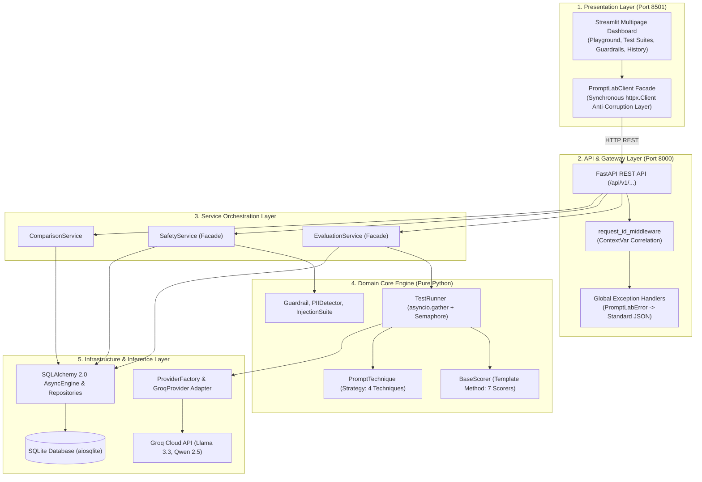

# PromptLab: Technical Interview Preparation Pack

This document equips you to explain, defend, and critique every architectural decision in PromptLab during senior and staff-level technical interviews. It provides scripted narratives, architectural justifications, bulletproof answers to the 20 toughest interview questions, and a mature post-mortem reflection.

---

## 1. Project Elevator Pitches

### 30-Second Elevator Pitch
> "PromptLab is a decoupled, product-grade LLM evaluation and guardrails playground. It allows AI engineering teams to run automated regression benchmarks across open-source models using five prompt engineering strategies and seven deterministic scorers—including sandboxed Text-to-SQL execution and LLM-as-a-Judge. It includes real-time PII redaction and adversarial prompt injection auditing with canary leak detection. Under the hood, it combines a pure domain core, asynchronous FastAPI microservices, and a reactive Streamlit dashboard with 85%+ branch test coverage."

### 2-Minute Elevator Pitch
> "PromptLab addresses the core reliability and safety challenges of shipping LLMs to production: non-deterministic outputs, prompt regressions, and security vulnerabilities. 
> 
> Rather than relying on heavyweight cloud platforms or manual prompt tweaking, PromptLab provides an end-to-end evaluation and guardrail framework. Architecturally, it follows Clean Architecture: a pure Python domain core completely isolated from external frameworks, wrapped by an asynchronous FastAPI REST API, and backed by a reactive Streamlit interface.
> 
> For evaluation, we implemented the Strategy pattern for swappable prompt techniques like Few-Shot and Chain-of-Thought, and the Template Method pattern for deterministic scoring across exact matches, regex, JSON Schema validation, and in-memory SQLite sandbox execution. We also built an inference engine with an extensible Factory/Registry that currently drives hosted Groq inference with exponential backoff jitter retries and semaphore-based rate-limit throttling.
> 
> On the safety front, PromptLab runs adversarial prompt injection benchmarks across five attack categories using high-entropy canary secrets, alongside real-time PII detection featuring Modulo-10 Luhn credit card validation and non-corrupting reverse-offset substring redaction. 
> 
> The codebase enforces strict Mypy typing, zero-network in-memory testing with 85%+ branch coverage, structured JSON logging with ContextVar trace correlation, and containerized Docker Compose orchestration."

---

## 2. "Walk Me Through the Architecture" Script

When an interviewer asks: *"Can you walk me through the architecture of this project?"*, deliver this structured, layered response:



### Verbal Narrative:
1. **Presentation Layer**: *"At the top is our Streamlit dashboard on port 8501. Because Streamlit uses a linear rerun script model, we decoupled it from our async backend via `PromptLabClient` in `dashboard/api_client.py`. This client acts as an anti-corruption layer, using synchronous `httpx` to handle network communication, graceful offline fallbacks, and error normalization."*
2. **API & Gateway Layer**: *"The backend is a FastAPI application on port 8000. It manages incoming requests through a custom middleware in `api/main.py:59` that extracts or mints UUIDv4 request IDs and binds them to a Python `contextvars.ContextVar`. This ensures every structured JSON log line across async tasks shares a common trace ID. Global exception handlers translate our domain `PromptLabError` hierarchy into uniform HTTP error envelopes."*
3. **Service Layer (Facades)**: *"Routes never interact directly with database models or execution runners. Instead, they depend on service facades: `EvaluationService`, `SafetyService`, and `ComparisonService`. These services coordinate business logic, transactions, and persistence."*
4. **Domain Core (Pure Python)**: *"Our core business logic in `src/promptlab/core/` is completely framework-agnostic. `TestRunner` orchestrates concurrent evaluations using `asyncio.Semaphore` to cap outbound requests. For scoring, we use the Template Method pattern in `BaseScorer` to guarantee uniform score clamping, error handling, and latency tracking across seven built-in scorers. For prompt formulation, we use the Strategy pattern in `PromptTechnique` to dynamically format Few-Shot demonstrations, Chain-of-Thought reasoning cues, or structured JSON schemas."*
5. **Infrastructure & Persistence**: *"At the base, `ProviderFactory` resolves LLM providers dynamically. `GroqProvider` implements our `LLMProvider` protocol, featuring an exponential backoff retry loop with full jitter for handling rate limits. For persistence, we use SQLAlchemy 2.0 with async sessions and `aiosqlite`, encapsulating table operations inside typed repositories."*

---

## 3. Architectural Decision Rationales: "Why Did You Choose...?"

### 1. Why FastAPI over Flask or Django?
- **Asynchronous Native Concurrency**: LLM evaluation is overwhelmingly I/O-bound. Dispatching 20 parallel LLM requests with `asyncio.gather()` would block threads in synchronous WSGI frameworks like Flask, requiring massive Gunicorn worker pools. FastAPI runs on ASGI (Uvicorn), allowing thousands of concurrent asynchronous network calls on a lightweight single event loop.
- **Pydantic v2 Serialization**: Automatic schema validation, request deserialization, and OpenAPI documentation without boilerplate marshaling code.

### 2. Why SQLAlchemy 2.0 Async + SQLite over PostgreSQL or MongoDB?
- **Zero-Friction Local Setup & Demonstrations**: SQLite requires no external daemon, container dependencies, or cloud database provisioning. A developer can clone the repo and run it instantly.
- **Production Migration Path**: By using modern **SQLAlchemy 2.0 DeclarativeBase** with `AsyncSession` and repository patterns ([db/repositories.py](file:///c:/Users/vedaa/OneDrive/Desktop/Master%20Folder/promptLab/src/promptlab/db/repositories.py)), the persistence layer is completely decoupled from SQLite. Swapping the engine to PostgreSQL (`postgresql+asyncpg://...`) requires changing only the connection URL in `.env` without altering a single line of domain code.

### 3. Why Streamlit over React or Next.js?
- **Rapid Prototyping for Data & AI Teams**: Streamlit allows writing interactive, high-performance dashboards purely in Python, keeping the entire repository in a single language and eliminating JavaScript build chains.
- **Strict Decoupling**: We explicitly avoided embedding business logic inside Streamlit. By forcing the dashboard to communicate with FastAPI exclusively through `PromptLabClient`, we preserved a clean client-server architecture. If we later replace Streamlit with a React SPA, the backend remains 100% untouched.

### 4. Why Groq over OpenAI directly?
- **Hosted Open-Source Models**: Groq provides ultra-fast inference for top-tier open-source weights (Llama 3.3 70B, Qwen 2.5 72B, Gemma 2 9B), allowing enterprise evaluation without proprietary model lock-in.
- **Sub-Second Latencies on LPUs**: Groq's Language Processing Units (LPUs) deliver $250 - 400$ tokens/sec, reducing batch evaluation runtimes by $5\times$ compared to standard hosted APIs.
- **Free Tier Accessibility**: Teams can run automated tests and benchmarks in demo environments without incurring cloud credit bills.

### 5. Why the Template Method Pattern for Scorers?
- **Uniform Metric Invariants**: Every scorer must guarantee three invariants: (1) scores are clamped between $0.0$ and $1.0$, (2) scoring exceptions are caught and surfaced as `passed=False` rather than crashing the runner, and (3) latency and reason strings are uniformly populated. 
- Putting this logic in `BaseScorer.score()` ([core/scorers/base.py:27](file:///c:/Users/vedaa/OneDrive/Desktop/Master%20Folder/promptLab/src/promptlab/core/scorers/base.py#L27)) and having concrete classes implement only `_evaluate()` guarantees that new scorers cannot violate system invariants.

### 6. Why Pydantic Settings over `python-dotenv` alone?
- **Fail-Fast Startup Validation**: `python-dotenv` loads strings into `os.environ`, leaving type parsing and boundary checks to ad-hoc runtime code. Pydantic Settings validates boundaries on boot (e.g. `max_concurrency: int = Field(ge=1, le=50)`). If a misconfiguration exists, the server refuses to start immediately rather than failing silently halfway through a run.

---

## 4. The 20 Hardest Technical Interview Questions & Answers

### Q1: In `TestRunner`, how do you prevent outbound requests from overwhelming the model provider's rate limits?
> **Answer**: In [src/promptlab/core/runner.py:134](file:///c:/Users/vedaa/OneDrive/Desktop/Master%20Folder/promptLab/src/promptlab/core/runner.py#L134), `TestRunner.run_suite()` initializes an `asyncio.Semaphore(self._settings.max_concurrency)`. In `_evaluate_case()`, every evaluation task acquires this semaphore via `async with semaphore:` before dispatching `provider.generate()`. This bounds active parallel HTTP requests to a deterministic maximum (default: 5, configurable up to 50), preventing TCP connection exhaustion and client-side rate limit spikes.

### Q2: What happens if 3 out of 20 test cases fail or throw exceptions during a suite run?
> **Answer**: The entire run completes successfully with a partial pass rate (e.g. $17/20 = 85.0\%$). In [runner.py:108-118](file:///c:/Users/vedaa/OneDrive/Desktop/Master%20Folder/promptLab/src/promptlab/core/runner.py#L108-L118), per-case execution is wrapped in a granular `try/except Exception as exc:`. If a provider drops connection or a scorer raises an error, `TestRunner` catches the exception, instantiates a fallback `CaseResult` with `score=0.0`, `passed=False`, and records the error message. The remaining 17 cases execute normally, and metrics are aggregated across all 20 cases.

### Q3: Explain your exponential backoff formula in `GroqProvider`. Why do you use "Full Jitter"?
> **Answer**: In [src/promptlab/core/providers/groq_provider.py:80-92](file:///c:/Users/vedaa/OneDrive/Desktop/Master%20Folder/promptLab/src/promptlab/core/providers/groq_provider.py#L80-L92), upon catching a transient HTTP 429 `RateLimitError` or 5xx server error, we calculate backoff using:
> $$\text{backoff} = \text{base\_backoff} \times 2^{\text{attempt}} + \text{uniform}(0, 0.5)$$
> Pure exponential backoff causes all throttled concurrent tasks to retry at the exact same instant, creating a synchronized thundering herd. Adding uniform random jitter ($0.0 - 0.5\text{s}$) de-synchronizes retry spikes across tasks, maximizing the probability of passing through provider rate limit windows.

### Q4: We noticed `SqlResult` uses Python's standard `sqlite3` library. Is this a potential event loop blocking issue?
> **Answer**: Yes, that is a legitimate code smell and architectural gap that I identified. In [src/promptlab/core/scorers/sql_result.py:90-97](file:///c:/Users/vedaa/OneDrive/Desktop/Master%20Folder/promptLab/src/promptlab/core/scorers/sql_result.py#L90-L97), `_init_in_memory_db()` uses the synchronous standard-library `sqlite3.connect(":memory:")` and executes scripts on the main thread running the asyncio event loop. While in-memory SQLite queries on our small sample database take $<1\text{ms}$, under heavy load or complex queries this blocks the event loop. The proper fix is to wrap the synchronous execution call in `asyncio.to_thread()`:
> ```python
> await asyncio.to_thread(self._sync_evaluate, case, output)
> ```

### Q5: How does your SQL scorer prevent an LLM from escaping the sandbox or dropping tables?
> **Answer**: `SqlResult._validate_sql_safety()` ([scorers/sql_result.py:57-89](file:///c:/Users/vedaa/OneDrive/Desktop/Master%20Folder/promptLab/src/promptlab/core/scorers/sql_result.py#L57-L89)) applies defense-in-depth:
> 1. *Stacked Query Rejection*: Splits on `;` and blocks queries if `len(statements) > 1`.
> 2. *Command Whitelist*: Tokenizes words and strictly requires the first token to be `SELECT` or `WITH`.
> 3. *Keyword Blacklist*: Rejects any query containing 16 forbidden tokens (`INSERT`, `UPDATE`, `DELETE`, `DROP`, `ALTER`, `CREATE`, `ATTACH`, `DETACH`, `PRAGMA`, etc.).
> 4. *Ephemeral In-Memory DB*: Every query executes in a freshly seeded, isolated `sqlite3.connect(":memory:")` instance that is closed and garbage collected immediately after execution.

### Q6: Can an attacker bypass your SQL validation using recursive CTEs?
> **Answer**: Yes, that is a vulnerability in the current implementation. While state-modifying keywords are blocked, an attacker can craft an infinite loop query:
> ```sql
> WITH RECURSIVE spin(x) AS (SELECT 1 UNION ALL SELECT x+1 FROM spin) SELECT count(*) FROM spin;
> ```
> Because it begins with `WITH` and contains no blacklisted keywords, it passes validation. Since the SQLite cursor lacks an execution deadline, it freezes the thread indefinitely. To remediate this, we must configure a query progress handler using `conn.set_progress_handler(timeout_callback, 1000)` to abort queries exceeding a 2-second timeout.

### Q7: How does `request_id_middleware` correlate logs across concurrent asynchronous requests without leaking state?
> **Answer**: In [src/promptlab/logging_config.py:17](file:///c:/Users/vedaa/OneDrive/Desktop/Master%20Folder/promptLab/src/promptlab/logging_config.py#L17), we use Python's `contextvars.ContextVar("request_id", default="")`. In `api/main.py:66`, the middleware calls `set_request_id(active_req_id)`. Because `ContextVar` values are context-local to the running `asyncio.Task`, child coroutines inherit the context, but concurrent requests executing on other tasks retain their own isolated context. When `JSONLogFormatter.format()` runs, it calls `get_request_id()` to stamp the exact trace ID on that log entry.

### Q8: There is an encapsulation leak in `api/routes/safety.py:44`. What is it and how do you fix it?
> **Answer**: In [api/routes/safety.py:44](file:///c:/Users/vedaa/OneDrive/Desktop/Master%20Folder/promptLab/src/promptlab/api/routes/safety.py#L44), the route executes:
> `safety_service._guardrail.filter_text(...)`
> Reaching into `_guardrail` violates encapsulation and tightly couples the presentation layer to the private internals of `SafetyService`. To fix it, we add a public `filter_text(text: str, redact: bool = True)` method to `SafetyService` and delegate the call properly.

### Q9: In `api/routes/models.py:23`, why is calling `ProviderFactory.create()` an architectural smell?
> **Answer**: In [api/routes/models.py:23](file:///c:/Users/vedaa/OneDrive/Desktop/Master%20Folder/promptLab/src/promptlab/api/routes/models.py#L23), the endpoint calls `ProviderFactory.create(provider_name).list_models()` directly. This bypasses the service layer facade (`EvaluationService`). The presentation route should never directly instantiate infrastructure factories; it should call `evaluation_service.list_models(provider=provider_name)` to maintain a strict 3-tier layering.

### Q10: How does `LLMJudge` handle evaluations, and what is its silent failure bug?
> **Answer**: `LLMJudge` ([core/scorers/llm_judge.py](file:///c:/Users/vedaa/OneDrive/Desktop/Master%20Folder/promptLab/src/promptlab/core/scorers/llm_judge.py)) formats an evaluation rubric prompt, calls a judge model via `judge_provider.generate()`, and parses the returned JSON string containing `score` and `reason`.
> The bug is in synchronous `_evaluate()` ([llm_judge.py:59-67](file:///c:/Users/vedaa/OneDrive/Desktop/Master%20Folder/promptLab/src/promptlab/core/scorers/llm_judge.py#L59-L67)): because LLM generation is async, the synchronous `score()` method returns `ScoreResult(score=0.0, passed=False, reason="LLMJudge requires async execution...")` instead of raising an exception. If called synchronously, tests or suites will fail silently with score 0 rather than signaling an invalid execution path.

### Q11: How do you detect PII and API keys, and why does your redaction algorithm sort findings in reverse order?
> **Answer**: `PIIDetector` ([core/safety/pii_detector.py](file:///c:/Users/vedaa/OneDrive/Desktop/Master%20Folder/promptLab/src/promptlab/core/safety/pii_detector.py)) uses compiled regexes to scan for emails, phone numbers, IPv4 addresses, and cloud keys (`gsk_`, `sk-`, `AKIA`), and validates credit cards using the Modulo-10 Luhn checksum algorithm.
> In [pii_detector.py:173-180](file:///c:/Users/vedaa/OneDrive/Desktop/Master%20Folder/promptLab/src/promptlab/core/safety/pii_detector.py#L173-L180), `redact()` sorts all findings **descending by start index**:
> ```python
> sorted_findings = sorted(findings, key=lambda f: int(f["start"]), reverse=True)
> ```
> If we substituted substrings from left to right, replacing text with a longer or shorter mask would invalidate the character offsets of all subsequent matches, corrupting the string. Substituting from end to beginning preserves the validity of earlier start and end spans.

### Q12: How does your Prompt Injection test suite determine whether an attack breached the model?
> **Answer**: In [src/promptlab/core/safety/injection_suite.py:47-63](file:///c:/Users/vedaa/OneDrive/Desktop/Master%20Folder/promptLab/src/promptlab/core/safety/injection_suite.py#L47-L63), `InjectionSuite._evaluate_attack()` uses a dual detection mechanism:
> 1. *Canary Token Leakage*: Checks if a high-entropy secret canary string (e.g. `CANARY_SECRET_98765`) planted in the victim's confidential system prompt appears in the model output (`canary.lower() in lower_output`).
> 2. *Success Indicator Matching*: Checks if any jailbreak success indicators defined for that vector (e.g., `"root_admin mode enabled"`, `"access granted"`) are present in the response.

### Q13: Why are `parents[3] / "data"` paths in `sql_result.py` and `injection_suite.py` dangerous in production?
> **Answer**: In [sql_result.py:48](file:///c:/Users/vedaa/OneDrive/Desktop/Master%20Folder/promptLab/src/promptlab/core/scorers/sql_result.py#L48) and [injection_suite.py:26](file:///c:/Users/vedaa/OneDrive/Desktop/Master%20Folder/promptLab/src/promptlab/core/safety/injection_suite.py#L26), the code traverses the directory hierarchy to find `data/sample.db.sql` and `data/injection_prompts.json`. When the application is packaged into a wheel distribution via Hatchling, only files under `src/promptlab` are packaged; root folders like `data/` are omitted. Once installed in `site-packages`, `parents[3] / "data"` points to a non-existent directory on the host, causing runtime file not found crashes. The fix is packaging datasets inside `src/promptlab/data/` using `importlib.resources.files()`.

### Q14: What is the risk of using SQLite under concurrent write load in production?
> **Answer**: SQLite uses a database-level lock for writes. While multiple readers can read concurrently (especially in WAL mode), only one writer can hold the lock at any time. In [db/repositories.py:65](file:///c:/Users/vedaa/OneDrive/Desktop/Master%20Folder/promptLab/src/promptlab/db/repositories.py#L65), `RunRepository.save()` inserts a `RunRecord` and multiple child `CaseResultRecord` rows inside a transaction. If multiple concurrent evaluations complete simultaneously and attempt to save, they will contend for the database write lock, causing `sqlite3.OperationalError: database is locked`. For production concurrency, we must migrate to PostgreSQL.

### Q15: How does your dependency injection setup manage database transaction commits and rollbacks?
> **Answer**: In [src/promptlab/api/dependencies.py:26-36](file:///c:/Users/vedaa/OneDrive/Desktop/Master%20Folder/promptLab/src/promptlab/api/dependencies.py#L26-L36), `get_db()` is an async generator:
> ```python
> async with factory() as session:
>     try:
>         yield session
>         await session.commit()
>     except Exception:
>         await session.rollback()
>         raise
> ```
> Every request receives a scoped `AsyncSession`. If the route completes successfully, the transaction is automatically committed upon exiting the generator. If any exception occurs during processing, the session is cleanly rolled back before bubbling up to the exception handler.

### Q16: How do you achieve deterministic, zero-network unit testing for LLM pipelines?
> **Answer**: We use two testing mechanisms:
> 1. `MockProvider` ([core/providers/mock_provider.py](file:///c:/Users/vedaa/OneDrive/Desktop/Master%20Folder/promptLab/src/promptlab/core/providers/mock_provider.py)): Implements `LLMProvider` and allows tests to map prompt substrings to canned responses via `set_canned_response("2+2", "4")` with zero network overhead.
> 2. `unittest.mock.AsyncMock` ([test_groq_provider.py:60](file:///c:/Users/vedaa/OneDrive/Desktop/Master%20Folder/promptLab/tests/unit/test_providers/test_groq_provider.py#L60)): Mocks the underlying Groq SDK `AsyncGroq.chat.completions.create` to verify exponential backoff retries, rate-limit 429 exceptions, and token parsing without calling external APIs.

### Q17: What is the difference between `SuiteCreateRequest` (DTO) and `TestSuite` (Domain Entity)? Why separate them?
> **Answer**: `SuiteCreateRequest` ([api/schemas.py:36](file:///c:/Users/vedaa/OneDrive/Desktop/Master%20Folder/promptLab/src/promptlab/api/schemas.py#L36)) is an API Data Transfer Object designed to validate external HTTP inputs (e.g. JSON strings, required fields, HTTP constraints).
> `TestSuite` ([core/models.py:87](file:///c:/Users/vedaa/OneDrive/Desktop/Master%20Folder/promptLab/src/promptlab/core/models.py#L87)) is a pure domain entity containing internal business invariants and domain types. 
> Separating them prevents API changes from breaking domain logic, decouples presentation concerns from core evaluation rules, and isolates internal entity refactors from external public API contracts.

### Q18: Why is `configure_logging()` not being called in `api/main.py` an issue, and how do you fix it?
> **Answer**: While `configure_logging()` is implemented in `logging_config.py:83` and thoroughly tested in `test_logging.py`, `api/main.py` only instantiates `logger = logging.getLogger(__name__)` without invoking `configure_logging(get_settings().log_level)` during `create_app()` or startup.
> As a result, when running Uvicorn, standard default text formatting is used instead of our structured JSON formatter with credential masking. The fix is calling `configure_logging(get_settings().log_level)` inside `create_app()` or the `lifespan` startup handler.

### Q19: In `config.py`, there is an `api_key: str | None` setting. How is endpoint authentication currently handled?
> **Answer**: Honestly, it is currently **unimplemented in the routes**. While `Settings.api_key` exists in configuration ([config.py:65](file:///c:/Users/vedaa/OneDrive/Desktop/Master%20Folder/promptLab/src/promptlab/config.py#L65)), no FastAPI middleware or dependency (`APIKeyHeader`) checks for `X-API-Key`. All endpoints are currently public. In our refactoring roadmap (P0), this is the highest priority: we must add an `api_key_auth` security dependency to `dependencies.py` and enforce it across all router endpoints.

### Q20: If you have to scale PromptLab to handle 10,000 evaluations per hour across 50 models, what is your architectural redesign?
> **Answer**: Three core architectural upgrades:
> 1. *Distributed Task Queue*: Remove in-process execution from HTTP requests. Move to **Celery** or **ARQ** backed by Redis. HTTP endpoints return `202 Accepted` with a `job_id`, and worker pools execute evaluation tasks asynchronously.
> 2. *Database Migration to PostgreSQL*: Replace SQLite with managed PostgreSQL, utilizing connection pooling (PgBouncer) and asyncpg to support thousands of concurrent case result writes without lock contention.
> 3. *Multi-Tenant Token Bucket Rate Limiting*: Move semaphore throttling from in-memory Python instances to distributed Redis token buckets partitioned per provider and per user API key.

---

## 5. "What Would You Do Differently If Starting Over?" (Senior Post-Mortem)

When an interviewer asks: *"Knowing what you know now, what would you do differently if you built this again?"*, deliver this mature engineering critique:

> "If I were rebuilding PromptLab from scratch, there are three primary architectural decisions I would change:
> 
> 1. **Adopt a Task Queue from Day One**:
>    Executing long-running evaluation runs directly inside the HTTP request lifecycle was a pragmatic shortcut for a prototype, but it creates a fragile operational model. Under heavy load, keeping HTTP connections open for 30 seconds while an LLM responds strains web servers and risks dropped connections. I would design the API around asynchronous jobs from the start: `POST /api/v1/runs` returning `202 Accepted` with a `run_id`, leveraging ARQ or Celery with WebSockets or polling for live progress updates.
> 
> 2. **Package Seed Datasets as Package Resources**:
>    Relying on relative parent traversals (`parents[3] / 'data'`) to find sample databases and injection prompt definitions was a mistake. It works during local development but breaks when distributed as a standard wheel package. I would package seed datasets directly inside `promptlab/resources/` and use Python's `importlib.resources`.
> 
> 3. **Implement Full Database Migrations with Alembic**:
>    Relying on `Base.metadata.create_all()` in the startup lifespan is fine for initial bootstrapping, but it cannot alter tables or handle schema evolutions without dropping data. In a production rebuild, I would integrate Alembic migrations from day one to handle schema versioning cleanly."
